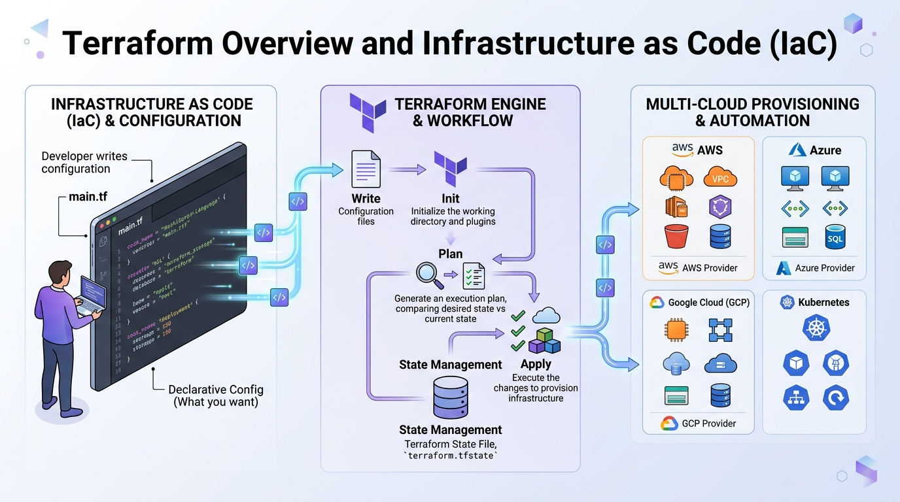
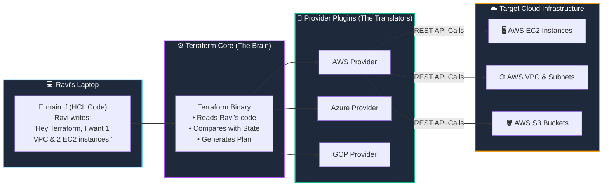

# 🌟 01. Terraform Fundamentals & Infrastructure as Code (IaC)

> *"Hey Ravi! ☕ Grab your favorite mug. Today, we're saying goodbye to clicking hundreds of buttons in the AWS console and saying hello to the magical world of Infrastructure as Code!"* — **Mentor Rithu 👩‍🏫**

---

## 👫 Mentor & Student Check-In

- **Ravi 👨‍🎓:** *"Rithu, I tried setting up a VPC and EC2 instance in the AWS Console yesterday, and I got lost in all the tabs and checkboxes. Is there really a way to build whole data centers just by writing code?"*
- **Rithu 👩‍🏫:** *"Yes, Ravi! That's exactly why Terraform exists. Instead of clicking around (what we call 'ClickOps'), we write simple, human-readable text files. Terraform reads our instructions and builds everything automatically. Let me show you how it works!"*

---

## 🎯 What Ravi Will Learn Today

By the end of our session, Ravi, you will be able to:
1. 💡 **Explain Infrastructure as Code (IaC)** and why companies hire DevOps engineers specifically for it.
2. 🍕 **Understand Declarative vs. Imperative** through my favorite pizza analogy!
3. ⚔️ **Know the difference between Terraform and Ansible** so you never get confused in interviews.
4. 🏗️ **See the big picture of Terraform Architecture** and how it talks to AWS, Azure, and Google Cloud.

---

## 📊 Visual Explanation





---

## 👶 Rithu Explains Like You Are a Beginner

### 🍕 The Pizza Order Analogy (Declarative vs. Imperative)
> *"Ravi, imagine you're hungry on a Friday evening. You have two ways to get dinner:"*

1. **The Imperative Way (Cooking yourself step-by-step):**
   You walk into the kitchen:
   - Turn stove to 200°C.
   - Knead dough for 8 minutes.
   - Spread tomato sauce evenly.
   - Bake for 14 minutes.  
   *(If you forget step 3 or burn step 4, dinner is ruined! Shell scripts work this way.)*

2. **The Declarative Way (Ordering from your favorite restaurant):**
   You call the restaurant and say:
   - *"I want a 12-inch Margherita pizza with extra cheese."*  
   You don't care *which* chef kneads the dough, what brand of oven they use, or which road the delivery driver takes. You declared the **desired final state**, and the restaurant makes it happen!

> *"Ravi, **Terraform is your cloud waiter.** You declare: 'I want an AWS VPC and an EC2 server.' Terraform calculates the steps, calls the AWS APIs, and delivers your infrastructure hot and ready!"*

---

## ⚡ The Essential 80/20 Concepts (Rithu's Focus Sheet)

| Concept | What Rithu Wants Ravi to Know | Why It Matters in Real DevOps |
|---|---|---|
| **Infrastructure as Code (IaC)** | Defining servers, networks, and databases as text files in Git instead of clicking web buttons. | You can review changes in Pull Requests, test them, and rebuild a destroyed environment in 5 minutes! |
| **Declarative Approach** | You describe *what* you want, not *how* to build it step-by-step. | Terraform handles the complicated creation sequence and error-handling automatically. |
| **Idempotency** | Running the same Terraform code 10 times results in the exact same infrastructure without duplicates. | If your server is already running, Terraform does nothing. No accidental duplicate bills! |
| **Terraform Core vs. Providers** | Terraform Core handles the logic; Providers translate that logic into cloud API calls. | You use the same HCL syntax whether you're provisioning AWS, Azure, Docker, or Kubernetes! |
| **State File (`terraform.tfstate`)** | Terraform's memory ledger that remembers what cloud resources belong to you. | Prevents Terraform from accidentally touching another team's servers. |

---

## ⚔️ Ravi Asks: "Rithu, What About Ansible?"

```text
┌─────────────────────────────────┐      ┌─────────────────────────────────┐
│     Terraform (The Builder)     │      │   Ansible (The Interior Decorator)│
├─────────────────────────────────┤      ├─────────────────────────────────┤
│ 🎯 Purpose: Provisioning infra  │      │ 🎯 Purpose: Configuring OS/Apps │
│ 🏗️ Builds: VPCs, VMs, DBs, ALBs │      │ 📦 Installs: Nginx, Docker, PHP │
│ 📜 Style: Declarative           │      │ 📜 Style: Procedural / Hybrid   │
│ 🗃️ State: Keeps State file      │      │ 🗃️ State: Stateless             │
└─────────────────────────────────┘      └─────────────────────────────────┘
```

> **Rithu's Rule of Thumb:** *"Think of building a house, Ravi. You hire **Terraform** to pour the concrete foundation, build the walls, and install the plumbing. Once the house stands, you bring in **Ansible** to paint the bedrooms, hang the curtains, and install the smart TV!"* 🏡🎨

---

## 💻 Ravi's First HCL Snippet: An AWS S3 Bucket

Look at how clean and readable this is, Ravi:

```hcl
# 1. Tell Terraform which provider plugin to download
terraform {
  required_version = ">= 1.8.0"

  required_providers {
    aws = {
      source  = "hashicorp/aws"
      version = "~> 5.0"
    }
  }
}

# 2. Configure AWS region
provider "aws" {
  region = "us-east-1"
}

# 3. Declare the cloud resource Ravi wants
resource "aws_s3_bucket" "ravi_bucket" {
  bucket_prefix = "ravi-devops-learning-"

  tags = {
    Owner       = "Ravi"
    Mentor      = "Rithu"
    Environment = "Dev"
  }
}
```

### 🔍 Rithu Breaks Down the Code for Ravi:
- `terraform { ... }`: The blueprint header specifying Terraform version and AWS plugin version.
- `provider "aws" { ... }`: Directs Terraform to connect to the `us-east-1` (North Virginia) AWS region.
- `resource "aws_s3_bucket" "ravi_bucket"`:
  - `aws_s3_bucket`: The official AWS resource type.
  - `ravi_bucket`: The local name Ravi chose for this bucket inside the code.
  - `bucket_prefix`: AWS generates a unique global bucket name starting with this prefix.

---

## ⌨️ The 4 Magical Commands Ravi Must Remember

| Command | What Rithu Says It Does | When Ravi Should Run It |
|---|---|---|
| `terraform init` | Downloads the provider plugins and sets up your working directory. | **Always first!** When starting a new project or cloning from Git. |
| `terraform fmt` | Automatically beautifies and aligns your code according to HashiCorp standards. | Before saving or committing your code to GitHub. |
| `terraform plan` | Generates a safe preview showing what Terraform will add (`+`), change (`~`), or delete (`-`). | Before every change. **Never apply blindly!** |
| `terraform apply` | Actually provisions the resources in the cloud after you review and type `yes`. | When you're happy with the plan. |

---

## 🧪 Hands-on Practice: Ravi's Zero-Cost Local Lab! 🚀

> *"Ravi, let's write our first Infrastructure as Code right now on your computer! We won't use AWS just yet, so you won't spend a single rupee or dollar. We'll use the local file provider!"* — **Rithu**

### 🎯 Objective
Declare, create, and destroy a local file using Terraform.

### 🚀 Steps for Ravi:

1. Open your terminal and create a practice folder:
   ```bash
   mkdir ravi-terraform-fundamentals
   cd ravi-terraform-fundamentals
   ```

2. Create a file named `main.tf` and paste this in:
   ```hcl
   terraform {
     required_providers {
       local = {
         source  = "hashicorp/local"
         version = "~> 2.5"
       }
     }
   }

   resource "local_file" "welcome_note" {
     filename = "${path.module}/hello-rithu.txt"
     content  = "Hey Rithu! I just wrote my very first Infrastructure as Code! 🚀 - Ravi\n"
   }
   ```

3. Initialize Terraform:
   ```bash
   terraform init
   ```
   *Rithu note: Watch Terraform download the `local` plugin!*

4. Preview the plan:
   ```bash
   terraform plan
   ```
   *Notice: `Plan: 1 to add, 0 to change, 0 to destroy.`*

5. Apply the configuration:
   ```bash
   terraform apply -auto-approve
   ```

### 🔎 Verification:
Check the file created on your machine:
```bash
# On Windows PowerShell:
Get-Content hello-rithu.txt

# On Linux / macOS / Git Bash:
cat hello-rithu.txt
```

### 🧹 Cleanup (Rithu's Golden Habit!):
```bash
terraform destroy -auto-approve
```
*Notice: `hello-rithu.txt` has vanished! That's the power of automated teardown!*

---

## ⚠️ Rithu's Warning: 3 Traps Beginners Fall Into

### 1. The "ClickOps" Urge
- **What happens:** You get impatient, log into the AWS Web Console, and change a setting manually.
- **Rithu says:** *"Don't do it, Ravi! The next time you run `terraform apply`, Terraform will notice that reality doesn't match your code, and it will overwrite your manual change! Treat your code as the single source of truth."*

### 2. Forgetting `terraform init`
- **What happens:** You run `terraform plan` and get: `Error: Could not load plugin...`.
- **Rithu says:** *"Whenever you start in a fresh folder, always run `terraform init` first so Terraform can download the required plugins!"*

### 3. Hardcoding Cloud Secrets
- **What happens:** Putting raw AWS keys (`AKIA...`) in `.tf` files.
- **Rithu says:** *"Never, ever do this, Ravi! Automated GitHub scrapers will steal your keys in under 60 seconds. We'll learn the safe way in Chapter 2!"*

---

## 💬 Ravi's Doubt Corner (Interview Prep)

### Ravi: *"Rithu, what if an interviewer asks: 'What is the main advantage of Declarative IaC over Imperative scripting?'"*
**Rithu:** *"Tell them this, Ravi: In imperative scripting (like Bash or Python), you must write complex conditional logic to check if a resource already exists before creating it. In declarative IaC (like Terraform), you only declare the desired end state. Terraform handles idempotency, dependency graphing, and state tracking automatically!"*

### Ravi: *"Why does Terraform need a state file?"*
**Rithu:** *"Because cloud providers don't track your Terraform code! The state file is Terraform's private memory ledger that maps your code definitions to the real cloud IDs returned by AWS. Without it, Terraform wouldn't know which servers belong to your project!"*

---

## ⚡ Quick Revision with Rithu

- 📌 **IaC:** Managing infrastructure via version-controlled code files.
- 📌 **Declarative:** You define the *What*; Terraform takes care of the *How*.
- 📌 **Idempotent:** Running code repeatedly produces the exact same result safely.
- 📌 **Terraform vs. Ansible:** Terraform builds the servers; Ansible configures the software inside.
- 📌 **4 Core Commands:** `init` $\rightarrow$ `fmt` $\rightarrow$ `plan` $\rightarrow$ `apply`

> [!TIP]
> **Rithu's Note to Ravi:** *"You did awesome in our first lesson, Ravi! Whenever you're ready, let's head over to Chapter 2 and get your developer cockpit and AWS authentication set up safely!"* 🚀✨
