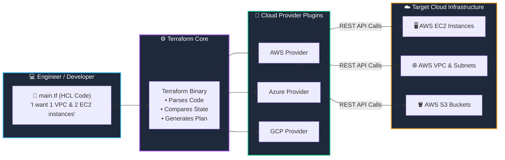

# 🌟 01. Terraform Fundamentals & Infrastructure as Code (IaC)

> *"Stop clicking buttons in cloud consoles. Write your infrastructure like software!"* 🚀💻

Welcome to your first step in mastering **Terraform**! In this chapter, we unpack what Infrastructure as Code is, why every high-performing DevOps team uses it, and how Terraform turns plain text files into resilient cloud networks, servers, and databases.

---

## 🎯 Learning Objectives

By the end of this topic, you will be able to:
1. 💡 **Explain Infrastructure as Code (IaC)** and how it replaces error-prone "ClickOps" manual configurations.
2. 🔄 **Distinguish Declarative vs. Imperative** paradigms with real-world clarity.
3. ⚔️ **Compare Terraform vs. Ansible** and understand where each tool shines in the DevOps toolchain.
4. 🏗️ **Understand Terraform's Architecture** and how it speaks to cloud APIs (AWS, Azure, GCP).

---

## 📊 Visual Explanation




---

## 👶 Explain Like I Am a Beginner

### 🍕 The Restaurant Menu Analogy
Imagine walking into a restaurant:
- **Imperative approach (Cooking yourself step-by-step):** You walk into the kitchen, turn the stove to 200°C, chop onions for 3 minutes, roll dough, bake for 15 minutes. If you miss a step, dinner is ruined!
- **Declarative approach (Ordering from the waiter):** You say: *"I want a 12-inch vegetarian pizza with extra olives."* You don't care *how* the chef operates the oven or in what micro-sequence the dough is kneaded. You simply declare the **desired end state**, and the restaurant delivers it.

**Terraform is your cloud waiter.** You declare: *"I want an AWS VPC with 2 public subnets and an EC2 instance."* Terraform figures out the API calls, the correct creation order, and builds it for you.

### ❓ What is it?
Terraform is an open-source **Infrastructure as Code (IaC)** tool created by HashiCorp. It allows you to define cloud and on-premise resources using human-readable configuration files.

### 🛑 Why do we need it?
Before IaC, engineers logged into the AWS Console and clicked dozens of buttons ("ClickOps").
- ❌ Human error (someone clicks the wrong checkbox).
- ❌ No version history (nobody knows who changed the security group rule).
- ❌ Impossible to reproduce (rebuilding production in disaster recovery takes days).

With Terraform:
- ✅ **Version Control:** Store your infrastructure in Git.
- ✅ **Repeatability:** Clone your entire environment from Development to Staging to Production in 2 minutes.
- ✅ **Safety:** Preview every change before touching real servers.

### ⚙️ How does it work?
Terraform reads your code (`.tf` files written in HCL), compares it against a record of what already exists (the **State file**), calculates the differences, and sends API calls to your cloud provider.

### 🏢 Where is it used in a real project?
When a FinTech startup needs to deploy a SOC2-compliant AWS infrastructure (VPC, private databases, encrypted storage, and Kubernetes clusters), they never click buttons. They commit Terraform code to GitHub, and automated CI/CD pipelines provision the cloud.

---

## ⚡ The Essential 80/20 Concepts

| Concept | Simple Explanation | Practical Importance |
|---|---|---|
| **Infrastructure as Code (IaC)** | Managing servers & networks using text configuration files instead of manual clicks. | Enables automated testing, Git reviews, and zero manual drift. |
| **Declarative Paradigm** | You declare *what* the final infrastructure should look like, not *how* to build it step-by-step. | You never write "if instance exists, skip; else create". Terraform handles idempotency automatically. |
| **Terraform Core vs. Providers** | Terraform Core handles the logic & graph; Providers translate instructions to cloud APIs. | Allows Terraform to manage AWS, Azure, Google Cloud, GitHub, and Kubernetes using the same syntax. |
| **Idempotency** | Running the same Terraform configuration 100 times produces the exact same result without unintended duplicates. | Prevents duplicate resources and accidental billing spikes. |
| **State Tracking** | A lightweight JSON ledger (`terraform.tfstate`) keeping track of what Terraform owns. | Allows Terraform to know what to update, delete, or leave untouched. |

---

## ⚔️ Terraform vs. Ansible: The Classic Confusion

Beginners often ask: *"Why do we need Terraform if we already have Ansible?"*

```text
┌─────────────────────────────────┐      ┌─────────────────────────────────┐
│     Terraform (Orchestrator)    │      │    Ansible (Config Manager)     │
├─────────────────────────────────┤      ├─────────────────────────────────┤
│ 🎯 Purpose: Provisioning infra  │      │ 🎯 Purpose: Configuring OS/Apps │
│ 🏗️ Builds: VPCs, VMs, DBs, ALBs │      │ 📦 Installs: Packages, files    │
│ 📜 Style: Declarative           │      │ 📜 Style: Procedural / Hybrid   │
│ 🗃️ State: Maintains State file  │      │ 🗃️ State: Stateless             │
└─────────────────────────────────┘      └─────────────────────────────────┘
```

> 💡 **DevOps Best Practice:** Use **Terraform** to spin up the VPC, Subnets, and EC2 virtual machines. Then use **Ansible** (or cloud-init) to install Docker, Nginx, and your application onto those machines!

---

## 💻 Practical Example: Your First Terraform Block

Here is what real HCL looks like. This snippet declares an AWS S3 bucket:

```hcl
# 1. Specify required provider and version
terraform {
  required_version = ">= 1.8.0"

  required_providers {
    aws = {
      source  = "hashicorp/aws"
      version = "~> 5.0"
    }
  }
}

# 2. Configure the cloud provider
provider "aws" {
  region = "us-east-1"
}

# 3. Declare the desired cloud resource
resource "aws_s3_bucket" "my_first_bucket" {
  bucket_prefix = "devops-learner-bucket-"

  tags = {
    Environment = "Dev"
    ManagedBy   = "Terraform"
  }
}
```

### 🔍 Code Breakdown:
- `terraform { ... }`: Tells Terraform which engine version and cloud provider plugins to download.
- `provider "aws" { ... }`: Connects Terraform to your AWS account in `us-east-1`.
- `resource "aws_s3_bucket" "my_first_bucket"`:
  - `aws_s3_bucket`: The **type** of cloud resource AWS provides.
  - `my_first_bucket`: The **local name** you choose to reference this resource inside your code.
  - `bucket_prefix`: Ensures AWS generates a unique global bucket name.

---

## ⌨️ Important Commands Overview

You don't need to learn 50 commands today. Master these core 4:

| Command | What it does | When to use it | Expected Result |
|---|---|---|---|
| `terraform init` | Downloads provider plugins and prepares directory. | First command in any new project or when adding providers. | `Terraform has been successfully initialized!` |
| `terraform fmt` | Rewrites code to follow canonical HashiCorp formatting. | Before saving or committing code to Git. | Automatically formats spacing and indentation. |
| `terraform plan` | Compares code against state and generates an execution plan. | Before every single infrastructure change. | Shows preview: `Plan: 1 to add, 0 to change, 0 to destroy.` |
| `terraform apply` | Provisions the actual infrastructure in the cloud. | After reviewing and approving the plan. | Prompts for `yes`, then provisions real resources. |

---

## 🧪 Hands-on Practice: Simulating IaC (Zero Cloud Cost)

Let's test Terraform right on your computer without needing an AWS account or spending a single cent by using the local file provider!

### 🎯 Objective
Use Terraform to declare, provision, update, and destroy a local file on your machine.

### 📋 Prerequisites
Terraform installed on your machine (we will cover full installation in Chapter 2, but if you have it installed, run this lab!).

### 🚀 Steps to Follow:

1. Create a test directory:
   ```bash
   mkdir terraform-fundamentals-lab
   cd terraform-fundamentals-lab
   ```

2. Create a file named `main.tf`:
   ```hcl
   terraform {
     required_providers {
       local = {
         source  = "hashicorp/local"
         version = "~> 2.5"
       }
     }
   }

   resource "local_file" "welcome_note" {
     filename = "${path.module}/hello-devops.txt"
     content  = "Welcome to Terraform! You just wrote Infrastructure as Code! 🚀\n"
   }
   ```

3. Initialize Terraform:
   ```bash
   terraform init
   ```

4. View the execution plan:
   ```bash
   terraform plan
   ```

5. Apply the configuration:
   ```bash
   terraform apply -auto-approve
   ```

### 🔎 Verification:
Check that the file was created:
```bash
# On Linux / macOS / Git Bash:
cat hello-devops.txt

# On Windows PowerShell:
Get-Content hello-devops.txt
```

### 🧹 Cleanup Instructions:
Tear down the created file cleanly:
```bash
terraform destroy -auto-approve
```
Notice `hello-devops.txt` has been automatically deleted!

---

## ⚠️ Common Beginner Mistakes

### 1. The "ClickOps" Temptation
- **Symptom:** Modifying a security group or server directly in the AWS Console because "it's faster".
- **Why it happens:** Impatience or unfamiliarity with HCL syntax.
- **The Fix:** Never modify Terraform-managed resources manually! The next time someone runs `terraform apply`, Terraform will overwrite or revert your manual console change (state drift).

### 2. Forgetting `terraform init`
- **Symptom:** Error: `Could not load plugin... Please run "terraform init"`.
- **Why it happens:** Terraform needs to download the provider binary for your operating system before it can parse provider-specific resource types.
- **The Fix:** Run `terraform init` whenever you clone a repo or add a new provider block.

### 3. Hardcoding Cloud Passwords and API Keys in `.tf` files
- **Symptom:** Leaking AWS access keys on GitHub within minutes.
- **Why it happens:** Putting raw credentials in `provider "aws" { access_key = "..." }`.
- **The Fix:** Never hardcode credentials. Use environment variables, IAM roles, or AWS CLI profiles.

---

## 💼 Interview Revision Questions

### Q1: What is Infrastructure as Code (IaC), and what core problem does it solve?
**Answer:** IaC is the practice of managing and provisioning computing infrastructure through machine-readable definition files rather than manual physical hardware configuration or interactive configuration tools. It eliminates human configuration errors, provides Git version history, enables peer review, and allows reproducible environment replication.

### Q2: What is the difference between Declarative and Imperative IaC?
**Answer:** In an **imperative** model (e.g., shell scripts), you specify the explicit sequential steps needed to achieve a result. In a **declarative** model (like Terraform), you specify the *desired end state*, and the tool automatically determines the necessary actions to transition from current state to desired state.

### Q3: Why does Terraform maintain a state file?
**Answer:** Terraform needs to map real-world cloud resources to the resources defined in your code. Without a state file, Terraform would have no way of knowing whether an existing server was created by this project or belongs to another team, making safe updates and deletions impossible.

### Q4: When would you use Terraform instead of Ansible?
**Answer:** Terraform is designed for **cloud infrastructure provisioning** (VPCs, subnets, managed databases, load balancers, virtual machines). Ansible is primarily designed for **configuration management and application deployment** (installing packages, updating configuration files, restarting services inside an already running operating system).

---

## ⚡ Quick Revision & Cheat Sheet

- 📌 **IaC Core Value:** Treat infrastructure like software code (versioned, tested, automated).
- 📌 **Declarative:** You define the *What*, Terraform handles the *How*.
- 📌 **Core Triad:** Code (`.tf`) + State (`.tfstate`) + Real Infrastructure (Cloud).
- 📌 **Terraform vs. Ansible:** Terraform provisions the building; Ansible decorates and paints the rooms.
- 📌 **The Golden Rule:** Never touch cloud console buttons for resources managed by Terraform!

> [!IMPORTANT]
> **Remember This:** Terraform is idempotent. If your code matches your cloud infrastructure, running `terraform apply` will do absolutely nothing. It only executes changes when your code and real-world reality differ!

---

## 🚀 Beyond the Basics

As you progress in DevOps, you will encounter **OpenTofu**, an open-source fork of Terraform created after HashiCorp adopted the Business Source License (BSL) in 2023. OpenTofu maintains compatibility with Terraform syntax up through version 1.5.x and is governed by the Linux Foundation. Everything you learn in this course applies seamlessly to both!
