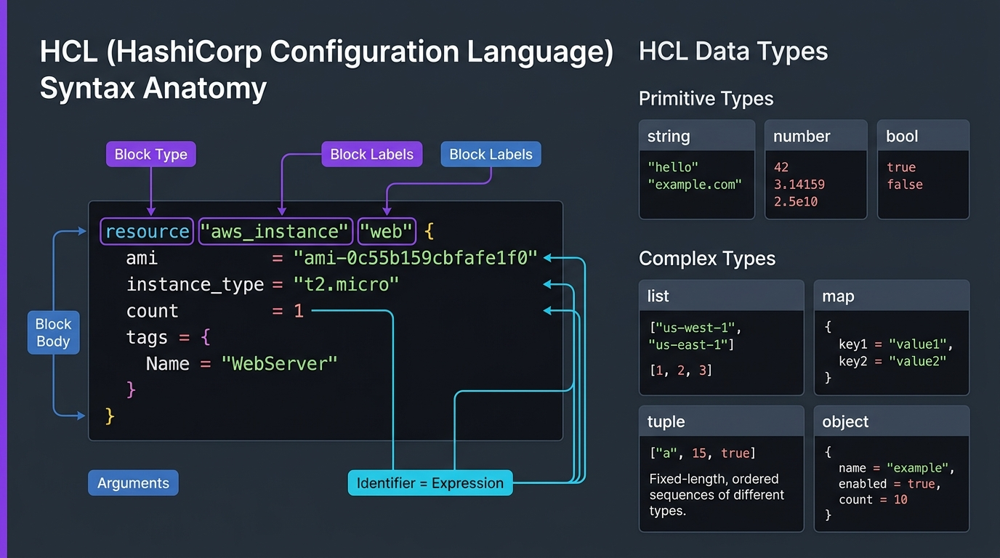

# 🧱 03. HashiCorp Configuration Language (HCL) Basics

> *"HCL is designed for humans: more readable than JSON, and far less indentation-sensitive than YAML!"* 🎨💡

To write Terraform, you need to understand its native tongue: **HCL (HashiCorp Configuration Language)**. HCL strikes the perfect balance between machine-parsable logic and human readability. In this chapter, you will master the anatomy of blocks, arguments, data types, and file organization.

---

## 🎯 Learning Objectives

By the end of this topic, you will be able to:
1. 🔍 **Deconstruct any HCL block** into its type, labels, arguments, and values.
2. 🔤 **Use all core HCL data types** confidently (string, number, bool, list, map).
3. 🔗 **Connect resources together** using cross-resource references (`<TYPE>.<NAME>.<ATTRIBUTE>`).
4. 📁 **Organize projects cleanly** using standard Terraform file conventions.

---

## 📊 Visual Explanation




---

## 👶 Explain Like I Am a Beginner

### 🏷️ The Grocery Label Analogy
Think of an HCL block like a nutritional label or item card in a supermarket inventory system:
- **Block Type:** *"Item"*
- **Item Category:** *"Cereal"*
- **Specific Brand / Name:** *"HoneyOats"*
- **Attributes:**
  - `price = 4.99`
  - `calories = 150`
  - `organic = true`
  - `ingredients = ["Oats", "Honey", "Wheat"]`

In Terraform, instead of cereal, you are defining cloud resources:
```hcl
# Block Type | Resource Type | Local Identifier
resource "aws_instance" "web_server" {
  # Arguments = Expressions
  ami           = "ami-0c55b159cbfafe1f0" # string
  instance_type = "t3.micro"               # string
  monitoring    = true                     # boolean
  cpu_core_count = 2                       # number
  tags = {                                 # map
    Environment = "Production"
  }
}
```

---

## ⚡ The Essential 80/20 Concepts

| Concept | Simple Explanation | Practical Importance |
|---|---|---|
| **Block** | A container for configuration (`block_type "label1" "label2" { ... }`). | The primary structural unit of all Terraform code. |
| **Argument** | Assigns a value to a particular name (`ami = "ami-123"`). | Configures the settings of the cloud resource. |
| **Identifier** | Names given to blocks or arguments (letters, digits, underscores, dashes). | Used to reference resources across your codebase. |
| **Cross-Resource Reference** | Reading an attribute from another resource (`aws_vpc.main.id`). | Allows Terraform to build the dependency graph and pass IDs automatically. |
| **Standard File Layout** | Splitting code into `main.tf`, `variables.tf`, and `outputs.tf`. | Makes projects easy to navigate for team collaboration. |

---

## 🗂️ Core HCL Data Types Cheat Sheet

### 1. Primitive Types
```hcl
# String: Quoted UTF-8 text
instance_type = "t3.medium"

# Number: Integers or floating-point decimals (no quotes!)
disk_size_gb = 50
idle_timeout = 60.5

# Boolean: true or false (no quotes!)
enable_ssl   = true
is_ephemeral = false
```

### 2. Complex / Collection Types
```hcl
# List: Ordered sequence of values (0-indexed)
availability_zones = ["us-east-1a", "us-east-1b", "us-east-1c"]
# First element: availability_zones[0]

# Map: Key-value dictionary
common_tags = {
  Environment = "Production"
  Project     = "PaymentGateway"
  ManagedBy   = "Terraform"
}
# Accessing a value: common_tags["Environment"]
```

---

## 🔗 Cross-Resource References: How Resources Talk

In real infrastructure, resources depend on one another. For example, a Virtual Machine needs a Subnet ID, which needs a VPC ID.

In HCL, you reference another resource using the syntax:
`<RESOURCE_TYPE>.<LOCAL_NAME>.<ATTRIBUTE>`

```hcl
# 1. Create a VPC
resource "aws_vpc" "app_network" {
  cidr_block = "10.0.0.0/16"
}

# 2. Create a Subnet inside that VPC
resource "aws_subnet" "web_subnet" {
  # Notice the automatic reference:
  vpc_id     = aws_vpc.app_network.id
  cidr_block = "10.0.1.0/24"
}
```

> 🧠 **What happens here?** Terraform sees `aws_vpc.app_network.id` inside `aws_subnet`. Terraform automatically understands: *"Aha! I must create `aws_vpc` FIRST, grab the generated VPC ID from AWS, and then pass it to `aws_subnet`."* You never have to manually specify creation orders!

---

## 📁 Standard File Organization

Terraform doesn't care if you put all 5,000 lines of code into a single `main.tf` or split it across 10 files. It automatically reads **all `.tf` files in the current folder** and merges them into one logical plan!

In professional DevOps, always follow this standard 4-file structure:

```text
my-terraform-project/
├── main.tf          # Core infrastructure resources (VPC, EC2, S3)
├── variables.tf     # Declarations of input variables
├── outputs.tf       # Exported outputs (IP addresses, URLs, ARNs)
├── terraform.tfvars # Real input values (e.g., environment = "production")
└── providers.tf     # Provider declarations (AWS, Azure, etc.)
```

---

## 🧪 Hands-on Practice: HCL Local Data Types Lab

### 🎯 Objective
Write valid HCL using strings, lists, maps, and cross-resource references using the `local_file` provider.

### 📋 Prerequisites
Terraform CLI installed.

### 🚀 Steps to Follow:

1. Create a lab directory:
   ```bash
   mkdir hcl-basics-lab
   cd hcl-basics-lab
   ```

2. Create `main.tf`:
   ```hcl
   terraform {
     required_providers {
       local = {
         source  = "hashicorp/local"
         version = "~> 2.5"
       }
     }
   }

   # Define some local values with different types
   locals {
     app_name   = "cloud-rocket"
     node_count = 3
     regions    = ["us-east-1", "eu-central-1", "ap-south-1"]
     team_info  = {
       owner  = "DevOps Squad"
       tier   = "Platinum"
     }
   }

   # Resource 1: File containing string and list references
   resource "local_file" "config_report" {
     filename = "${path.module}/config-summary.txt"
     content  = <<-EOT
       Application: ${locals.app_name}
       Desired Nodes: ${locals.node_count}
       Primary Region: ${locals.regions[0]}
       Backup Region: ${locals.regions[1]}
       Team Owner: ${locals.team_info["owner"]}
     EOT
   }

   # Resource 2: Reference attribute from Resource 1
   resource "local_file" "audit_log" {
     filename = "${path.module}/audit.log"
     content  = "Generated file at: ${local_file.config_report.filename}\n"
   }
   ```

3. Run Terraform:
   ```bash
   terraform init
   terraform apply -auto-approve
   ```

### 🔎 Expected Result:
Inspect the generated files:
```bash
# View the config summary
cat config-summary.txt
# View the audit log
cat audit.log
```
Notice how `audit.log` dynamically received the filename path from `local_file.config_report`!

### 🧹 Cleanup Instructions:
```bash
terraform destroy -auto-approve
```

---

## ⚠️ Common Beginner Mistakes

### 1. Quoting Numbers or Booleans
- **What it looks like:**
  ```hcl
  # ❌ Bad: Strings instead of proper types
  port_number = "80"
  enable_dns  = "true"
  ```
- **Why it happens:** Habit from JSON or bash.
- **The Fix:** Remove the quotes: `port_number = 80` and `enable_dns = true`. While Terraform attempts type-coercion, quoting can break strict type checks in modules.

### 2. Forgetting Quotes around Strings
- **What it looks like:**
  ```hcl
  # ❌ Bad: Terraform thinks 'us-east-1' is a variable name!
  region = us-east-1
  ```
- **Why it happens:** Mistaking strings for identifiers.
- **The Fix:** Strings must always be wrapped in double quotes: `region = "us-east-1"`.

### 3. Misunderstanding Local Names vs Cloud Names
- **What it looks like:** Confusing `resource "aws_instance" "web"` with the actual EC2 tag or server name in the AWS console.
- **The Fix:** The local name (`web`) only exists inside Terraform code. To name the server in the cloud console, configure the `tags = { Name = "..." }` argument!

---

## 💼 Interview Revision Questions

### Q1: What is the syntax structure of a Terraform resource block?
**Answer:** `resource "<RESOURCE_TYPE>" "<LOCAL_NAME>" { <ARGUMENTS> }`. The resource type is dictated by the provider (e.g., `aws_s3_bucket`), while the local name is a user-chosen identifier within the Terraform workspace (e.g., `primary_storage`).

### Q2: What is the difference between an Argument and an Attribute in HCL?
**Answer:** An **argument** is an input value configured by the user inside a block (e.g., `cidr_block = "10.0.0.0/16"`). An **attribute** is an output value computed and returned by the cloud provider after creation (e.g., `id`, `arn`, `public_ip`).

### Q3: How does Terraform automatically resolve dependencies between resources?
**Answer:** Through **implicit dependencies**. When resource B references an attribute of resource A (e.g., `subnet_id = aws_subnet.public.id`), Terraform builds a Directed Acyclic Graph (DAG) and ensures resource A is provisioned before resource B.

---

## ⚡ Quick Revision & Cheat Sheet

- 📌 **Block Syntax:** `type "label1" "label2" { key = value }`
- 📌 **Primitive Types:** `string` ("..."), `number` (123), `bool` (true/false)
- 📌 **Collections:** `list` (["a", "b"]), `map` ({ key = "val" })
- 📌 **Cross-Reference:** `aws_vpc.my_vpc.id`
- 📌 **Comments:** `# single line`, `/* multi line */`

> [!TIP]
> **Remember This:** Always run `terraform fmt` on your files! It aligns all equal signs (`=`) into neat columns, ensuring your code looks professional and clean for pull requests.
