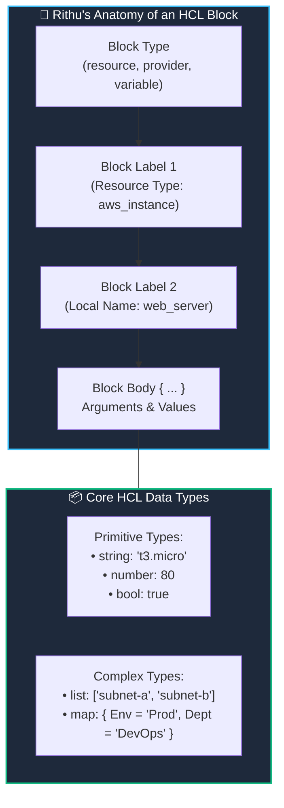

# 🧱 03. HashiCorp Configuration Language (HCL) Basics

> *"Hey Ravi! 🌸 Today we learn the language of Terraform: HCL! Don't worry—it's far easier than Python or Java, cleaner than JSON, and doesn't get angry over tiny space indents like YAML does!"* — **Mentor Rithu 👩‍🏫**

---

## 👫 Mentor & Student Check-In

- **Ravi 👨‍🎓:** *"Rithu, whenever I look at Kubernetes YAML files, one misplaced space breaks my entire deployment. Is Terraform going to be just as finicky?"*
- **Rithu 👩‍🏫:** *"Haha, I feel your pain, Ravi! YAML indentation headaches are legendary. But HashiCorp built HCL specifically to fix that. HCL uses clean curly braces `{ ... }`, quotes strings, and reads almost like plain English. Let's break down its anatomy together!"*

---

## 🎯 What Ravi Will Learn Today

1. 🔍 **Deconstruct any HCL block** into its Type, Labels, Arguments, and Values.
2. 🔤 **Master HCL data types**: strings, numbers, booleans, lists, and maps.
3. 🔗 **Connect resources together** like puzzle pieces using cross-resource references (`<TYPE>.<NAME>.<ATTRIBUTE>`).
4. 📁 **Organize files cleanly** using the industry-standard 4-file structure.

---

## 📊 Visual Explanation




---

## 👶 Rithu Explains Like You Are a Beginner

### 🏷️ The Grocery Product Label Analogy
> *"Ravi, imagine picking up a jar of peanut butter at the grocery store. The label has a clear structure:"*
- **Category:** *"Food Item"*
- **Type:** *"Peanut Butter"*
- **Brand / Identifier:** *"OrganicCrunch"*
- **Nutritional Facts:**
  - `price = 4.99` (Number)
  - `calories = 190` (Number)
  - `gluten_free = true` (Boolean)
  - `ingredients = ["Peanuts", "Sea Salt"]` (List)

In Terraform, Ravi, you do the exact same thing for cloud resources:

```hcl
# Block Type | Resource Type | Ravi's Chosen Name
resource "aws_instance" "web_server" {
  # Arguments = Values
  ami            = "ami-0c55b159cbfafe1f0" # String
  instance_type  = "t3.micro"               # String
  cpu_core_count = 2                       # Number (no quotes!)
  monitoring     = true                     # Boolean (no quotes!)
  tags = {                                 # Map (Key-Value pairs)
    Environment = "Dev"
    Owner       = "Ravi"
    Mentor      = "Rithu"
  }
}
```

---

## ⚡ The Essential 80/20 Concepts (Rithu's Summary Table)

| Concept | What Rithu Wants Ravi to Know | Practical DevOps Importance |
|---|---|---|
| **Block** | A container wrapped in curly braces (`{ ... }`). | The primary building block of all Terraform code. |
| **Argument** | Assigns a value to a setting (`key = value`). | Controls how the cloud resource is configured. |
| **Identifier** | Names given to blocks or arguments. | Used to reference resources across your codebase. |
| **Cross-Resource Reference** | Reading an attribute from another resource (`aws_vpc.main.id`). | Lets Terraform automatically figure out the correct order to build resources! |
| **Standard File Layout** | Splitting code into `main.tf`, `variables.tf`, `outputs.tf`. | Keeps your projects neat so teammates can easily collaborate. |

---

## 🗂️ Core HCL Data Types Cheat Sheet for Ravi

### 1. Primitive Types
```hcl
# String: Text wrapped in double quotes
instance_type = "t3.medium"

# Number: Integers or decimals (NO quotes!)
disk_size_gb = 50
timeout_sec  = 30.5

# Boolean: true or false (NO quotes!)
enable_monitoring = true
is_ephemeral      = false
```

### 2. Complex Collection Types
```hcl
# List: Ordered list of items (0-indexed)
availability_zones = ["us-east-1a", "us-east-1b", "us-east-1c"]
# To get the first item: availability_zones[0]

# Map: Key-Value dictionary
resource_tags = {
  Project     = "CloudPortal"
  ManagedBy   = "Terraform"
  Owner       = "Ravi"
}
# To get the owner: resource_tags["Owner"]
```

---

## 🔗 Cross-Resource References: How Resources Talk to Each Other

> *"Ravi, pay close attention to this! This is how Terraform connects resources together without you needing to do it manually."* — **Rithu**

The magic syntax is:  
`<RESOURCE_TYPE>.<LOCAL_NAME>.<ATTRIBUTE>`

```hcl
# 1. Create a VPC
resource "aws_vpc" "ravi_network" {
  cidr_block = "10.0.0.0/16"
}

# 2. Create a Subnet INSIDE that VPC
resource "aws_subnet" "ravi_subnet" {
  # Notice the reference right here:
  vpc_id     = aws_vpc.ravi_network.id  # 👈 Implicit Dependency!
  cidr_block = "10.0.1.0/24"
}
```

### 🧠 Rithu Explains the Magic:
*"Terraform inspects your code and notices `aws_vpc.ravi_network.id` inside the subnet. It says: 'Aha! I must create `aws_vpc.ravi_network` FIRST, wait for AWS to generate its VPC ID, and then feed that ID into `aws_subnet.ravi_subnet`!' You never have to manually worry about order!"*

---

## 📁 Rithu's Recommended File Organization

Terraform reads **all `.tf` files in your folder** and combines them. To keep things clean, always use Rithu's 4-file setup:

```text
my-project/
├── main.tf          # Core infrastructure resources (VPC, EC2, S3)
├── variables.tf     # Configurable inputs (region, instance_size)
├── outputs.tf       # Exported values (IP addresses, URLs)
├── terraform.tfvars # Real input values (e.g. environment = "dev")
└── providers.tf     # Provider blocks (AWS, Azure)
```

---

## 🧪 Hands-on Practice: Ravi's HCL Playground Lab

### 🎯 Objective
Write HCL combining strings, numbers, lists, maps, and cross-resource references using the local provider.

### 🚀 Steps for Ravi:

1. Create a practice folder:
   ```bash
   mkdir ravi-hcl-lab
   cd ravi-hcl-lab
   ```

2. Create `main.tf`:
   ```hcl
   terraform {
     required_providers {
       local = {
         source  = "hashicorp/local"
         version = "~> 2.5"
       }
     }
   }

   locals {
     student_name = "Ravi"
     mentor_name  = "Rithu"
     regions      = ["us-east-1", "ap-south-1", "eu-west-1"]
     cloud_specs  = {
       tier  = "Standard"
       cores = 4
     }
   }

   # Resource 1: Summary file
   resource "local_file" "student_card" {
     filename = "${path.module}/student-profile.txt"
     content  = <<-EOT
       === DEVOPS LEARNER PROFILE ===
       Student:      ${locals.student_name}
       Mentor:       ${locals.mentor_name}
       Primary DC:   ${locals.regions[0]}
       Backup DC:    ${locals.regions[1]}
       Compute Tier: ${locals.cloud_specs["tier"]}
     EOT
   }

   # Resource 2: Reference attribute from Resource 1
   resource "local_file" "audit_entry" {
     filename = "${path.module}/audit.log"
     content  = "Profile generated successfully at: ${local_file.student_card.filename}\n"
   }
   ```

3. Initialize and apply:
   ```bash
   terraform init
   terraform apply -auto-approve
   ```

### 🔎 Expected Result:
Check your generated files:
```bash
cat student-profile.txt
cat audit.log
```

### 🧹 Cleanup:
```bash
terraform destroy -auto-approve
```

---

## ⚠️ Rithu's Top 3 HCL Traps to Avoid

### 1. Quoting Numbers and Booleans
- **Bad:** `port = "80"` or `enable_dns = "true"`.
- **Rithu says:** *"Numbers and booleans should be bare: `port = 80` and `enable_dns = true`. Quoting them turns them into strings!"*

### 2. Forgetting Quotes on Strings
- **Bad:** `region = us-east-1`
- **Rithu says:** *"Without quotes, Terraform thinks `us-east-1` is a variable name! Always wrap strings in double quotes: `region = "us-east-1"`."*

### 3. Confusing Local Identifiers with Cloud Names
- **Rithu says:** *"Remember, Ravi: in `resource "aws_instance" "web"`, the word `web` only exists in your code! To name the server in the AWS Console, you set the tag: `tags = { Name = "Web-Server" }`."*

---

## 💬 Ravi's Doubt Corner

### Ravi: *"Rithu, what is the difference between an Argument and an Attribute?"*
**Rithu:** *"Think of it this way, Ravi: An **Argument** is an input that you provide (e.g. `cidr_block = "10.0.0.0/16"`). An **Attribute** is an output value that the cloud computes and hands back to you after creation (e.g. `id`, `arn`, `public_ip`). You set arguments; you read attributes!"*

---

## ⚡ Quick Revision with Rithu

- 📌 **Block Syntax:** `type "label1" "label2" { key = value }`
- 📌 **Data Types:** `string`, `number`, `bool`, `list`, `map`
- 📌 **Cross-Reference:** `aws_vpc.ravi_network.id`
- 📌 **Auto-Format:** Run `terraform fmt` to keep code clean
- 📌 **Standard Files:** `main.tf`, `variables.tf`, `outputs.tf`

> [!TIP]
> **Rithu's Note to Ravi:** *"Great job on HCL, Ravi! Next up in Chapter 4, we'll see how Terraform connects to cloud providers and the magic behind `.terraform.lock.hcl`!"* 🔌✨
