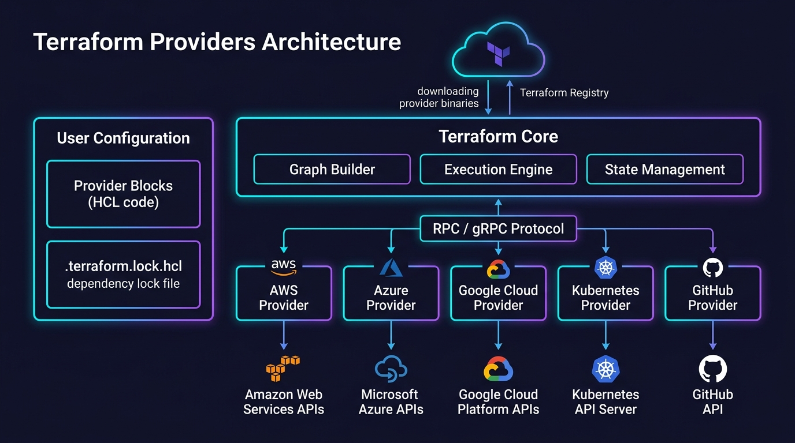
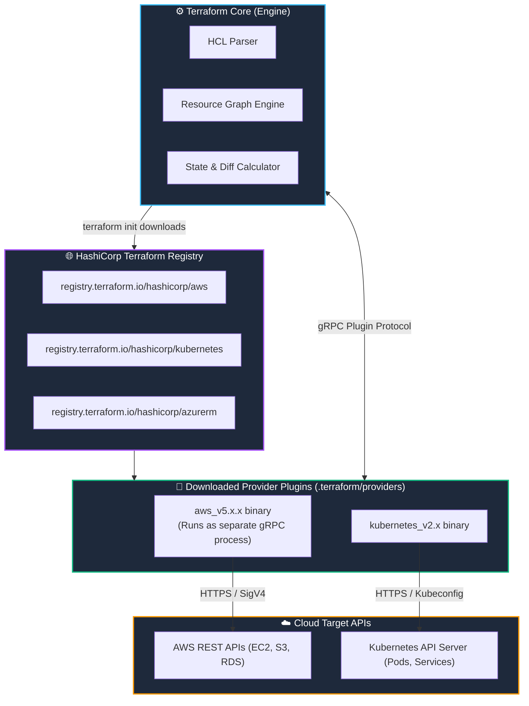

# 🔌 04. Terraform Providers & The Plugin Ecosystem

> *"Terraform Core knows nothing about AWS, Azure, or Docker. Providers are the magical translators that speak each cloud's native language!"* 🌐🚀

Have you ever wondered how a single CLI tool can create an AWS VPC, an Azure virtual machine, a Google Cloud SQL database, and a GitHub repository using the exact same syntax? The secret lies in **Terraform Providers**. In this chapter, we demystify how providers work, how to manage versions, and why `.terraform.lock.hcl` is your best friend.

---

## 🎯 Learning Objectives

By the end of this topic, you will be able to:
1. 🧩 **Understand Provider Plugin Architecture** and how Terraform Core communicates via RPC.
2. 📦 **Declare and source providers** from the official [Terraform Registry](https://registry.terraform.io/).
3. 📌 **Lock provider versions** with confidence using pessimistic version constraints (`~>`).
4. 🔒 **Explain the critical role of `.terraform.lock.hcl`** and why it must be committed to Git.
5. 🌍 **Configure provider aliases** to manage multi-region infrastructure in a single project.

---

## 📊 Visual Explanation





---

## 👶 Explain Like I Am a Beginner

### 🔌 The Universal Power Adapter Analogy
Imagine traveling around the world with your favorite laptop:
- In the US, the wall outlet is Type A (two flat pins).
- In the UK, the wall outlet is Type G (three large rectangular prongs).
- In Europe, the wall outlet is Type C (two round pins).

Your laptop doesn't redesign its motherboard for every country. Instead, you carry **adapters**. You plug the US adapter when in New York, and the European adapter when in Paris.

**Terraform Core is your laptop.** The **Providers are your power adapters**. Whether you want to talk to AWS, Google Cloud, Docker, or Cloudflare, Terraform Core stays the same—it just loads the appropriate provider plugin!

---

## ⚡ The Essential 80/20 Concepts

| Concept | Simple Explanation | Practical Importance |
|---|---|---|
| **Provider** | A standalone executable plugin that manages a collection of cloud resource types. | Translates high-level HCL into cloud vendor API calls. |
| **Terraform Registry** | HashiCorp's centralized public marketplace for providers and modules. | Where `terraform init` downloads verified plugins. |
| **`required_providers`** | The block declaring which plugins, sources, and versions are needed. | Prevents breaking changes when upstream providers update. |
| **Dependency Lock File (`.terraform.lock.hcl`)** | A file recording exact version numbers and cryptographic checksums of downloaded plugins. | Ensures every team member and CI/CD runner runs the *exact same* plugin code. |
| **Provider Alias** | A mechanism to instantiate the same provider multiple times (e.g., across regions or AWS accounts). | Enables multi-region deployments (e.g., primary in `us-east-1` and disaster recovery in `us-west-2`). |

---

## 📦 How to Declare Providers in HCL

Every modern Terraform project begins with a `terraform` block declaring required providers:

```hcl
terraform {
  required_version = ">= 1.8.0"

  required_providers {
    # 1. AWS Provider from HashiCorp
    aws = {
      source  = "hashicorp/aws"
      version = "~> 5.40"
    }

    # 2. Random string/ID generator provider
    random = {
      source  = "hashicorp/random"
      version = "~> 3.6"
    }
  }
}

# Provider configuration block
provider "aws" {
  region = "us-east-1"

  # Enterprise Tip: Default tags apply to ALL resources created by this provider!
  default_tags {
    tags = {
      Environment = "Development"
      ManagedBy   = "Terraform"
      Project     = "DevOpsMastery"
    }
  }
}
```

---

## 📌 Mastering Version Constraints (`~>`, `>=`, `=`)

Understanding version pinning is critical to prevent accidental production outages when a provider author releases a major version update:

| Operator | Syntax Example | Meaning | What it permits |
|---|---|---|---|
| **Pessimistic Constraint (`~>`)** | `~> 5.40` | Allows bug fixes and minor features, blocks major breaking changes. | Allows `>= 5.40.0` and `< 6.0.0` |
| **Pessimistic Patch (`~>`)** | `~> 5.40.0` | Locks minor version, only allows patch updates. | Allows `>= 5.40.0` and `< 5.41.0` |
| **Greater than or equal (`>=`)** | `>= 5.0` | Any version starting from 5.0 upwards. | Allows 5.0, 6.0, 7.0... (Risk of breaking changes!) |
| **Exact Pin (`=`)** | `= 5.45.0` | Strictly exact version only. | Only version 5.45.0 |

> 💡 **Best Practice:** Always use pessimistic constraint `~> 5.0` for providers. This guarantees you receive security updates and bug fixes without breaking your code!

---

## 🔒 The Magic of `.terraform.lock.hcl`

When you run `terraform init`, Terraform generates a file called `.terraform.lock.hcl`:

```hcl
# This file is maintained automatically by "terraform init".
# Manual edits may be lost in future updates.

provider "registry.terraform.io/hashicorp/aws" {
  version     = "5.45.0"
  constraints = "~> 5.40"
  hashes = [
    "h1:exampleHash123...",
    "zh:exampleZipHash...",
  ]
}
```

### 🚨 Why You MUST Commit This File to Git:
1. **Deterministic Builds:** Without this file, your teammate who clones the repo next month might pull version `5.89.0` while you are on `5.45.0`, causing subtle bugs.
2. **Supply Chain Security:** The `hashes` list ensures nobody can tamper with or inject malware into the downloaded provider binary.

---

## 🌍 Advanced: Multi-Region Deployments using Provider Aliases

Need an S3 bucket in `us-east-1` and a backup bucket in `eu-central-1`? Use an **alias**:

```hcl
# Default provider (Primary Region)
provider "aws" {
  region = "us-east-1"
}

# Aliased provider (Secondary Region)
provider "aws" {
  alias  = "frankfurt"
  region = "eu-central-1"
}

# Resource in primary region (uses default provider automatically)
resource "aws_s3_bucket" "primary" {
  bucket_prefix = "prod-primary-data-"
}

# Resource in secondary region (explicitly specifies alias)
resource "aws_s3_bucket" "backup" {
  provider      = aws.frankfurt  # 👈 Points to the aliased provider!
  bucket_prefix = "prod-backup-frankfurt-"
}
```

---

## 🧪 Hands-on Practice: Multi-Provider Local Lab

### 🎯 Objective
Use both the `random` provider and `local` provider together to generate dynamic, unique local files.

### 📋 Prerequisites
Terraform CLI installed.

### 🚀 Steps to Follow:

1. Create a lab directory:
   ```bash
   mkdir provider-lab
   cd provider-lab
   ```

2. Create `main.tf`:
   ```hcl
   terraform {
     required_providers {
       local = {
         source  = "hashicorp/local"
         version = "~> 2.5"
       }
       random = {
         source  = "hashicorp/random"
         version = "~> 3.6"
       }
     }
   }

   # Generates a random hexadecimal string
   resource "random_id" "server_id" {
     byte_length = 4
   }

   # Generates a random pet name (e.g., "gentle-tiger")
   resource "random_pet" "server_name" {
     separator = "-"
     length    = 2
   }

   # Writes the random values to a local file
   resource "local_file" "inventory" {
     filename = "${path.module}/server-details.txt"
     content  = <<-EOT
       Server ID:   ${random_id.server_id.hex}
       Server Name: ${random_pet.server_name.id}
       Created On:  ${timestamp()}
     EOT
   }
   ```

3. Run Terraform:
   ```bash
   terraform init
   terraform apply -auto-approve
   ```

### 🔎 Verification:
View the generated file:
```bash
cat server-details.txt
```
Look at your directory: you will also notice `.terraform/` and `.terraform.lock.hcl` created automatically!

### 🧹 Cleanup Instructions:
```bash
terraform destroy -auto-approve
```

---

## ⚠️ Common Beginner Mistakes

### 1. Forgetting to Re-Run `terraform init` After Changing Versions
- **What it looks like:** Error: `Provider version constraint ~> 5.50 requires provider registry.terraform.io/hashicorp/aws version 5.50.0, but version 5.40.0 is selected in the lock file.`
- **Why it happens:** The lock file still has the older version pinned.
- **The Fix:** Run `terraform init -upgrade` to tell Terraform: *"Yes, please update my lock file to match the new version constraint!"*

### 2. Sourcing Providers without Namespace
- **What it looks like:** `source = "aws"` instead of `source = "hashicorp/aws"`.
- **Why it happens:** In legacy Terraform (pre-0.13), providers did not require namespaces.
- **The Fix:** Always specify full source addresses (`<NAMESPACE>/<PROVIDER>`), such as `hashicorp/aws` or `cloudflare/cloudflare`.

### 3. Missing `alias` on Secondary Providers
- **What it looks like:** Error: `Duplicate provider configuration: A default provider configuration for "aws" was already given at...`
- **Why it happens:** Having two `provider "aws"` blocks without an `alias` argument in one of them.
- **The Fix:** Add `alias = "my_alias_name"` to the secondary provider block.

---

## 💼 Interview Revision Questions

### Q1: What is a Terraform Provider, and how does Terraform interact with it under the hood?
**Answer:** A provider is a standalone plugin binary that exposes cloud resources and data sources to Terraform. Under the hood, Terraform Core communicates with provider binaries across local RPC (Remote Procedure Calls) using gRPC over local Unix domain sockets or named pipes.

### Q2: What is the purpose of the `.terraform.lock.hcl` file?
**Answer:** It acts as a dependency lock file. It records the exact version of each provider plugin installed along with cryptographic hash signatures. This prevents "it worked on my machine" issues by ensuring deterministic, identical provider versions across team members and CI/CD pipelines.

### Q3: When should you use the `terraform init -upgrade` flag?
**Answer:** Use `terraform init -upgrade` when you update version constraints in your configuration (e.g. bumping from `~> 5.30` to `~> 5.50`) and need Terraform to ignore existing lock file pins and download the newest compatible versions.

---

## ⚡ Quick Revision & Cheat Sheet

- 📌 **Registry Address:** `source = "hashicorp/aws"`
- 📌 **Recommended Pinning:** `version = "~> 5.0"` (Allows non-breaking updates)
- 📌 **Commit to Git:** Always commit `.terraform.lock.hcl`!
- 📌 **Multi-Region:** Use `alias = "name"` and `provider = aws.name`
- 📌 **Upgrade Plugins:** `terraform init -upgrade`

> [!IMPORTANT]
> **Remember This:** Never commit the `.terraform/` directory to Git (it is huge and OS-specific), but ALWAYS commit `.terraform.lock.hcl`!
