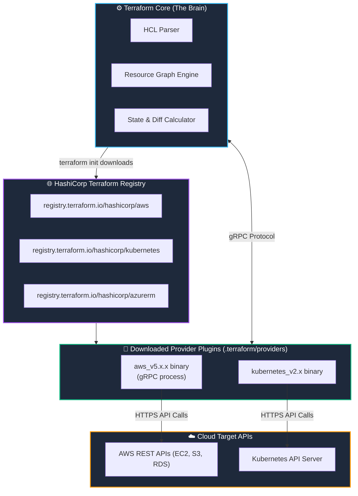

# 🔌 04. Terraform Providers & The Plugin Ecosystem

> *"Hey Ravi! 🌸 Have you ever wondered how one single CLI tool can talk to AWS, Azure, Google Cloud, Docker, and GitHub using the exact same language? Today, I introduce you to the magic of Providers!"* — **Mentor Rithu 👩‍🏫**

---

## 👫 Mentor & Student Check-In

- **Ravi 👨‍🎓:** *"Rithu, does Terraform Core come pre-packaged with all the code for AWS, Azure, and Google Cloud?"*
- **Rithu 👩‍🏫:** *"No, Ravi! Terraform Core actually knows zero cloud-specific details! It's just a smart orchestrator. It uses 'Provider Plugins' as translators. Let me explain with my universal travel adapter analogy!"*

---

## 🎯 What Ravi Will Learn Today

1. 🧩 **Understand Provider Plugin Architecture** and gRPC communication under the hood.
2. 📦 **Source official plugins** from the [Terraform Registry](https://registry.terraform.io/).
3. 📌 **Lock versions safely** using pessimistic constraints (`~>`).
4. 🔒 **Understand why `.terraform.lock.hcl` must be committed to Git**.
5. 🌍 **Configure provider aliases** for multi-region cloud deployments.

---

## 📊 Visual Explanation




---

## 👶 Rithu Explains Like You Are a Beginner

### 🔌 The Universal Power Adapter Analogy
> *"Ravi, imagine traveling around the world with your laptop:"*
- In India, wall sockets use Type D/M round plugs.
- In the United States, wall sockets use Type A flat prongs.
- In the UK, wall sockets use Type G three-pin prongs.

You don't redesign your laptop motherboard for every country! You carry a **Universal Power Adapter**. You plug in the UK adapter in London, and the US adapter in New York.

> *"In Terraform, Ravi, **Terraform Core is your laptop.** The **Providers are your power adapters.** When you want to talk to AWS, Terraform downloads the AWS provider. When you want to manage Kubernetes, it downloads the Kubernetes provider!"*

---

## ⚡ The Essential 80/20 Concepts (Rithu's Focus Sheet)

| Concept | What Rithu Wants Ravi to Know | Practical DevOps Importance |
|---|---|---|
| **Provider** | An executable plugin binary that manages cloud resource types. | Translates HCL declarations into vendor REST API calls. |
| **Terraform Registry** | HashiCorp's centralized public marketplace for providers and modules. | Where `terraform init` downloads verified plugins. |
| **`required_providers`** | The block specifying which plugins and versions your project requires. | Protects your code from sudden breaking changes when plugins update. |
| **Dependency Lock File (`.terraform.lock.hcl`)** | A file recording exact version numbers and cryptographic checksums. | Ensures every team member and CI/CD runner uses identical plugin binaries. |
| **Provider Alias** | A way to instantiate the same provider multiple times (e.g., across regions). | Enables multi-region deployments like disaster recovery in another region. |

---

## 📦 How Ravi Declares Providers in HCL

Every professional project begins with a `providers.tf` file:

```hcl
# providers.tf
terraform {
  required_version = ">= 1.8.0"

  required_providers {
    # Official AWS Provider
    aws = {
      source  = "hashicorp/aws"
      version = "~> 5.40"
    }

    # Utility Random Provider
    random = {
      source  = "hashicorp/random"
      version = "~> 3.6"
    }
  }
}

# Provider configuration
provider "aws" {
  region = "us-east-1"

  # Rithu's Pro Tip: default_tags automatically tags ALL resources created!
  default_tags {
    tags = {
      Student   = "Ravi"
      Mentor    = "Rithu"
      ManagedBy = "Terraform"
    }
  }
}
```

---

## 📌 Version Constraints: Rithu's Quick Guide for Ravi

| Operator | Syntax Example | Meaning | What It Permits |
|---|---|---|---|
| **Pessimistic Constraint (`~>`)** | `~> 5.40` | Allows minor features and bug fixes; blocks breaking major changes. | Allows `>= 5.40.0` and `< 6.0.0` |
| **Pessimistic Patch (`~>`)** | `~> 5.40.0` | Locks minor version; allows patch updates only. | Allows `>= 5.40.0` and `< 5.41.0` |
| **Exact Pin (`=`)** | `= 5.45.0` | Exact pin only. | Only version 5.45.0 |

> **Rithu's Best Practice:** *"Always use `~> 5.0` or `~> 5.40` for providers, Ravi! It ensures you receive critical security updates without waking up to broken code!"*

---

## 🔒 Rithu's Golden Rule: Commit `.terraform.lock.hcl`!

When you run `terraform init`, Terraform generates `.terraform.lock.hcl`:
- It locks the exact version of the provider you tested with.
- It records cryptographic checksum hashes (`h1:...`).

> *"Ravi, **never delete or gitignore this file!** If you commit it, your teammates and your CI/CD pipeline will use the exact same tested provider binary, preventing nasty 'it worked on my machine' bugs!"*

---

## 🌍 Advanced: Multi-Region Deployments with Provider Aliases

Need a primary bucket in Virginia and a backup in Frankfurt? Use an **alias**:

```hcl
# Primary Region (Default)
provider "aws" {
  region = "us-east-1"
}

# Secondary Region (Aliased)
provider "aws" {
  alias  = "frankfurt"
  region = "eu-central-1"
}

# Resource in primary region (uses default provider)
resource "aws_s3_bucket" "primary" {
  bucket_prefix = "ravi-primary-data-"
}

# Resource in secondary region (uses aliased provider)
resource "aws_s3_bucket" "dr_backup" {
  provider      = aws.frankfurt  # 👈 Points to the aliased provider!
  bucket_prefix = "ravi-backup-frankfurt-"
}
```

---

## 🧪 Hands-on Practice: Multi-Provider Lab for Ravi

### 🎯 Objective
Combine the `random` provider and `local` provider together to see multiple plugins working in harmony!

### 🚀 Steps for Ravi:

1. Create a practice folder:
   ```bash
   mkdir ravi-provider-lab
   cd ravi-provider-lab
   ```

2. Create `main.tf`:
   ```hcl
   terraform {
     required_providers {
       local = {
         source  = "hashicorp/local"
         version = "~> 2.5"
       }
       random = {
         source  = "hashicorp/random"
         version = "~> 3.6"
       }
     }
   }

   # Generates a random server ID
   resource "random_id" "server_id" {
     byte_length = 4
   }

   # Generates a friendly animal name
   resource "random_pet" "server_alias" {
     separator = "-"
     length    = 2
   }

   # Writes the outputs to a local file
   resource "local_file" "server_manifest" {
     filename = "${path.module}/server-info.txt"
     content  = <<-EOT
       === PROVISIONED SERVER ===
       ID:    ${random_id.server_id.hex}
       Name:  ${random_pet.server_alias.id}
       Owner: Ravi & Rithu
     EOT
   }
   ```

3. Initialize and apply:
   ```bash
   terraform init
   terraform apply -auto-approve
   ```

### 🔎 Verification:
View your generated file:
```bash
cat server-info.txt
```
Notice that `.terraform.lock.hcl` was created in your folder!

### 🧹 Cleanup:
```bash
terraform destroy -auto-approve
```

---

## 💬 Ravi's Doubt Corner

### Ravi: *"Rithu, what should I do if I want to upgrade to a newer provider version?"*
**Rithu:** *"Simply update the version constraint in your `.tf` file, and run `terraform init -upgrade`! The `-upgrade` flag tells Terraform to update the `.terraform.lock.hcl` file with the newest compatible version."*

---

## ⚡ Quick Revision with Rithu

- 📌 **Registry Source:** `source = "hashicorp/aws"`
- 📌 **Version Constraint:** `~> 5.0` (Pessimistic constraint)
- 📌 **Lockfile:** Always commit `.terraform.lock.hcl` to Git!
- 📌 **Multi-Region:** Use `alias = "name"` and `provider = aws.name`
- 📌 **Upgrade Flag:** `terraform init -upgrade`

> [!TIP]
> **Rithu's Note to Ravi:** *"You're making great progress, Ravi! Now that we know how providers work, let's explore Chapter 5 and dive deep into Resources and their lifecycles!"* 🏗️✨
