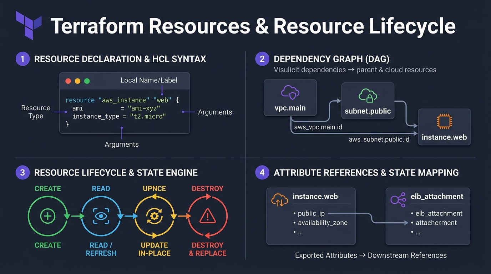
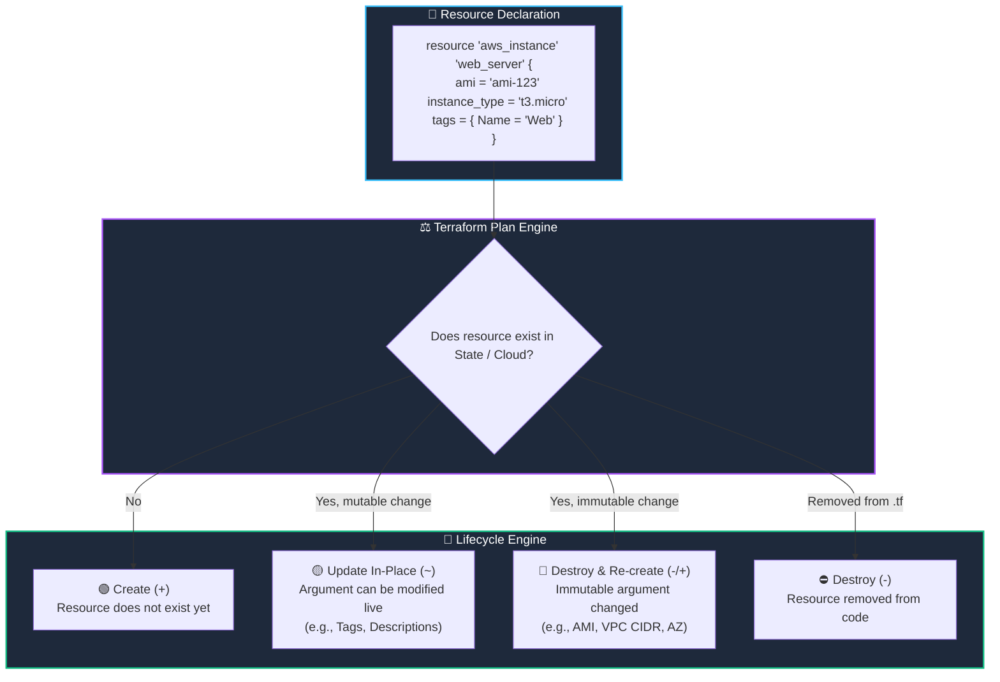

# 🏗️ 05. Terraform Resources & The Infrastructure Lifecycle

> *"Resources are the heart and soul of Terraform. If providers are the power tools, resources are the houses you build with them!"* 🏠🔨

Everything in Terraform revolves around the `resource` block. A resource is an actual piece of cloud infrastructure: a virtual machine, a DNS record, a firewall rule, or a database. In this chapter, you will master how resources are created, updated in-place, replaced, or destroyed.

---

## 🎯 Learning Objectives

By the end of this topic, you will be able to:
1. 🧱 **Write clean resource blocks** distinguishing between *Resource Type* and *Local Name*.
2. 🔄 **Understand the 4 Resource Lifecycle States**: Create, Update in-place, Replace, and Destroy.
3. ⚠️ **Predict when Terraform will destroy and recreate** a resource versus updating it safely.
4. 🕸️ **Visualize Directed Acyclic Graphs (DAG)** and how Terraform calculates dependencies.

---

## 📊 Visual Explanation





---

## 👶 Explain Like I Am a Beginner

### 🚗 The Car Customization Analogy
Imagine owning a car:
- **Update In-Place (🟡 `~`):** You want to repaint the car blue or put bumper stickers on it. You don't need to throw the car away to repaint it! The car stays where it is, and the modification happens in place.
- **Destroy and Replace (🔴 `- / +`):** You decide you want your 2-door sedan to become a 40-foot commercial cargo truck with an electric battery. You cannot simply modify the sedan chassis into a truck—you must **scrap the sedan and buy a brand-new truck** from scratch.

In AWS:
- Changing an EC2 instance's **Tags** = Repainting the car (Update In-Place).
- Changing an EC2 instance's **AMI (Operating System)** or **Subnet** = Scrapping the car (Terraform destroys the old server and provisions a brand-new one with a new IP address!).

---

## ⚡ The Essential 80/20 Concepts

| Concept | Simple Explanation | Practical Importance |
|---|---|---|
| **Resource Type** | Provider-defined object (e.g. `aws_vpc`, `aws_instance`, `aws_s3_bucket`). | Defines what kind of cloud infrastructure will be created. |
| **Local Identifier** | User-defined name used to reference this resource inside your code. | Only exists in Terraform code; invisible in AWS console. |
| **Arguments vs Attributes** | Arguments are inputs you set; Attributes are outputs the cloud returns (like `id` or `arn`). | You feed arguments in; you read attributes out. |
| **Update In-Place (`~`)** | Modifying arguments without destroying the cloud resource. | Zero downtime! |
| **Force New / Replacement (`-/+`)** | When an immutable argument changes, Terraform must destroy the old resource before creating a new one. | Critical to detect before applying to production to prevent accidental downtime or data loss! |

---

## 💻 Practical Example: AWS Networking & Compute

Let's look at how resources reference each other:

```hcl
terraform {
  required_providers {
    aws = {
      source  = "hashicorp/aws"
      version = "~> 5.0"
    }
  }
}

provider "aws" {
  region = "us-east-1"
}

# 1. Create a VPC
resource "aws_vpc" "production_network" {
  cidr_block           = "10.0.0.0/16"
  enable_dns_hostnames = true

  tags = {
    Name = "Production-VPC"
  }
}

# 2. Create a Subnet referencing the VPC's generated ID
resource "aws_subnet" "public_subnet_1" {
  vpc_id                  = aws_vpc.production_network.id  # 👈 Implicit Dependency!
  cidr_block              = "10.0.1.0/24"
  availability_zone       = "us-east-1a"
  map_public_ip_on_launch = true

  tags = {
    Name = "Public-Subnet-1"
  }
}

# 3. Create a Security Group inside the VPC
resource "aws_security_group" "web_sg" {
  name        = "web-server-sg"
  description = "Allow inbound HTTP traffic"
  vpc_id      = aws_vpc.production_network.id

  ingress {
    description = "HTTP from internet"
    from_port   = 80
    to_port     = 80
    protocol    = "tcp"
    cidr_blocks = ["0.0.0.0/0"]
  }

  egress {
    from_port   = 0
    to_port     = 0
    protocol    = "-1"
    cidr_blocks = ["0.0.0.0/0"]
  }
}
```

### 🧠 How Terraform Resolves the Order:
Terraform builds a dependency tree:
1. `aws_vpc.production_network` has no dependencies $\rightarrow$ Created **First**.
2. `aws_subnet.public_subnet_1` and `aws_security_group.web_sg` both need `aws_vpc.id` $\rightarrow$ Created in **Parallel** after VPC is ready!

---

## ⚠️ Safe Resource Replacement: Why It Matters

When you run `terraform plan`, pay special attention to the symbols:

```text
# aws_instance.web must be replaced
-/+ resource "aws_instance" "web" {
      ~ ami           = "ami-0123" -> "ami-0987" # forces replacement
      ~ id            = "i-0a1b2c3d" -> (known after apply)
        instance_type = "t3.micro"
    }

Plan: 1 to add, 0 to change, 1 to destroy.
```

> [!WARNING]
> If you see `- / +` on a production database (`aws_db_instance`) or storage volume, **STOP!** Terraform is telling you: *"I am about to delete the existing database and launch an empty new one!"* Always read your plan carefully!

---

## 🧪 Hands-on Practice: Simulating Resource Updates

### 🎯 Objective
Observe Update In-Place vs. Replacement behavior using the safe `local_file` provider.

### 📋 Prerequisites
Terraform CLI installed.

### 🚀 Steps to Follow:

1. Create a directory:
   ```bash
   mkdir resource-lifecycle-lab
   cd resource-lifecycle-lab
   ```

2. Create `main.tf`:
   ```hcl
   terraform {
     required_providers {
       local = {
         source  = "hashicorp/local"
         version = "~> 2.5"
       }
     }
   }

   resource "local_file" "demo_file" {
     filename = "${path.module}/app-config.json"
     content  = jsonencode({
       version = "1.0.0"
       mode    = "debug"
     })
   }
   ```

3. Initialize and apply:
   ```bash
   terraform init
   terraform apply -auto-approve
   ```
   *Result:* `Plan: 1 to add, 0 to change, 0 to destroy.` (Created `app-config.json`).

4. **Test Update In-Place:**
   Change `mode = "debug"` to `mode = "production"` in `main.tf`:
   ```hcl
   content = jsonencode({
     version = "1.0.0"
     mode    = "production"
   })
   ```
   Run:
   ```bash
   terraform plan
   ```
   Notice the `~` symbol: Terraform updates the file in place!

5. **Test Force Replacement:**
   Change the `filename` argument from `app-config.json` to `new-app-config.json`:
   ```hcl
   filename = "${path.module}/new-app-config.json"
   ```
   Run:
   ```bash
   terraform plan
   ```
   Notice the `- / +` symbol! Terraform must delete the old file name and create the new one!

### 🧹 Cleanup Instructions:
```bash
terraform destroy -auto-approve
```

---

## ⚠️ Common Beginner Mistakes

### 1. Renaming the Local Identifier
- **What it looks like:** Changing `resource "aws_instance" "server_one"` to `resource "aws_instance" "server_two"`.
- **Why it happens:** Believing that renaming the identifier in code is harmless.
- **The Result:** Terraform thinks you **deleted** `server_one` and created a brand new `server_two`! It will destroy your real server and create a new one!
- **The Fix:** In Terraform 1.1+, use the `moved` block if you need to rename resource identifiers without recreating them:
  ```hcl
  moved {
    from = aws_instance.server_one
    to   = aws_instance.server_two
  }
  ```

### 2. Confusing Local Name with Cloud Name
- **What it looks like:** Thinking `resource "aws_s3_bucket" "my_cool_bucket"` means the S3 bucket in AWS will be named `my_cool_bucket`.
- **The Fix:** Set the `bucket = "globally-unique-bucket-name"` argument inside the body.

### 3. Circular Dependencies
- **What it looks like:** Error: `Cycle: aws_security_group.a, aws_security_group.b, aws_security_group.a`.
- **Why it happens:** Resource A depends on Resource B, while Resource B also depends on Resource A. Terraform cannot determine which to create first.
- **The Fix:** Break the cycle by using separate attachment resources (e.g., `aws_security_group_rule`).

---

## 💼 Interview Revision Questions

### Q1: What is the difference between Update In-Place and Replacement in Terraform?
**Answer:** An **Update In-Place** (`~`) modifies existing resource arguments directly via cloud update APIs without terminating or re-creating the resource (e.g. changing tags or security group descriptions). A **Replacement** (`-/+`) occurs when an immutable property changes (e.g. changing an EC2 instance AMI or subnet); Terraform must destroy the existing resource and create a new one.

### Q2: What are Implicit Dependencies, and how do they differ from Explicit Dependencies?
**Answer:** **Implicit dependencies** are detected automatically when one resource references an attribute of another in its configuration (e.g., `subnet_id = aws_subnet.web.id`). **Explicit dependencies** are manually enforced using the `depends_on = [aws_resource.name]` meta-argument when Terraform cannot infer the order on its own.

### Q3: What is the purpose of the `moved` block in modern Terraform?
**Answer:** The `moved` block allows engineers to refactor code (renaming resources or migrating them into modules) without Terraform destroying and recreating the underlying cloud infrastructure.

---

## ⚡ Quick Revision & Cheat Sheet

- 📌 **Declaration:** `resource "<TYPE>" "<NAME>" { ... }`
- 📌 **Plan Symbols:**
  - `+` Create
  - `~` Update In-Place (Safe)
  - `-` Destroy
  - `- / +` Destroy & Recreate (Dangerous for DBs!)
- 📌 **Attribute Reference:** `aws_vpc.production.id`
- 📌 **Refactor Safely:** Use `moved { ... }` blocks

> [!NOTE]
> **Remember This:** Always inspect the execution plan for `- / +` symbols before typing `yes`. Replacement causes downtime and new IP addresses!
