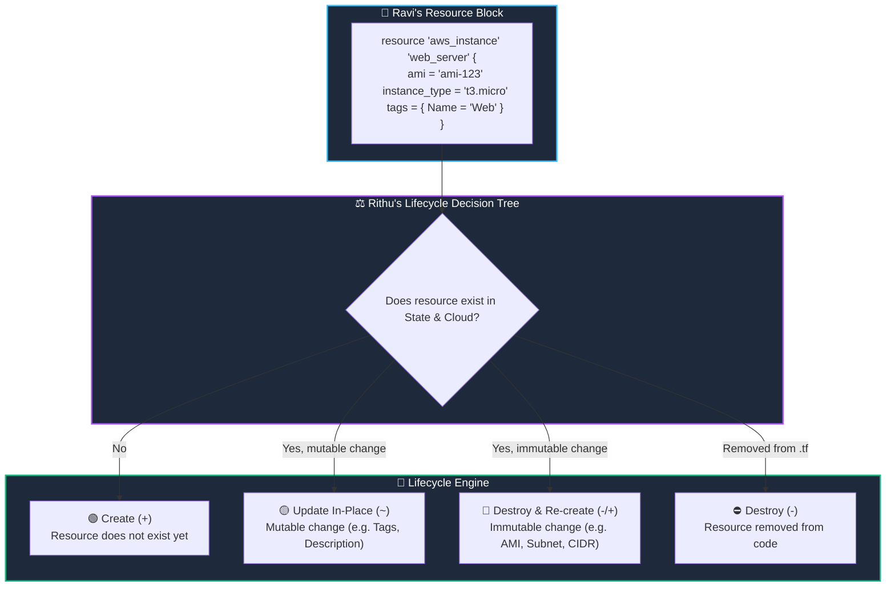

# 🏗️ 05. Terraform Resources & The Infrastructure Lifecycle

> *"Hey Ravi! 🌸 Today we meet the heart and soul of Terraform: Resources! If providers are the power tools, resources are the actual skyscrapers you build!"* — **Mentor Rithu 👩‍🏫**

---

## 👫 Mentor & Student Check-In

- **Ravi 👨‍🎓:** *"Rithu, when I change a setting on a server in Terraform, does it always modify it live, or does it ever delete and rebuild it?"*
- **Rithu 👩‍🏫:** *"Oh Ravi, that is one of the most critical questions in all of cloud engineering! Some changes happen in-place without downtime, but other changes force Terraform to completely destroy and recreate the server! Let's understand how Terraform decides, so you never accidentally drop a database in production!"*

---

## 🎯 What Ravi Will Learn Today

1. 🧱 **Write clean resource blocks** distinguishing between Resource Type and Local Identifier.
2. 🔄 **Understand the 4 Resource Lifecycle States**: Create (`+`), Update In-Place (`~`), Replace (`-/+`), and Destroy (`-`).
3. ⚠️ **Predict which argument changes cause resource destruction** vs safe updates.
4. 🕸️ **Understand how Terraform builds the Directed Acyclic Graph (DAG)** to order operations automatically.

---

## 📊 Visual Explanation




---

## 👶 Rithu Explains Like You Are a Beginner

### 🚗 The Car Customization Analogy
> *"Ravi, imagine owning a car in your garage:"*

- **Update In-Place (🟡 `~`):** You want to repaint the car blue or put bumper stickers on it. You don't take the car to the junkyard and crush it to repaint it! The car stays right in your driveway, and the paint is applied in-place.
- **Destroy and Replace (🔴 `- / +`):** You decide you want your 2-door sedan to become a 40-foot commercial cargo truck with an electric battery. You can't just modify the sedan into a giant truck. You have to **scrap the sedan and buy a brand-new truck**!

In AWS:
- Changing an EC2 instance's **Tags** = Repainting the car (Update In-Place).
- Changing an EC2 instance's **Operating System (AMI)** or **Subnet** = Scrapping the car (Terraform destroys the old server and provisions a brand-new one with a new IP address!).

---

## ⚡ The Essential 80/20 Concepts (Rithu's Focus Sheet)

| Concept | What Rithu Wants Ravi to Know | Practical DevOps Importance |
|---|---|---|
| **Resource Type** | Provider object (e.g. `aws_vpc`, `aws_instance`, `aws_s3_bucket`). | Defines what type of cloud asset is built. |
| **Local Identifier** | The name Ravi gives the resource inside the `.tf` code. | Used to reference this resource elsewhere in the code. |
| **Update In-Place (`~`)** | Modifies attributes directly without destroying the live cloud resource. | Zero downtime! Safe for production. |
| **Replacement (`-/+`)** | Occurs when an immutable attribute is changed. | **Danger Zone!** Terraform deletes the existing resource first. |
| **The `moved` Block** | A block that renames resources in code without recreating them in the cloud. | Prevents accidental downtime during code refactoring. |

---

## 💻 Practical Example: Ravi's AWS Network & Server

```hcl
terraform {
  required_providers {
    aws = {
      source  = "hashicorp/aws"
      version = "~> 5.0"
    }
  }
}

provider "aws" {
  region = "us-east-1"
}

# 1. Create a VPC
resource "aws_vpc" "ravi_vpc" {
  cidr_block           = "10.0.0.0/16"
  enable_dns_hostnames = true

  tags = {
    Name  = "Ravi-Production-VPC"
    Owner = "Ravi"
  }
}

# 2. Create a Subnet referencing the VPC ID
resource "aws_subnet" "ravi_public_subnet" {
  vpc_id                  = aws_vpc.ravi_vpc.id  # 👈 Implicit Dependency!
  cidr_block              = "10.0.1.0/24"
  availability_zone       = "us-east-1a"
  map_public_ip_on_launch = true

  tags = {
    Name = "Ravi-Public-Subnet"
  }
}
```

---

## ⚠️ Rithu's Red Alert: Inspecting `- / +` in Plans

When you run `terraform plan`, pay special attention to the symbols:

```text
# aws_instance.web must be replaced
-/+ resource "aws_instance" "web" {
      ~ ami           = "ami-old" -> "ami-new" # forces replacement
        instance_type = "t3.micro"
    }

Plan: 1 to add, 0 to change, 1 to destroy.
```

> [!WARNING]
> **Rithu's Advice:** *"Ravi, whenever you see `- / +` on a database (`aws_db_instance`) or storage volume in production, **STOP!** Terraform is warning you that it is about to delete your existing database and launch an empty one! Always read the plan carefully!"*

---

## 🧪 Hands-on Practice: Ravi's Lifecycle Observation Lab

### 🎯 Objective
Experience Update In-Place vs. Replacement safely on your local machine.

### 🚀 Steps for Ravi:

1. Create a folder:
   ```bash
   mkdir ravi-resource-lab
   cd ravi-resource-lab
   ```

2. Create `main.tf`:
   ```hcl
   terraform {
     required_providers {
       local = {
         source  = "hashicorp/local"
         version = "~> 2.5"
       }
     }
   }

   resource "local_file" "config" {
     filename = "${path.module}/app-settings.json"
     content  = jsonencode({
       version = "1.0"
       mode    = "dev"
     })
   }
   ```

3. Initialize and apply:
   ```bash
   terraform init
   terraform apply -auto-approve
   ```

4. **Observe Update In-Place:**
   Change `mode = "dev"` to `mode = "production"` in `main.tf`.
   Run:
   ```bash
   terraform plan
   ```
   *Notice the `~` symbol: Terraform updates the file in place!*

5. **Observe Force Replacement:**
   Change `filename = "${path.module}/app-settings.json"` to `filename = "${path.module}/new-settings.json"`.
   Run:
   ```bash
   terraform plan
   ```
   *Notice the `- / +` symbol! Terraform must destroy the old file path and create the new one!*

### 🧹 Cleanup:
```bash
terraform destroy -auto-approve
```

---

## 💬 Ravi's Doubt Corner

### Ravi: *"Rithu, what happens if I rename `resource "aws_instance" "web"` to `resource "aws_instance" "api"` in my code?"*
**Rithu:** *"Be careful here, Ravi! If you just change the local name, Terraform thinks you **deleted** the `web` server and wrote a brand-new `api` server. It will destroy your live server! To avoid this, use a `moved` block so Terraform knows you only renamed the identifier without touching the real cloud asset!"*

---

## ⚡ Quick Revision with Rithu

- 📌 **Syntax:** `resource "<TYPE>" "<NAME>" { ... }`
- 📌 **Symbols:**
  - `+` Create
  - `~` Update In-Place (Safe)
  - `-` Destroy
  - `- / +` Destroy & Recreate (Take extra care!)
- 📌 **Dependencies:** References like `aws_vpc.ravi_vpc.id` build the dependency graph automatically.

> [!TIP]
> **Rithu's Note to Ravi:** *"Excellent work, Ravi! Now let's jump into Chapter 6 and see how Variables and Outputs make your code dynamic and reusable!"* 📥✨
