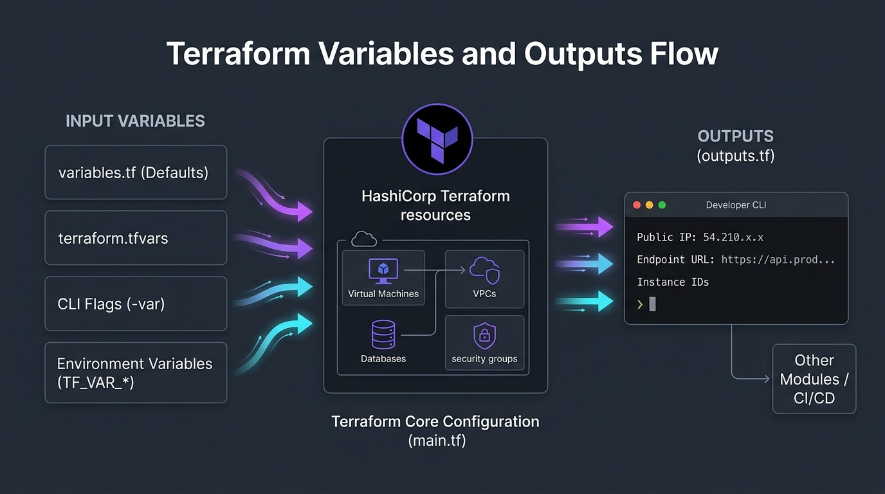
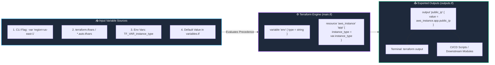

# 📥 06. Input Variables, `.tfvars`, and Output Values

> *"Hardcoded code is rigid and brittle. Variables make your Terraform code reusable across Dev, Staging, and Production!"* 🎛️📦

Imagine writing a Terraform template for an AWS EC2 server, but you want to deploy a tiny `t3.micro` instance in Development and a powerful `m6i.large` in Production without duplicating 500 lines of code. That's the power of **Input Variables and Outputs**. In this chapter, you will master variable types, precedence rules, sensitive secrets, and exporting outputs.

---

## 🎯 Learning Objectives

By the end of this topic, you will be able to:
1. 🎛️ **Declare typed input variables** with descriptions, default values, and validations.
2. 🥇 **Master Variable Precedence** (never guess which `.tfvars` file wins again!).
3. 🔒 **Use `sensitive = true` correctly** and understand why it does *not* encrypt state files.
4. 📤 **Export valuable outputs** (IP addresses, endpoints, ARNs) to terminal screens and external scripts.

---

## 📊 Visual Explanation





---

## 👶 Explain Like I Am a Beginner

### ☕ The Coffee Machine Analogy
Think of a commercial coffee machine:
- **Input Variables:** You choose the size (*Small, Medium, Large*), temperature (*Hot, Iced*), and milk type (*Oat, Dairy, Almond*). You don't build a new machine every time you want an iced coffee—you just change the inputs!
- **Terraform Code (`main.tf`):** The internal heating coil, water pump, and brewing logic.
- **Outputs:** The delicious cup of coffee handed to you, with a printed receipt showing the price and brew time!

In Terraform:
- **Inputs:** `instance_type = "t3.micro"`, `region = "us-east-1"`.
- **Code:** Creates the VPC and EC2 instance.
- **Outputs:** Prints the public IP address (`54.210.12.34`) and Website URL directly to your terminal.

---

## ⚡ The Essential 80/20 Concepts

| Concept | Simple Explanation | Practical Importance |
|---|---|---|
| **Input Variable (`variable`)** | A parameter you define to customize Terraform configurations without modifying code. | Turns static code into reusable, multi-environment templates. |
| **Output Value (`output`)** | A return value computed by Terraform and exposed to the user or other modules. | Displays connection strings, IP addresses, and DNS names immediately after apply. |
| **`.tfvars` File** | A file containing key-value pairs assigned to variables (`environment = "prod"`). | Keeps configuration values separated from infrastructure logic. |
| **Variable Precedence** | The strict hierarchical rule Terraform uses when a variable is defined in multiple places. | Ensures predictable builds across local terminals and CI/CD pipelines. |
| **`sensitive = true`** | Prevents variable or output values from appearing in CLI stdout logs. | Guards passwords and tokens from leaking into CI/CD build logs. |

---

## 💻 Declaring Input Variables (`variables.tf`)

Always declare type constraints and descriptions for clean code:

```hcl
# variables.tf

variable "aws_region" {
  type        = string
  description = "Target AWS Region for deployment"
  default     = "us-east-1"
}

variable "instance_type" {
  type        = string
  description = "EC2 instance size"
  default     = "t3.micro"

  # Custom validation rule!
  validation {
    condition     = contains(["t3.micro", "t3.small", "t3.medium"], var.instance_type)
    error_message = "Only t3.micro, t3.small, or t3.medium are allowed in this project."
  }
}

variable "environment" {
  type        = string
  description = "Deployment environment name"
  # No default = Terraform will prompt you or require a .tfvars entry!
}

variable "allowed_ports" {
  type        = list(number)
  description = "List of ingress firewall ports"
  default     = [80, 443]
}

variable "project_tags" {
  type        = map(string)
  description = "Default resource tags"
  default = {
    Owner     = "DevOps Squad"
    ManagedBy = "Terraform"
  }
}

variable "db_password" {
  type        = string
  description = "Database master password"
  sensitive   = true  # 👈 Masks value in terminal logs!
}
```

---

## 🥇 The Variable Precedence Hierarchy

What happens if a variable is defined in `variables.tf`, inside `terraform.tfvars`, AND passed via the command line?

Here is the exact order (**Highest priority wins**):

```text
▲ HIGHEST PRIORITY (Wins over everything)
│
│  1. -var and -var-file flags on the command line
│     (terraform apply -var="instance_type=c5.xlarge")
│
│  2. *.auto.tfvars or *.auto.tfvars.json (alphabetical order)
│
│  3. terraform.tfvars or terraform.tfvars.json
│     (Automatically loaded by Terraform)
│
│  4. Environment Variables prefixed with TF_VAR_
│     (export TF_VAR_instance_type="t3.small")
│
│  5. Default value inside variables.tf
│     (default = "t3.micro")
│
▼ LOWEST PRIORITY (Fallback only)
```

---

## 📁 Managing Environments with `.tfvars`

Create environment-specific values files:

```hcl
# dev.tfvars
environment   = "dev"
instance_type = "t3.micro"
```

```hcl
# prod.tfvars
environment   = "prod"
instance_type = "t3.large"
```

Apply your chosen environment with the `-var-file` flag:
```bash
terraform apply -var-file="prod.tfvars"
```

---

## 📤 Declaring Outputs (`outputs.tf`)

Outputs make your infrastructure useful by printing attributes immediately after `terraform apply`:

```hcl
# outputs.tf

output "web_public_ip" {
  description = "Public IPv4 address of the web server"
  value       = aws_instance.web.public_ip
}

output "website_url" {
  description = "Full URL to visit the web application"
  value       = "http://${aws_instance.web.public_ip}:8080"
}

output "db_connection_string" {
  description = "Private database connection string"
  value       = "postgresql://admin:${var.db_password}@${aws_db_instance.db.endpoint}/mydb"
  sensitive   = true  # 👈 Masks from terminal output: "<sensitive>"
}
```

Query outputs anytime without running apply:
```bash
terraform output
terraform output website_url
```

---

## 🧪 Hands-on Practice: Variables & Outputs Playground

### 🎯 Objective
Create a dynamic configuration using variables, `.tfvars`, and outputs using the local provider.

### 📋 Prerequisites
Terraform CLI installed.

### 🚀 Steps to Follow:

1. Create a lab directory:
   ```bash
   mkdir variables-outputs-lab
   cd variables-outputs-lab
   ```

2. Create `variables.tf`:
   ```hcl
   variable "app_name" {
     type        = string
     description = "Name of the web application"
     default     = "CloudPortal"
   }

   variable "environment" {
     type        = string
     description = "Environment name (dev, staging, prod)"
   }

   variable "server_count" {
     type        = number
     description = "Number of cluster nodes"
     default     = 2
   }
   ```

3. Create `terraform.tfvars`:
   ```hcl
   environment  = "staging"
   server_count = 3
   ```

4. Create `main.tf`:
   ```hcl
   terraform {
     required_providers {
       local = {
         source  = "hashicorp/local"
         version = "~> 2.5"
       }
     }
   }

   resource "local_file" "manifest" {
     filename = "${path.module}/app-manifest.txt"
     content  = <<-EOT
       === APPLICATION MANIFEST ===
       App:         ${var.app_name}
       Environment: ${upper(var.environment)}
       Nodes:       ${var.server_count}
       Generated:   ${timestamp()}
     EOT
   }
   ```

5. Create `outputs.tf`:
   ```hcl
   output "manifest_path" {
     description = "Absolute path to the created manifest"
     value       = local_file.manifest.filename
   }

   output "cluster_size" {
     description = "Configured cluster capacity"
     value       = var.server_count
   }
   ```

6. Run Terraform:
   ```bash
   terraform init
   terraform apply -auto-approve
   ```

### 🔎 Expected Result:
```text
Apply complete! Resources: 1 added, 0 changed, 0 destroyed.

Outputs:

cluster_size = 3
manifest_path = "./app-manifest.txt"
```
Inspect the output file:
```bash
cat app-manifest.txt
```

### 🧹 Cleanup Instructions:
```bash
terraform destroy -auto-approve
```

---

## ⚠️ Common Beginner Mistakes

### 1. Believing `sensitive = true` Encrypts the State File
- **What it looks like:** Setting `sensitive = true` on a database password and assuming the state file is encrypted.
- **Why it happens:** Misunderstanding what the flag does.
- **The Reality:** `sensitive = true` **ONLY masks the value in terminal stdout and plan diffs**. The password is STILL stored in 100% plain text inside `terraform.tfstate`!
- **The Fix:** Protect your state file using remote backends (S3 with KMS encryption) and strict IAM access controls.

### 2. Typo in Variable Names in `.tfvars`
- **What it looks like:** Warning: `The variable "instnace_type" defined in terraform.tfvars was not declared in any .tf file.`
- **Why it happens:** Spelling mistakes between `variables.tf` and `terraform.tfvars`.
- **The Fix:** Variable names must match identically.

### 3. Missing Quotes Around Strings in `.tfvars`
- **What it looks like:** Error: `Variables may not be used here.`
- **Why it happens:** Writing `environment = dev` without quotes in `terraform.tfvars`.
- **The Fix:** Always quote strings: `environment = "dev"`.

---

## 💼 Interview Revision Questions

### Q1: What is the exact variable precedence in Terraform?
**Answer:** The hierarchy from highest priority to lowest is:
1. `-var` and `-var-file` command-line flags.
2. `*.auto.tfvars` or `*.auto.tfvars.json` files.
3. `terraform.tfvars` or `terraform.tfvars.json`.
4. Environment variables starting with `TF_VAR_<name>`.
5. Default values declared within the `variable` block.

### Q2: What happens if a variable has no `default` value and is not provided in any `.tfvars` file or CLI flag?
**Answer:** Terraform will pause execution during `terraform plan` or `terraform apply` and interactively prompt the user in the terminal to enter a value for the variable.

### Q3: What is the limitation of setting `sensitive = true` on a variable or output?
**Answer:** `sensitive = true` only prevents the value from displaying in terminal output, plan summaries, and logs. It does **not** encrypt the value at rest; the raw value is still stored in plain text inside the `terraform.tfstate` JSON file.

---

## ⚡ Quick Revision & Cheat Sheet

- 📌 **Declare Variable:** `variable "name" { type = string, default = "val" }`
- 📌 **Reference Variable:** `var.name`
- 📌 **Environment Variable:** `export TF_VAR_name="val"`
- 📌 **Custom Vars File:** `terraform apply -var-file="prod.tfvars"`
- 📌 **Read Outputs:** `terraform output`

> [!WARNING]
> **Remember This:** Never commit `*.tfvars` files containing passwords or API tokens to public Git repositories! Use `.gitignore` to keep them local.
