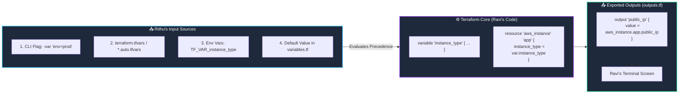

# 📥 06. Input Variables, `.tfvars`, and Output Values

> *"Hey Ravi! 🌸 Hardcoding values in code is like writing on stone with permanent ink—it's rigid and breaks easily. Today, let's make your Terraform code flexible and reusable across Dev, Staging, and Production!"* — **Mentor Rithu 👩‍🏫**

---

## 👫 Mentor & Student Check-In

- **Ravi 👨‍🎓:** *"Rithu, do I really need to copy-paste all my `.tf` files into a separate folder just to deploy a smaller server in Development and a larger server in Production?"*
- **Rithu 👩‍🏫:** *"Never copy-paste infrastructure code, Ravi! In DevOps, our golden rule is DRY: Don't Repeat Yourself. With **Input Variables and Outputs**, you write the code once, and you simply feed different values into it. Let me show you how!"*

---

## 🎯 What Ravi Will Learn Today

1. 🎛️ **Declare typed input variables** with validation rules and descriptions.
2. 🥇 **Master the Variable Precedence hierarchy** so you never guess which value wins.
3. 🔒 **Use `sensitive = true` correctly** and understand why it does *not* encrypt state files.
4. 📤 **Export valuable outputs** (like website URLs and IP addresses) directly to your terminal screen.

---

## 📊 Visual Explanation




---

## 👶 Rithu Explains Like You Are a Beginner

### ☕ The Coffee Vending Machine Analogy
> *"Ravi, imagine standing in front of a coffee vending machine:"*
- **Input Variables:** You press buttons to pick your options:
  - Size: *Small, Medium, Large*
  - Sugar: *Zero, 1 spoon, 2 spoons*
  - Milk: *Dairy, Oat, Almond*
  You don't buy a brand-new machine to make an iced coffee! The machine's inner brewing logic stays the same; it just accepts your inputs.
- **Outputs:** The machine delivers your fresh coffee, and prints a receipt showing the cost and timestamp.

In Terraform, Ravi:
- **Inputs:** `instance_type = "t3.micro"`, `region = "us-east-1"`.
- **Logic:** Creates the VPC and EC2 instances.
- **Outputs:** Prints the public IP address and website link directly to your terminal!

---

## ⚡ The Essential 80/20 Concepts (Rithu's Focus Sheet)

| Concept | What Rithu Wants Ravi to Know | Practical Importance |
|---|---|---|
| **Input Variable (`variable`)** | A parameter you define to customize configurations without modifying code. | Turns static code into reusable templates for Dev, QA, and Prod. |
| **Output Value (`output`)** | An exported attribute printed after apply or consumed by downstream modules. | Displays connection strings and IP addresses immediately. |
| **`.tfvars` File** | A file containing real values (`environment = "prod"`). | Keeps your secret parameters separated from your logic. |
| **Variable Precedence** | The strict hierarchical rule Terraform uses when a variable is defined in multiple places. | Ensures predictable builds across developer laptops and CI/CD pipelines. |
| **`sensitive = true`** | Suppresses values from displaying in terminal stdout logs. | Guards passwords from leaking into CI/CD build logs. |

---

## 💻 Declaring Variables in `variables.tf`

Look at how clear and structured this is, Ravi:

```hcl
# variables.tf

variable "aws_region" {
  type        = string
  description = "Target AWS Region"
  default     = "us-east-1"
}

variable "instance_type" {
  type        = string
  description = "Size of the EC2 instance"
  default     = "t3.micro"

  # Rithu's Pro Tip: Validation protects against typos!
  validation {
    condition     = contains(["t3.micro", "t3.small", "t3.medium"], var.instance_type)
    error_message = "Only t3.micro, t3.small, or t3.medium are permitted."
  }
}

variable "environment" {
  type        = string
  description = "Deployment environment (dev, staging, prod)"
  # No default = Terraform will ask Ravi or look in .tfvars!
}

variable "db_password" {
  type        = string
  description = "Master database password"
  sensitive   = true  # 👈 Masks value from terminal logs!
}
```

---

## 🥇 Rithu's Precedence Ladder (Who Wins?)

If Ravi defines a variable in `variables.tf`, inside `terraform.tfvars`, AND passes a CLI flag, which one wins?

```text
▲ HIGHEST PRIORITY (Wins over everything)
│
│  1. -var and -var-file flags on the command line
│     (terraform apply -var="instance_type=c5.xlarge")
│
│  2. *.auto.tfvars or *.auto.tfvars.json files
│
│  3. terraform.tfvars file
│
│  4. Environment Variables prefixed with TF_VAR_
│     (export TF_VAR_instance_type="t3.small")
│
│  5. Default value inside variables.tf
│     (default = "t3.micro")
│
▼ LOWEST PRIORITY (Fallback only)
```

---

## 📤 Declaring Outputs in `outputs.tf`

```hcl
# outputs.tf

output "server_ip" {
  description = "Public IPv4 address of Ravi's server"
  value       = aws_instance.web.public_ip
}

output "website_url" {
  description = "Direct URL to visit the web app"
  value       = "http://${aws_instance.web.public_ip}:8080"
}

output "database_secret" {
  description = "Database connection password"
  value       = var.db_password
  sensitive   = true # 👈 Prints: database_secret = <sensitive>
}
```

---

## 🧪 Hands-on Practice: Ravi's Variables Playground

### 🎯 Objective
Use variables, a `.tfvars` file, and outputs to build a dynamic local report.

### 🚀 Steps for Ravi:

1. Create a practice folder:
   ```bash
   mkdir ravi-variables-lab
   cd ravi-variables-lab
   ```

2. Create `variables.tf`:
   ```hcl
   variable "project_name" {
     type        = string
     default     = "RaviCloud"
   }

   variable "node_count" {
     type        = number
     default     = 2
   }

   variable "environment" {
     type = string
   }
   ```

3. Create `terraform.tfvars`:
   ```hcl
   environment = "staging"
   node_count  = 4
   ```

4. Create `main.tf`:
   ```hcl
   terraform {
     required_providers {
       local = {
         source  = "hashicorp/local"
         version = "~> 2.5"
       }
     }
   }

   resource "local_file" "manifest" {
     filename = "${path.module}/cluster-manifest.txt"
     content  = <<-EOT
       Project:     ${var.project_name}
       Environment: ${upper(var.environment)}
       Nodes:       ${var.node_count}
       Owner:       Ravi (Guided by Rithu)
     EOT
   }
   ```

5. Create `outputs.tf`:
   ```hcl
   output "manifest_file" {
     value = local_file.manifest.filename
   }

   output "allocated_nodes" {
     value = var.node_count
   }
   ```

6. Run Terraform:
   ```bash
   terraform init
   terraform apply -auto-approve
   ```

### 🔎 Expected Result:
```text
Outputs:
allocated_nodes = 4
manifest_file = "./cluster-manifest.txt"
```
Check `cluster-manifest.txt`:
```bash
cat cluster-manifest.txt
```

### 🧹 Cleanup:
```bash
terraform destroy -auto-approve
```

---

## 💬 Ravi's Doubt Corner

### Ravi: *"Rithu, does `sensitive = true` encrypt the password inside the state file?"*
**Rithu:** *"I am so glad you asked, Ravi! The answer is **NO**. `sensitive = true` only prevents the secret from appearing on your terminal screen and in CI/CD build logs. The raw password is still stored in **plain text JSON** inside `terraform.tfstate`. That's why we protect the state file with encrypted S3 backends in Chapter 13!"*

---

## ⚡ Quick Revision with Rithu

- 📌 **Declare Variable:** `variable "name" { type = string, default = "val" }`
- 📌 **Reference Variable:** `var.name`
- 📌 **Precedence:** CLI flag `-var` beats `.tfvars`, which beats `TF_VAR_`, which beats `default`.
- 📌 **Mask Logs:** `sensitive = true` on secrets.
- 📌 **Read Outputs Anytime:** `terraform output`

> [!TIP]
> **Rithu's Note to Ravi:** *"You've got variables down pat, Ravi! Let's head over to Chapter 7 and master the complete 6-step Terraform CLI Workflow!"* 🔄✨
