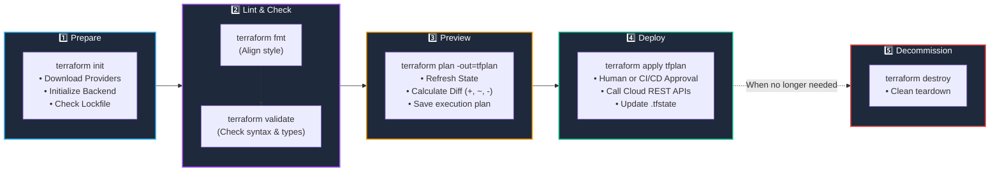

# 🔄 07. The Terraform Core Workflow & Execution Lifecycle

> *"Write $\rightarrow$ Format $\rightarrow$ Validate $\rightarrow$ Plan $\rightarrow$ Apply $\rightarrow$ Teardown. This 6-step loop is the daily bread and butter of every DevOps engineer!"* 🔁⚡

In DevOps, consistency and predictability are king. You never run straight into production making blind changes. Terraform enforces a disciplined, deterministic workflow that allows you to preview, verify, and approve every infrastructure change before it touches real cloud resources. In this chapter, you will master the full lifecycle.

---

## 🎯 Learning Objectives

By the end of this topic, you will be able to:
1. 🔁 **Execute the standard 6-step Terraform lifecycle** in the correct sequence.
2. 🔍 **Read execution plans like a senior engineer** (identifying `+`, `~`, `-`, and `- / +` symbols).
3. 🤖 **Implement plan-file automation** (`-out=tfplan`) for bulletproof CI/CD pipelines.
4. 🧹 **Tear down infrastructure safely** using `terraform destroy`.

---

## 📊 Visual Explanation




---

## 👶 Explain Like I Am a Beginner

### 📐 The Blueprint & Construction Analogy
Imagine hiring an architect to build an extension on your house:
1. **`terraform init`:** The architect unpacks their drafting tools, rulers, and materials.
2. **`terraform fmt & validate`:** The architect checks the blueprint for basic spelling mistakes or structural impossibilities (like putting a door on the roof).
3. **`terraform plan`:** The architect presents you with a **3D blueprint simulation**:
   - 🟢 *"We will add a new balcony here."* (`+`)
   - 🟡 *"We will repaint the living room."* (`~`)
   - 🔴 *"We must tear down the old shed."* (`-`)
4. **`terraform apply`:** You sign the approval contract (`yes`), and the construction team shows up with brick and mortar to build what you approved.
5. **`terraform destroy`:** The wrecking ball arrives when the building lease expires.

---

## ⚡ The Essential 80/20 Concepts

| Step / Command | What It Does | Why It Matters |
|---|---|---|
| `terraform init` | Downloads provider binaries and backend drivers. | Must be run first; without it, Terraform cannot parse provider resources. |
| `terraform fmt` | Rewrites code into canonical HashiCorp formatting. | Prevents messy Git diffs caused by irregular spaces and tabs. |
| `terraform validate` | Verifies syntax and internal consistency without connecting to the cloud. | Catches typos and type mismatches instantly without network latency. |
| `terraform plan` | Compares configuration code against state and cloud reality. | Zero-risk dry run. Never deploy without checking the plan! |
| `terraform apply` | Provisions changes and records results into the state file. | The only command that mutates real cloud infrastructure. |
| `terraform destroy` | Removes all resources managed by the current workspace. | Clean teardown preventing unwanted cloud bills. |

---

## 📖 How to Decipher an Execution Plan

When you run `terraform plan`, Terraform prints a color-coded diff:

```text
Terraform will perform the following actions:

  # aws_security_group.web will be updated in-place
  ~ resource "aws_security_group" "web" {
        id          = "sg-0123456789abcdef0"
        name        = "web-sg"
      ~ description = "Old description" -> "Updated HTTP Security Group"
    }

  # aws_instance.web will be created
  + resource "aws_instance" "web" {
      + ami                          = "ami-0c55b159cbfafe1f0"
      + arn                          = (known after apply)
      + id                           = (known after apply)
      + instance_type                = "t3.micro"
      + public_ip                    = (known after apply)
    }

Plan: 1 to add, 1 to change, 0 to destroy.
```

### 🔍 Symbols Legend:
- `+` **Create:** Resource does not exist; Terraform will create it.
- `~` **Update In-Place:** Resource exists; only specific mutable attributes will change.
- `-` **Destroy:** Resource exists in state/cloud but was deleted from your code; Terraform will destroy it.
- `-/+` **Replace:** Resource must be destroyed first, then recreated with a new ID.
- `(known after apply)`: Attributes computed by the cloud provider only after creation (like IP addresses, IDs, or timestamps).

---

## 🤖 The Production CI/CD Pattern: Saved Plans (`-out=tfplan`)

In local development, running `terraform apply` prompts you with `Enter a value: yes`.
In automated pipelines (GitHub Actions, GitLab CI), interactive prompts are impossible.

Furthermore, between running `plan` in a Pull Request and merging the code 3 hours later, **cloud state could change**!

### The Solution: Saved Plan Files
```bash
# Step 1: In the PR check, generate an exact binary plan file:
terraform plan -out=tfplan

# Step 2: On Merge, apply ONLY the exact saved plan file:
terraform apply tfplan
```

> 🔒 **Why this is critical:** When applying a pre-saved plan file (`tfplan`), Terraform **guarantees** it will only apply the exact actions computed during the plan step. It does not ask for interactive confirmation and prevents race conditions!

---

## 🧪 Hands-on Practice: The Full 6-Step Cycle

### 🎯 Objective
Run the complete workflow lifecycle from init to destroy using the `local_file` provider.

### 📋 Prerequisites
Terraform CLI installed.

### 🚀 Steps to Follow:

1. Create a project directory:
   ```bash
   mkdir workflow-lab
   cd workflow-lab
   ```

2. Create an intentionally unformatted `main.tf`:
   ```hcl
   terraform{
   required_providers{
   local={
   source="hashicorp/local"
   version="~> 2.5"
   }}}

   resource "local_file" "demo"{
   filename="${path.module}/status.txt"
   content="System Operational 🟢"
   }
   ```

3. **Step 1: Initialize**
   ```bash
   terraform init
   ```
   *Output:* `Terraform has been successfully initialized!`

4. **Step 2: Auto-Format**
   ```bash
   terraform fmt
   ```
   *Inspect `main.tf`:* Notice how all indentation, braces, and equal signs snapped into perfect alignment!

5. **Step 3: Validate Syntax**
   ```bash
   terraform validate
   ```
   *Output:* `Success! The configuration is valid.`

6. **Step 4: Generate Saved Plan**
   ```bash
   terraform plan -out=tfplan
   ```
   *Output:* `Plan: 1 to add, 0 to change, 0 to destroy. Saved the plan to: tfplan`

7. **Step 5: Apply Saved Plan**
   ```bash
   terraform apply tfplan
   ```
   *Output:* `Apply complete! Resources: 1 added, 0 changed, 0 destroyed.`

8. **Step 6: Destroy Cleanly**
   ```bash
   terraform destroy -auto-approve
   ```
   *Output:* `Destroy complete! Resources: 1 destroyed.`

---

## ⚠️ Common Beginner Mistakes

### 1. Blindly Using `-auto-approve` Everywhere
- **What it looks like:** Running `terraform apply -auto-approve` on developer laptops without reading the plan.
- **Why it happens:** Wanting to skip typing `yes`.
- **The Catastrophe:** If a typo triggers `- / +` replacement on your database, `-auto-approve` will destroy the database without asking for confirmation!
- **The Fix:** Only use `-auto-approve` in automated CI/CD pipelines on verified branches. Always inspect plans manually locally!

### 2. Editing `.terraform.lock.hcl` Manually
- **What it looks like:** Changing version numbers directly inside the lock file.
- **Why it happens:** Trying to force an upgrade.
- **The Fix:** Never manually edit the lock file. Update your `.tf` files and run `terraform init -upgrade`.

### 3. Applying Without Initializing First
- **What it looks like:** Error: `Could not load plugin...`
- **The Fix:** Always run `terraform init` when opening a new terminal or pulling Git updates.

---

## 💼 Interview Revision Questions

### Q1: What is the purpose of `terraform validate` vs `terraform plan`?
**Answer:** `terraform validate` performs static analysis—it verifies that the syntax is correct, arguments exist, and types match, without contacting cloud APIs or checking state. `terraform plan` connects to the cloud provider, refreshes the state against real infrastructure, and generates a concrete execution diff.

### Q2: Why is saving a plan with `terraform plan -out=tfplan` considered best practice in CI/CD?
**Answer:** It ensures **atomicity and consistency**. It guarantees that the changes applied during deployment are identical to the changes reviewed and approved during the pull request, preventing drift or unexpected actions caused by changes in the cloud between the plan and apply stages.

### Q3: What does the `(known after apply)` label in an execution plan signify?
**Answer:** It indicates an attribute whose value cannot be determined until the resource is actually created by the cloud API (e.g. dynamic IPv4 addresses, AWS ARNs, generated passwords, or creation timestamps).

---

## ⚡ Quick Revision & Cheat Sheet

- 📌 **Order of Operations:** `init` $\rightarrow$ `fmt` $\rightarrow$ `validate` $\rightarrow$ `plan` $\rightarrow$ `apply` $\rightarrow$ `destroy`
- 📌 **Plan Review:**
  - `+` Create
  - `~` Update
  - `-` Delete
  - `-/+` Replace (Watch out!)
- 📌 **Pipeline Safety:** `terraform plan -out=tfplan` && `terraform apply tfplan`
- 📌 **Format Instantly:** `terraform fmt -recursive`

> [!IMPORTANT]
> **Remember This:** Always read the plan summary before applying! A plan summary reading `Plan: 0 to add, 0 to change, 1 to destroy` when you expected an update means something in your code caused a deletion!
