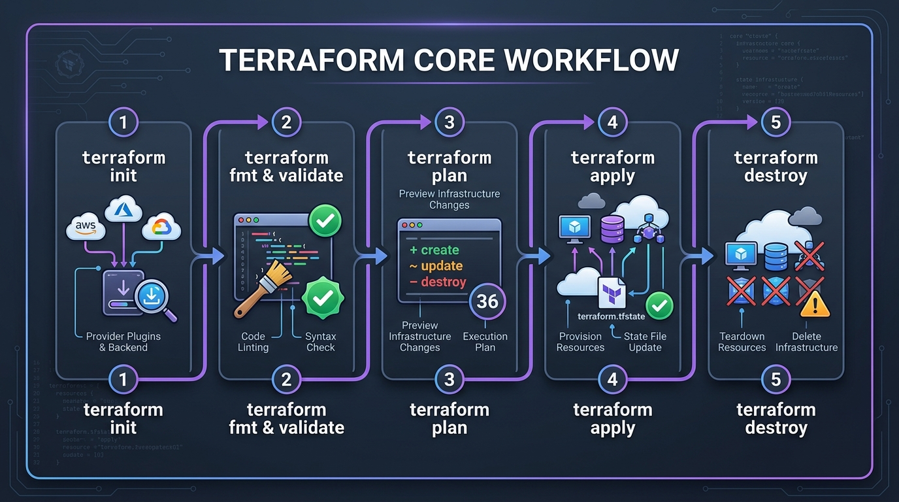
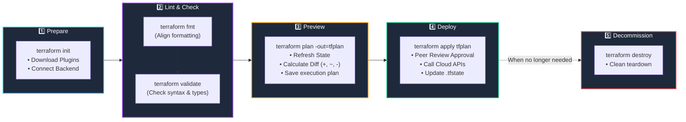

# 🔄 07. The Terraform Core Workflow & Execution Lifecycle

> *"Hey Ravi! 🌸 Today we practice the heartbeat of every professional DevOps engineer: the 6-step Terraform lifecycle loop!"* — **Mentor Rithu 👩‍🏫**

---

## 👫 Mentor & Student Check-In

- **Ravi 👨‍🎓:** *"Rithu, in my last project, I ran `terraform apply` directly without planning first. Is that dangerous?"*
- **Rithu 👩‍🏫:** *"Oh Ravi, running apply without checking the plan is like signing a house contract without reading the price tag! In production, one innocent typo could tear down the company's database. Today, I'm going to teach you the exact disciplined loop that protects you and your team every single day."*

---

## 🎯 What Ravi Will Learn Today

1. 🔁 **Execute the standard 6-step lifecycle** in the exact right order.
2. 🔍 **Read execution plans like a senior architect** (decoding `+`, `~`, `-`, and `- / +`).
3. 🤖 **Save plans (`-out=tfplan`)** for automated, race-condition-free CI/CD pipelines.
4. 🧹 **Tear down infrastructure safely** using `terraform destroy`.

---

## 📊 Visual Explanation





---

## 👶 Rithu Explains Like You Are a Beginner

### 📐 The House Blueprint Analogy
> *"Ravi, imagine hiring a contractor to build an extension on your house:"*
1. **`terraform init`:** The contractor unpacks their toolbox, measuring tapes, and safety gear.
2. **`terraform fmt & validate`:** The contractor inspects the blueprint for obvious errors (like drawing a window inside a solid brick chimney).
3. **`terraform plan`:** The contractor presents you with a **3D computer simulation**:
   - 🟢 *"We will build a new balcony here."* (`+`)
   - 🟡 *"We will repaint the living room walls."* (`~`)
   - 🔴 *"We must demolish the rickety old garden shed."* (`-`)
4. **`terraform apply`:** You sign the approval document, and the builders pick up their hammers to construct exactly what was in the simulation.
5. **`terraform destroy`:** The lease ends, and the teardown crew clears the lot cleanly.

---

## ⚡ The Essential 80/20 Concepts (Rithu's Focus Sheet)

| Command | What Rithu Wants Ravi to Know | When Ravi Must Run It |
|---|---|---|
| `terraform init` | Downloads provider binaries and initializes backends. | First command in any new project or when cloning from Git. |
| `terraform fmt` | Aligns all spacing and indentation automatically. | Before saving or pushing code to Git. |
| `terraform validate` | Checks syntax and internal consistency without connecting to cloud APIs. | Catches typos instantly with zero network latency. |
| `terraform plan` | Compares code against real cloud infrastructure and previews the diff. | Before EVERY change. Never skip! |
| `terraform apply` | Executes the changes and updates the state file. | Only after reviewing the plan diff! |
| `terraform destroy` | Deletes all resources managed by the current project. | When you are finished with practice to keep bills at $0.00. |

---

## 🤖 Rithu's Pro Pipeline Pattern: Saved Plans (`-out=tfplan`)

In real DevOps teams, humans don't log in and run `apply` from laptops. CI/CD pipelines (like GitHub Actions) do it:

```bash
# Step 1: In the Pull Request check:
terraform plan -out=tfplan

# Step 2: On Merge to main branch:
terraform apply tfplan
```

> 🔒 **Rithu explains why this is brilliant:** *"Ravi, if you save the plan to a file (`tfplan`), Terraform guarantees it will ONLY apply the exact actions that your team reviewed in the pull request! It prevents race conditions and eliminates unexpected surprises!"*

---

## 🧪 Hands-on Practice: The Full 6-Step Loop for Ravi

### 🎯 Objective
Run through the entire 6-step lifecycle from start to finish!

### 🚀 Steps for Ravi:

1. Create a lab folder:
   ```bash
   mkdir ravi-workflow-lab
   cd ravi-workflow-lab
   ```

2. Create an intentionally messy `main.tf`:
   ```hcl
   terraform{
   required_providers{
   local={
   source="hashicorp/local"
   version="~> 2.5"
   }}}

   resource "local_file" "demo"{
   filename="${path.module}/app-health.txt"
   content="System Status: Healthy 🟢 (Monitored by Ravi)"
   }
   ```

3. **Step 1: Init**
   ```bash
   terraform init
   ```

4. **Step 2: Auto-Format**
   ```bash
   terraform fmt
   ```
   *Look at `main.tf` now, Ravi! All the braces and equal signs snapped into clean columns!*

5. **Step 3: Validate**
   ```bash
   terraform validate
   ```
   *Expected: `Success! The configuration is valid.`*

6. **Step 4: Generate Saved Plan**
   ```bash
   terraform plan -out=tfplan
   ```

7. **Step 5: Apply Saved Plan**
   ```bash
   terraform apply tfplan
   ```

8. **Step 6: Destroy Cleanly**
   ```bash
   terraform destroy -auto-approve
   ```

---

## 💬 Ravi's Doubt Corner

### Ravi: *"Rithu, what does `(known after apply)` mean when I inspect a plan?"*
**Rithu:** *"That means the attribute cannot be known until AWS actually creates the resource! For example, AWS doesn't generate your EC2 public IP address or your RDS endpoint until the server actually spins up in the data center. So Terraform tells you: '(known after apply)'."*

---

## ⚡ Quick Revision with Rithu

- 📌 **Order of Operations:** `init` $\rightarrow$ `fmt` $\rightarrow$ `validate` $\rightarrow$ `plan` $\rightarrow$ `apply` $\rightarrow$ `destroy`
- 📌 **Plan Symbols:** `+` Create, `~` Modify, `-` Delete, `-/+` Destroy & Recreate
- 📌 **CI/CD Best Practice:** `terraform plan -out=tfplan` followed by `terraform apply tfplan`

> [!TIP]
> **Rithu's Note to Ravi:** *"You've got the muscle memory down, Ravi! In Chapter 8, we tackle State Management—the most important secret of Terraform!"* 🗄️✨
