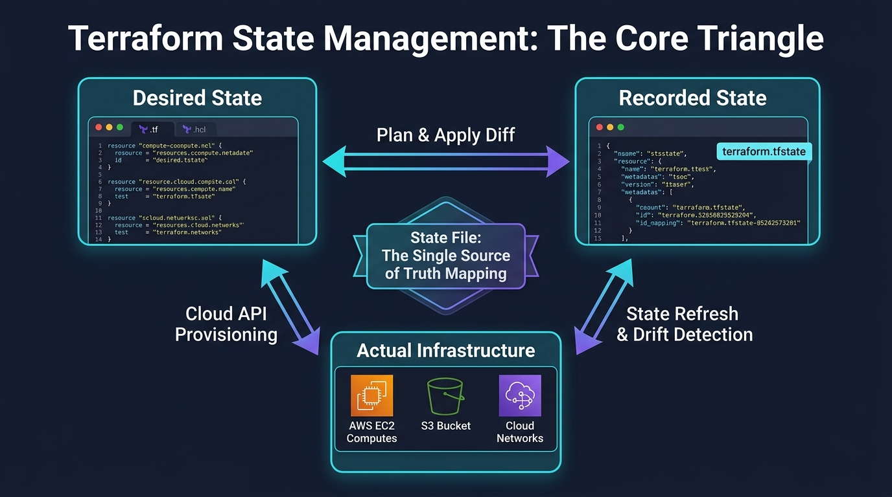
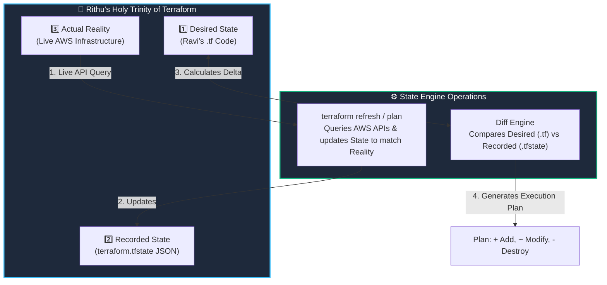

# 🗄️ 08. Terraform State Management & Drift Detection

> *"Hey Ravi! 🌸 Today we tackle the single most important concept in Terraform: State! If you understand state, you understand 80% of how senior DevOps engineers troubleshoot infrastructure!"* — **Mentor Rithu 👩‍🏫**

---

## 👫 Mentor & Student Check-In

- **Ravi 👨‍🎓:** *"Rithu, what actually happens if someone goes into the AWS Console and deletes a subnet or resizes a server without telling Terraform?"*
- **Rithu 👩‍🏫:** *"That, Ravi, is what we call **State Drift**! And it happens in real companies all the time. Today, I'm going to show you the 'Holy Trinity' of Terraform (Code, State, and Reality) and how Terraform catches drift automatically and restores order!"*

---

## 🎯 What Ravi Will Learn Today

1. 📐 **Understand the Holy Trinity**: Desired Code (`.tf`), Recorded State (`.tfstate`), and Cloud Reality.
2. 🔍 **Inspect state records** using `terraform state list` and `terraform state show`.
3. 🌪️ **Detect and heal State Drift** caused by manual clicks in cloud consoles.
4. ✂️ **Refactor resources safely** without downtime using `terraform state mv` and `state rm`.

---

## 📊 Visual Explanation





---

## 👶 Rithu Explains Like You Are a Beginner

### 🏷️ The Coat Check Ticket Analogy
> *"Ravi, imagine attending a wedding banquet and checking your winter jacket into the coat check room:"*
- The attendant hangs your jacket on Rack #42 and hands you **Claim Ticket #42**.
- **Ticket #42 is your Terraform State file.** The ticket doesn't keep you warm, but it maps the abstract number `42` directly to your physical jacket.
- When you return, you hand over Ticket #42. The attendant looks at the rack, finds jacket #42, and returns it to you.

Now imagine if someone sneaks in and swaps jackets on Rack #42 without telling the attendant (**State Drift**)! 
When the attendant inspects Rack #42, they notice: *"Wait! This jacket isn't what my ledger says!"*

> *"In Terraform, Ravi, **`terraform.tfstate` is your claim ticket ledger.** It maps the resource in your code (`resource "aws_instance" "web"`) to the physical ID generated by AWS (`i-08a91b2c3d4e5f670`)."*

---

## ⚡ The Essential 80/20 Concepts (Rithu's Focus Sheet)

| Concept | What Rithu Wants Ravi to Know | Practical DevOps Importance |
|---|---|---|
| **`terraform.tfstate`** | A JSON file recording IDs, metadata, and dependencies of managed resources. | The single source of truth mapping your code to cloud reality. |
| **Resource Address** | The address of a resource in state (`aws_instance.web`, `module.vpc.subnet[0]`). | Used to inspect, target, or move specific resources. |
| **State Drift** | Discrepancy between code and real cloud assets caused by manual changes. | Terraform detects drift during `plan` and attempts to heal it. |
| **`terraform state list`** | Lists all resource addresses currently tracked in the state file. | Quickest way to check what Terraform manages in a folder. |
| **`terraform state show`** | Displays all metadata and cloud attributes of a specific resource. | Lets you view private IPs, subnets, and ARNs without opening the AWS Console! |

---

## 🌪️ How Terraform Heals State Drift (Rithu's Scenario)

1. You create an AWS EC2 instance with `instance_type = "t3.micro"` using Terraform.
2. At 2:00 AM, a junior engineer logs into the AWS Web Console and manually resizes it to `t3.medium`.
3. The next morning, you run `terraform plan`.
4. **Terraform Refreshes:** Terraform queries AWS: *"Hey AWS, what size is instance `i-12345`?"*
5. AWS replies: *"It's `t3.medium`."*
6. Terraform compares this with your code (`t3.micro`) and reports:
   ```text
   ~ resource "aws_instance" "web" {
       ~ instance_type = "t3.medium" -> "t3.micro"
     }
   Plan: 0 to add, 1 to change, 0 to destroy.
   ```
7. When you run `terraform apply`, Terraform automatically reverts the manual console change and restores the server back to `t3.micro`!

---

## 🛠️ Essential State Commands for Ravi

| Command | Action | Example |
|---|---|---|
| `terraform state list` | Lists all resources tracked in state. | `terraform state list` |
| `terraform state show` | Displays all attributes of one resource. | `terraform state show aws_instance.web` |
| `terraform state mv` | Renames a resource in state without destroying it. | `terraform state mv aws_instance.old aws_instance.new` |
| `terraform state rm` | Stops tracking a resource without deleting it from the cloud! | `terraform state rm aws_instance.legacy` |

---

## 🧪 Hands-on Practice: Ravi's State Inspection Lab

### 🎯 Objective
Use `state list`, `state show`, and `state rm` to inspect and safely untrack resources.

### 🚀 Steps for Ravi:

1. Create a practice folder:
   ```bash
   mkdir ravi-state-lab
   cd ravi-state-lab
   ```

2. Create `main.tf`:
   ```hcl
   terraform {
     required_providers {
       local = {
         source  = "hashicorp/local"
         version = "~> 2.5"
       }
     }
   }

   resource "local_file" "server_a" {
     filename = "${path.module}/server-a.txt"
     content  = "Server A configuration"
   }

   resource "local_file" "server_b" {
     filename = "${path.module}/server-b.txt"
     content  = "Server B configuration"
   }
   ```

3. Initialize and apply:
   ```bash
   terraform init
   terraform apply -auto-approve
   ```

4. **Inspect State:**
   ```bash
   terraform state list
   ```
   *Expected:*
   ```text
   local_file.server_a
   local_file.server_b
   ```

5. **Show Attributes of Server A:**
   ```bash
   terraform state show local_file.server_a
   ```

6. **Untrack Server B without deleting it:**
   ```bash
   terraform state rm local_file.server_b
   ```
   *Notice:* The physical file `server-b.txt` is still right on your disk, but Terraform has forgotten about it!

### 🧹 Cleanup:
```bash
terraform destroy -auto-approve
rm -f server-b.txt
```

---

## 💬 Ravi's Doubt Corner

### Ravi: *"Rithu, can I just open `terraform.tfstate` in VS Code and edit the JSON manually?"*
**Rithu:** *"NO, Ravi! Never ever edit `.tfstate` by hand! A single missing comma or bracket corrupts the state file, and Terraform will lock you out with syntax errors. Always use `terraform state mv` or the `moved` block in HCL!"*

---

## ⚡ Quick Revision with Rithu

- 📌 **State File:** Maps code to physical cloud IDs.
- 📌 **Drift:** When reality deviates from code; Terraform heals it during apply.
- 📌 **List State:** `terraform state list`
- 📌 **Inspect Resource:** `terraform state show <RESOURCE>`
- 📌 **Golden Rule:** Never edit `terraform.tfstate` directly in a text editor!

> [!TIP]
> **Rithu's Note to Ravi:** *"You've unlocked one of the biggest secrets in DevOps, Ravi! In Chapter 9, let's explore Data Sources and see how to read pre-existing cloud assets dynamically!"* 🔍✨
