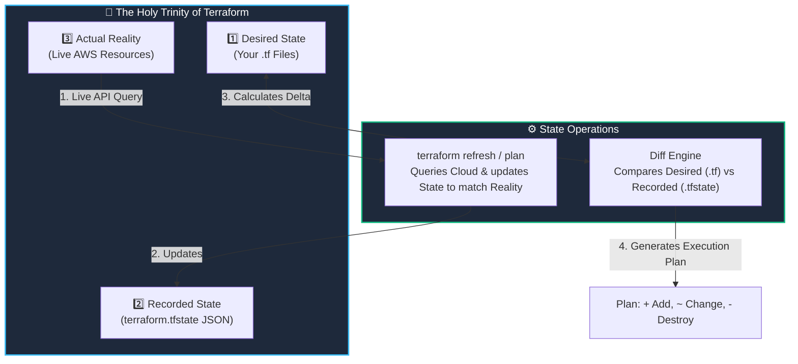

# 🗄️ 08. Terraform State Management & Drift Detection

> *"Terraform State is the single source of truth that binds your human-readable HCL code to real-world cloud APIs!"* 🧭💾

If there is one concept in Terraform that separates junior dabblers from seasoned DevOps engineers, it is **State Management**. Without state, Terraform is blind. It wouldn't know whether a server in AWS was created by you 5 minutes ago or belongs to your company's production payroll system. In this chapter, we unpack how state works, how to inspect it, and how to conquer state drift.

---

## 🎯 Learning Objectives

By the end of this topic, you will be able to:
1. 📐 **Understand the Holy Trinity of Terraform**: Code, State, and Real Infrastructure.
2. 🔍 **Inspect state records** using `terraform state list` and `terraform state show`.
3. 🌪️ **Detect and reconcile State Drift** caused by manual changes in cloud consoles.
4. ✂️ **Refactor and manage state safely** without destroying live production servers (`state mv`, `state rm`).

---

## 📊 Visual Explanation




---

## 👶 Explain Like I Am a Beginner

### 🏷️ The Coat Check Room Analogy
Imagine attending a grand gala and checking your winter coat into the coat check room:
- The attendant hangs your black wool coat on Rack #42 and hands you **Claim Ticket #42**.
- **Ticket #42 is your Terraform State file.** It doesn't keep you warm, but it maps the abstract number `42` directly to your physical coat.
- At the end of the night, you hand over Ticket #42. The attendant looks up the number, walks to Rack #42, and retrieves your coat.

Now imagine if you lose your ticket, or someone swaps coats on Rack #42 without updating the ledger (**State Drift**)! The attendant has no idea whose coat is whose. 

**The State File (`terraform.tfstate`) is Terraform's ticket ledger.** It maps the resource in your code (`resource "aws_instance" "web"`) to the physical ID generated by AWS (`i-08a91b2c3d4e5f670`).

---

## ⚡ The Essential 80/20 Concepts

| Concept | Simple Explanation | Practical Importance |
|---|---|---|
| **`terraform.tfstate`** | A JSON document recording metadata, resource IDs, and attributes of managed infrastructure. | Acts as the single source of truth mapping your code to cloud IDs. |
| **Resource Address** | The unique identifier of a resource in state (`aws_instance.web`, `module.vpc.aws_subnet.public[0]`). | Used to target, inspect, or move individual resources. |
| **State Drift** | Discrepancy when someone manually changes or deletes cloud resources outside of Terraform. | Terraform automatically detects drift during `plan` and attempts to restore desired state. |
| **`terraform state list`** | Prints all resource addresses currently tracked in the state file. | Quickest way to check what Terraform is managing in a directory. |
| **`terraform state show`** | Prints all metadata and cloud attributes for a specific resource address. | Allows you to view private IPs, subnets, and ARNs without logging into the cloud console. |

---

## 🔬 Inside a `.tfstate` File: What Does It Look Like?

When you open `terraform.tfstate`, you find structured JSON:

```json
{
  "version": 4,
  "terraform_version": "1.8.2",
  "serial": 12,
  "lineage": "e4587a12-8874-4b52-9f33-1b98a3c8e7f1",
  "resources": [
    {
      "mode": "managed",
      "type": "aws_instance",
      "name": "web",
      "provider": "provider[\"registry.terraform.io/hashicorp/aws\"]",
      "instances": [
        {
          "schema_version": 1,
          "attributes": {
            "ami": "ami-0c55b159cbfafe1f0",
            "arn": "arn:aws:ec2:us-east-1:123456789012:instance/i-0a1b2c3d4e5f",
            "id": "i-0a1b2c3d4e5f",
            "instance_type": "t3.micro",
            "public_ip": "54.210.45.12"
          }
        }
      ]
    }
  ]
}
```

> [!CAUTION]
> **Warning:** Notice that all attributes are plain text! If you create a database with a password, that password is saved **in plain text** inside this JSON file. Never commit `.tfstate` to Git!

---

## 🌪️ What is State Drift and How is It Fixed?

### Scenario:
1. You deploy an AWS EC2 instance with `instance_type = "t3.micro"` using Terraform.
2. At 2:00 AM, a junior engineer logs into the AWS Web Console and manually resizes the instance to `t3.medium`.
3. The next morning, you run `terraform plan`.

### What Terraform Does:
1. **Refresh Phase:** Terraform calls the AWS API: *"Hey AWS, what size is instance `i-0a1b2c3d4e5f` right now?"*
2. AWS replies: *"It's `t3.medium`."*
3. Terraform compares this with your code (`t3.micro`).
4. Terraform reports **Drift Detected**:
   ```text
   ~ resource "aws_instance" "web" {
       ~ instance_type = "t3.medium" -> "t3.micro"
     }
   Plan: 0 to add, 1 to change, 0 to destroy.
   ```
5. When you run `terraform apply`, Terraform overwrites the manual console change and restores the server back to `t3.micro`!

---

## 🛠️ Essential State Management Commands

| Command | Action | Example |
|---|---|---|
| `terraform state list` | Lists all resource addresses in state. | `terraform state list` |
| `terraform state show` | Displays all attributes of one resource. | `terraform state show aws_instance.web` |
| `terraform state mv` | Renames or moves a resource in state without destroying it. | `terraform state mv aws_instance.web aws_instance.primary` |
| `terraform state rm` | Stops tracking a resource in Terraform without deleting it from the cloud. | `terraform state rm aws_instance.legacy_server` |

---

## 🧪 Hands-on Practice: State Inspection Lab

### 🎯 Objective
Use state CLI commands to inspect, query, and safely remove resources from state.

### 📋 Prerequisites
Terraform CLI installed.

### 🚀 Steps to Follow:

1. Create a lab directory:
   ```bash
   mkdir state-management-lab
   cd state-management-lab
   ```

2. Create `main.tf`:
   ```hcl
   terraform {
     required_providers {
       local = {
         source  = "hashicorp/local"
         version = "~> 2.5"
       }
     }
   }

   resource "local_file" "alpha" {
     filename = "${path.module}/alpha.txt"
     content  = "Resource Alpha Data"
   }

   resource "local_file" "beta" {
     filename = "${path.module}/beta.txt"
     content  = "Resource Beta Data"
   }
   ```

3. Initialize and apply:
   ```bash
   terraform init
   terraform apply -auto-approve
   ```

4. **Inspect State List:**
   ```bash
   terraform state list
   ```
   *Output:*
   ```text
   local_file.alpha
   local_file.beta
   ```

5. **Show Attributes of Resource Alpha:**
   ```bash
   terraform state show local_file.alpha
   ```

6. **Untrack Resource Beta without deleting the file:**
   ```bash
   terraform state rm local_file.beta
   ```
   *Notice:* The physical file `beta.txt` still exists on your disk, but Terraform has forgotten about it!

7. Remove `resource "local_file" "beta"` from `main.tf`, then run:
   ```bash
   terraform plan
   ```
   *Result:* No changes needed! Terraform cleanly untracked the resource without attempting to destroy it.

### 🧹 Cleanup Instructions:
```bash
terraform destroy -auto-approve
rm -f beta.txt
```

---

## ⚠️ Common Beginner Mistakes

### 1. Manually Editing `terraform.tfstate` in a Text Editor
- **What it looks like:** Opening the `.tfstate` file in VS Code, editing JSON lines, and saving.
- **Why it happens:** Trying to fix a typo or rename a resource quickly.
- **The Disaster:** A single missing bracket or mismatched `serial` number corrupts the entire state file. Terraform will refuse to run any future commands!
- **The Fix:** Never edit `.tfstate` by hand. Always use `terraform state mv` or the `moved` block in HCL!

### 2. Committing `.tfstate` to Public Git Repositories
- **What it looks like:** Seeing `terraform.tfstate` appear on GitHub.
- **Why it happens:** Missing `.gitignore` configuration.
- **The Fix:** Add `*.tfstate` and `*.tfstate.*` to `.gitignore`. In team environments, always use **Remote State (S3 + DynamoDB)** (covered in Chapter 13).

### 3. Deleting the `.tfstate` File Manually
- **What it looks like:** Deleting `terraform.tfstate` from your folder because you wanted to "start fresh".
- **The Result:** The physical cloud resources are still running in AWS, costing money every hour! Terraform now has zero record of them and will create duplicate resources or fail with "Resource already exists" errors!

---

## 💼 Interview Revision Questions

### Q1: What does Terraform State do, and why is it needed?
**Answer:** Terraform state maps configuration code to real-world cloud resources, tracks metadata (such as dependencies between resources), caches resource attributes for fast execution plan generation, and serves as the single source of truth for detecting state drift.

### Q2: What is State Drift, and how does Terraform reconcile it?
**Answer:** State drift occurs when resources managed by Terraform are modified out-of-band (e.g. through cloud web consoles or CLI). During `terraform plan` or `terraform apply`, Terraform refreshes its state by querying cloud APIs. If drift is detected, Terraform's plan shows changes required to restore real infrastructure back to the state declared in code.

### Q3: What is the difference between `terraform destroy` and `terraform state rm`?
**Answer:** `terraform destroy` issues API calls to the cloud provider to terminate and permanently delete physical cloud resources. `terraform state rm` only removes the resource record from the Terraform state file—the actual physical cloud resource continues to run untouched in the cloud.

---

## ⚡ Quick Revision & Cheat Sheet

- 📌 **Inspect Tracked Resources:** `terraform state list`
- 📌 **View Resource Details:** `terraform state show <RESOURCE_ADDRESS>`
- 📌 **Rename in State:** `terraform state mv <OLD> <NEW>`
- 📌 **Untrack Without Deleting:** `terraform state rm <RESOURCE_ADDRESS>`
- 📌 **Golden Rule:** Never edit JSON state files directly with a text editor!

> [!IMPORTANT]
> **Remember This:** Terraform state can contain sensitive values in plain text. Always add `*.tfstate` to `.gitignore` and use encrypted remote backends for team collaboration!
