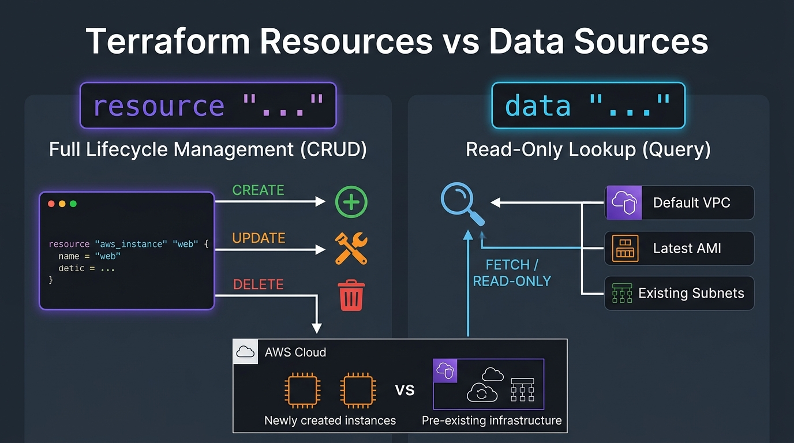

# 🔍 09. Terraform Data Sources: Querying Existing Cloud Infrastructure

> *"Hey Ravi! 🌸 In real DevOps jobs, you rarely build infrastructure in an empty void. You often need to plug your servers into a VPC built by the networking team, or fetch the newest official Ubuntu AMI. That's what Data Sources are for!"* — **Mentor Rithu 👩‍🏫**

---

## 👫 Mentor & Student Check-In

- **Ravi 👨‍🎓:** *"Rithu, I keep seeing tutorials where people hardcode `ami = "ami-0c55b159..."` directly in their code. Is that bad practice?"*
- **Rithu 👩‍🏫:** *"It is a terrible anti-pattern in production, Ravi! That AMI ID only exists in one specific AWS region, and in 3 months it will be outdated and unpatched. Today, I'm going to teach you how to write self-healing code that asks AWS for the newest official AMI dynamically every time!"*

---

## 🎯 What Ravi Will Learn Today

1. 📖 **Distinguish Data Sources (`data`) from Resources (`resource`)** with total confidence.
2. 🔎 **Execute read-only queries** against AWS (VPCs, Subnets, AMIs, IAM identities).
3. 🚫 **Eliminate brittle hardcoded IDs** from your code forever.
4. 🛡️ **Understand why Data Sources are immune** to `terraform destroy`.

---

## 📊 Visual Explanation



```mermaid
flowchart LR
    subgraph RaviCode ["💻 Ravi's Terraform Code"]
        DATA_BLOCK["📖 data 'aws_vpc' 'existing' {\n  default = true\n}"]
        RES_BLOCK["🏗️ resource 'aws_subnet' 'new_subnet' {\n  vpc_id = data.aws_vpc.existing.id\n  cidr_block = '172.31.96.0/20'\n}"]
    end

    subgraph AWSCloud ["☁️ AWS Cloud Environment"]
        EXISTING_VPC["🌐 Pre-existing Default VPC\n(Created outside of this project)"]
        NEW_SUBNET["✨ Brand New Subnet\n(Provisioned by Ravi)"]
    end

    DATA_BLOCK -->|1. Read-Only Query (GET API)| EXISTING_VPC
    EXISTING_VPC -.->|2. Returns vpc_id: vpc-12345| DATA_BLOCK
    DATA_BLOCK -->|3. Feeds ID into| RES_BLOCK
    RES_BLOCK -->|4. Provisions via POST API| NEW_SUBNET

    style RaviCode fill:#1e293b,stroke:#38bdf8,stroke-width:2px,color:#fff
    style AWSCloud fill:#1e293b,stroke:#ff9900,stroke-width:2px,color:#fff
```

---

## 👶 Rithu Explains Like You Are a Beginner

### 📚 The Library Book Analogy
> *"Ravi, think of the difference between buying a personal notebook and reading an encyclopedia at a public library:"*
- **`resource` (Buying a personal notebook):** You buy it, you own it, you write inside it, and when you're done, you can throw it in the trash (`terraform destroy`).
- **`data` (Reading a library encyclopedia):** You walk up to the bookshelf, open the volume, look up a piece of information (e.g. *What is the capital of Japan?*), jot down "Tokyo" in your notepad, and place the encyclopedia back on the shelf. **You do NOT own the library book, and you cannot tear its pages or throw it in the trash!**

In Terraform, Ravi:
- A `resource` is created, modified, and deleted by Terraform.
- A `data` source is **strictly read-only**. Terraform inspects it, reads its attributes, and uses them in your configuration. Running `terraform destroy` will **never** delete a data source!

---

## ⚡ The Essential 80/20 Concepts (Rithu's Focus Sheet)

| Concept | What Rithu Wants Ravi to Know | Practical Importance |
|---|---|---|
| **Data Block (`data`)** | A read-only query fetching existing cloud metadata. | Lets you reference shared corporate infrastructure without re-creating it. |
| **Data Reference** | `data.<TYPE>.<NAME>.<ATTRIBUTE>` (Notice the `data.` prefix!). | Injects fetched information into downstream resource blocks. |
| **Search Filter** | Criteria used to find specific cloud objects (e.g. `most_recent = true`). | Dynamically retrieves the latest OS image or correct subnet. |
| **Destroy Immunity** | Data sources cannot be deleted by `terraform destroy`. | Eliminates the fear of accidentally deleting shared production networks. |

---

## 💻 Rithu's Dynamic AMI Lookup in Action

Look at how elegant this is, Ravi! No hardcoded AMI IDs:

```hcl
# 1. Ask AWS for the newest official Ubuntu 22.04 AMI
data "aws_ami" "ubuntu" {
  most_recent = true
  owners      = ["099720109477"] # Canonical's official AWS ID

  filter {
    name   = "name"
    values = ["ubuntu/images/hvm-ssd/ubuntu-jammy-22.04-amd64-server-*"]
  }
}

# 2. Query the existing Default VPC
data "aws_vpc" "default" {
  default = true
}

# 3. Deploy an EC2 instance that works in ANY AWS region!
resource "aws_instance" "web" {
  ami           = data.aws_ami.ubuntu.id       # 👈 Dynamic AMI ID!
  instance_type = "t3.micro"

  tags = {
    Name  = "Ravi-Ubuntu-Server"
    Owner = "Ravi"
  }
}
```

---

## 🧪 Hands-on Practice: Ravi's Local Data Source Lab

### 🎯 Objective
Use a `data` source to read an existing system file and incorporate its contents into a newly created file.

### 🚀 Steps for Ravi:

1. Create a practice folder:
   ```bash
   mkdir ravi-data-lab
   cd ravi-data-lab
   ```

2. Create an external file (simulating pre-existing corporate infrastructure):
   ```bash
   echo "CORP-SEC-POLICY-2026" > policy.txt
   ```

3. Create `main.tf`:
   ```hcl
   terraform {
     required_providers {
       local = {
         source  = "hashicorp/local"
         version = "~> 2.5"
       }
     }
   }

   # Read the existing file (read-only query)
   data "local_file" "security_policy" {
     filename = "${path.module}/policy.txt"
   }

   # Create a new resource incorporating the data
   resource "local_file" "application_manifest" {
     filename = "${path.module}/app-manifest.txt"
     content  = <<-EOT
       === APPLICATION MANIFEST ===
       Owner:            Ravi (Mentor: Rithu)
       Inherited Policy: ${data.local_file.security_policy.content}
       Created On:       ${timestamp()}
     EOT
   }

   output "fetched_policy" {
     value = data.local_file.security_policy.content
   }
   ```

4. Initialize and apply:
   ```bash
   terraform init
   terraform apply -auto-approve
   ```

### 🔎 Expected Result:
Inspect `app-manifest.txt`:
```bash
cat app-manifest.txt
```

### 🧹 Cleanup:
```bash
terraform destroy -auto-approve
```
*Notice: `app-manifest.txt` is destroyed, but your original `policy.txt` remains completely untouched!*

---

## 💬 Ravi's Doubt Corner

### Ravi: *"Rithu, why did Terraform give me an error when I typed `vpc_id = aws_vpc.default.id`?"*
**Rithu:** *"Look closely, Ravi! You forgot the `data.` prefix! When referencing a resource, you write `<TYPE>.<NAME>.<ATTR>`. But when referencing a data source, you MUST write `data.<TYPE>.<NAME>.<ATTR>` so Terraform knows you are reading from a query!"*

---

## ⚡ Quick Revision with Rithu

- 📌 **Syntax:** `data "<TYPE>" "<NAME>" { ... }`
- 📌 **Reference:** `data.<TYPE>.<NAME>.<ATTRIBUTE>`
- 📌 **Safety:** Completely safe from `terraform destroy`!
- 📌 **Dynamic AMIs:** Use `data "aws_ami"` with `most_recent = true`

> [!TIP]
> **Rithu's Note to Ravi:** *"You're doing fantastic, Ravi! Next up in Chapter 10, we'll teach Terraform how to think with Conditionals, Functions, and Expressions!"* 🧠✨
