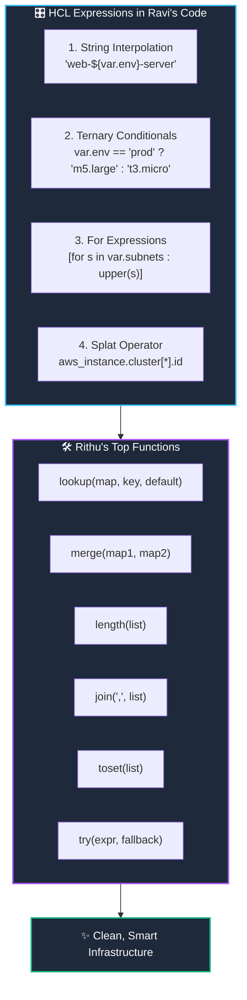

# 🧠 10. Terraform Expressions, Conditionals & Built-in Functions

> *"Hey Ravi! 🌸 Today we give your Terraform code a brain! We'll teach it how to make smart decisions using conditionals and transform data using built-in functions!"* — **Mentor Rithu 👩‍🏫**

---

## 👫 Mentor & Student Check-In

- **Ravi 👨‍🎓:** *"Rithu, can Terraform make decisions like 'If environment is production, create 5 servers, otherwise create 1'? Or do I need to write Python scripts for that?"*
- **Rithu 👩‍🏫:** *"Terraform can do that right inside HCL, Ravi! It has ternary conditional operators and built-in functions like `lookup`, `merge`, and `join`. Let me show you how to write smart infrastructure logic!"*

---

## 🎯 What Ravi Will Learn Today

1. 🔀 **Write ternary conditional expressions** (`condition ? true_val : false_val`) to make dynamic decisions.
2. 🔄 **Transform lists using `for` expressions** and extract attributes with the **Splat operator (`[*]`)**.
3. 🛠️ **Apply Rithu's top 6 built-in functions** (`lookup`, `merge`, `length`, `join`, `toset`, `try`).
4. 💻 **Experiment live** using the interactive `terraform console` terminal REPL.

---

## 📊 Visual Explanation




---

## 👶 Rithu Explains Like You Are a Beginner

### 🧮 The Excel Formula Analogy
> *"Ravi, think of Terraform expressions like Excel formulas:"*
- In an Excel spreadsheet, you don't write an entire C++ software application just to calculate a total.
- You type `=IF(A1="Prod", 5, 1)` or `=UPPER(B1)` or `=SUM(C1:C10)`.

In Terraform, Ravi:
- **Ternary Operator:** `var.is_prod ? "m5.large" : "t3.micro"` $\rightarrow$ Evaluates to `m5.large` if true, `t3.micro` if false.
- **Lookup Function:** Safely looks up an AMI in a map, with a safe fallback if missing.
- **Merge Function:** Combines corporate default tags with Ravi's project tags!

---

## 🛠️ Rithu's Top 6 Built-in Functions for Ravi

### 1. `lookup(map, key, default)`
Looks up a key in a map without crashing if the key doesn't exist:
```hcl
locals {
  instance_sizes = {
    dev  = "t3.micro"
    prod = "m5.large"
  }
}

# If var.environment is "staging", falls back to "t3.small"!
instance_type = lookup(locals.instance_sizes, var.environment, "t3.small")
```

### 2. `merge(map1, map2)`
Combines two maps into one (perfect for tagging!):
```hcl
locals {
  corp_tags = { Company = "Acme", ManagedBy = "Terraform" }
  ravi_tags = { Owner = "Ravi", Mentor = "Rithu" }
}

tags = merge(locals.corp_tags, locals.ravi_tags)
```

### 3. `length(list)`
Counts the number of items:
```hcl
subnets = ["subnet-a", "subnet-b", "subnet-c"]
total   = length(locals.subnets) # Returns 3
```

### 4. `join(separator, list)`
Glues a list into a single string:
```hcl
ports = ["80", "443", "8080"]
list_str = join(", ", locals.ports) # Returns "80, 443, 8080"
```

### 5. `toset(list)`
Converts a list to a unique set (removes duplicates):
```hcl
raw_list   = ["us-east-1", "us-east-1", "us-west-2"]
unique_set = toset(locals.raw_list) # ["us-east-1", "us-west-2"]
```

### 6. `try(expression, fallback)`
Evaluates an expression; if it errors, returns the safe fallback:
```hcl
port = try(var.custom_config.port, 80)
```

---

## 💻 Ravi's Secret Weapon: `terraform console`

> *"Ravi, whenever you aren't sure what an expression evaluates to, don't run apply! Open `terraform console` in your terminal!"* — **Rithu**

```bash
$ terraform console
> max(10, 25, 8)
25
> upper("hello ravi")
"HELLO RAVI"
> 10 > 5 ? "production" : "development"
"production"
> exit
```

---

## 🧪 Hands-on Practice: Ravi's Expressions Lab

### 🎯 Objective
Use `merge`, `lookup`, and ternary conditionals in a local configuration.

### 🚀 Steps for Ravi:

1. Create a practice folder:
   ```bash
   mkdir ravi-expressions-lab
   cd ravi-expressions-lab
   ```

2. Create `main.tf`:
   ```hcl
   terraform {
     required_providers {
       local = {
         source  = "hashicorp/local"
         version = "~> 2.5"
       }
     }
   }

   variable "env" {
     type    = string
     default = "prod"
   }

   locals {
     cluster_sizes = {
       dev  = 1
       prod = 5
     }
     nodes = lookup(locals.cluster_sizes, var.env, 2)
     is_prod = var.env == "prod" ? true : false

     tags = merge(
       { ManagedBy = "Terraform" },
       { Owner = "Ravi", Mentor = "Rithu" }
     )
   }

   resource "local_file" "report" {
     filename = "${path.module}/env-report.json"
     content  = jsonencode({
       environment = var.env
       nodes       = locals.nodes
       high_avail  = locals.is_prod
       tags        = locals.tags
     })
   }

   output "summary" {
     value = locals.tags
   }
   ```

3. Run Terraform:
   ```bash
   terraform init
   terraform apply -auto-approve
   ```

### 🔎 Expected Result:
Inspect `env-report.json`:
```bash
cat env-report.json
```

### 🧹 Cleanup:
```bash
terraform destroy -auto-approve
```

---

## 💬 Ravi's Doubt Corner

### Ravi: *"Rithu, what is the Splat operator `[*]`?"*
**Rithu:** *"Great question, Ravi! When you create 3 EC2 servers using `count = 3`, getting all of their IDs normally requires writing a loop. But with the splat operator, you can just write: `aws_instance.web[*].id`! It automatically extracts a clean list of all 3 server IDs!"*

---

## ⚡ Quick Revision with Rithu

- 📌 **Ternary Logic:** `var.is_prod ? "m5.large" : "t3.micro"`
- 📌 **Merge Maps:** `merge(tags1, tags2)`
- 📌 **Safe Lookup:** `lookup(map, key, default)`
- 📌 **REPL Sandbox:** `terraform console`

> [!TIP]
> **Rithu's Note to Ravi:** *"You're writing smart code now, Ravi! In Chapter 11, we'll learn Meta-Arguments and how to control resource scaling and lifecycles!"* ⚙️✨
