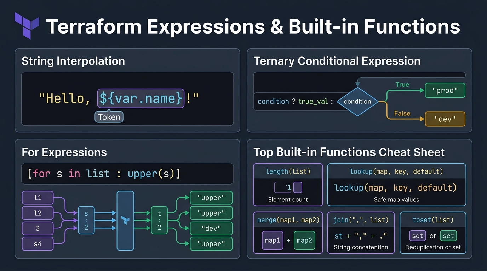
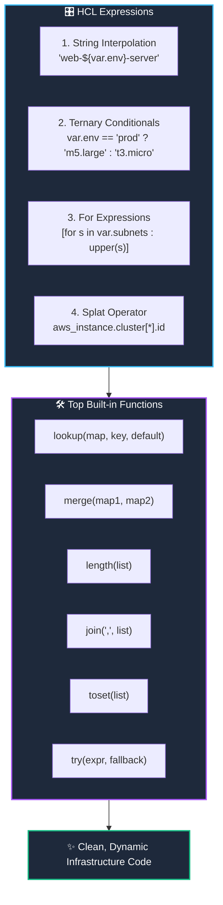

# 🧠 10. Terraform Expressions, Conditionals & Built-in Functions

> *"Supercharge your infrastructure logic: interpolate strings, make decisions with ternary conditionals, and transform data using built-in functions!"* ⚡🎛️

As your infrastructure grows, static values are no longer enough. You need logic: *"If the environment is production, deploy 5 instances, else deploy 1."* or *"Take this list of subnet names and uppercase them."* Terraform provides powerful expressions and a rich library of built-in functions to make your configurations smart and adaptable.

---

## 🎯 Learning Objectives

By the end of this topic, you will be able to:
1. 🔀 **Write ternary conditional expressions** (`condition ? true_val : false_val`) to make dynamic decisions.
2. 🔄 **Transform collections using `for` expressions** and extract lists with the **Splat operator (`[*]`)**.
3. 🛠️ **Apply the top 6 built-in functions** used in everyday DevOps (`length`, `lookup`, `merge`, `join`, `toset`, `try`).
4. 💻 **Test expressions live in your terminal** using the interactive `terraform console`.

---

## 📊 Visual Explanation





---

## 👶 Explain Like I Am a Beginner

### 🧮 The Excel Formula Analogy
Think of Terraform expressions like Excel formulas:
- In an Excel cell, you don't just type raw numbers. You type `=IF(A1="Prod", "Large", "Small")` or `=CONCATENATE("Server-", B1)` or `=UPPER(C1)`.
- The spreadsheet doesn't require you to write a complex Python program; it gives you handy **functions** right inside the cells.

In Terraform:
- **Ternary conditional:** `var.is_prod ? 3 : 1` $\rightarrow$ Evaluates to `3` if true, `1` if false.
- **Lookup function:** Look up an AMI in a map, but provide a safe default if the key is missing.
- **Merge function:** Combine your corporate default tags with project-specific tags.

---

## ⚡ The Essential 80/20 Concepts

| Concept | Syntax Example | When to Use in DevOps |
|---|---|---|
| **String Interpolation** | `"app-${var.env}-api"` | Dynamically naming servers, buckets, and roles with environment prefixes. |
| **Ternary Operator** | `var.env == "prod" ? 3 : 1` | Sizing clusters or enabling features (like multi-AZ) only in production. |
| **Splat Operator (`[*]`)** | `aws_instance.web[*].id` | Extracting a clean list of IDs from multiple instances created with `count`. |
| **`for` Expression** | `[for s in list : upper(s)]` | Iterating over and transforming lists or maps into new structures. |
| **`terraform console`** | `terraform console` in terminal | Interactive REPL prompt to experiment with functions and expressions safely. |

---

## 🔀 1. Conditional Expressions (Ternary)

Syntax:
`CONDITION ? TRUE_VALUE : FALSE_VALUE`

### Practical DevOps Examples:
```hcl
variable "environment" {
  type    = string
  default = "dev"
}

# 1. Dynamic Instance Sizing
resource "aws_instance" "app" {
  ami           = "ami-0c55b159cbfafe1f0"
  instance_type = var.environment == "prod" ? "m5.large" : "t3.micro"
}

# 2. Toggle Feature Flags (e.g., Enable CloudWatch Detailed Monitoring)
resource "aws_instance" "monitoring_demo" {
  ami           = "ami-0c55b159cbfafe1f0"
  instance_type = "t3.micro"
  monitoring    = var.environment == "prod" ? true : false
}
```

---

## 🛠️ 2. The Top 6 Built-in Functions You Must Know

Terraform has dozens of functions, but these 6 do **80% of real work**:

### 1. `lookup(map, key, default)`
Safely looks up a key in a map without crashing if the key doesn't exist:
```hcl
locals {
  instance_sizes = {
    dev  = "t3.micro"
    prod = "m5.large"
  }
}

# If var.environment is "staging" (not in map), falls back to "t3.small"!
instance_type = lookup(locals.instance_sizes, var.environment, "t3.small")
```

### 2. `merge(map1, map2, ...)`
Combines multiple maps into one (perfect for combining mandatory company tags with team tags):
```hcl
locals {
  corporate_tags = {
    Company   = "AcmeCorp"
    ManagedBy = "Terraform"
  }

  app_tags = {
    AppOwner    = "DataTeam"
    CostCenter  = "1014"
  }
}

tags = merge(locals.corporate_tags, locals.app_tags)
```

### 3. `length(list_or_map)`
Counts the number of items:
```hcl
subnets = ["subnet-a", "subnet-b", "subnet-c"]
total   = length(locals.subnets) # Returns 3
```

### 4. `join(separator, list)`
Glues a list of strings into a single string separated by a delimiter:
```hcl
ports = ["80", "443", "8080"]
list_str = join(", ", locals.ports) # Returns "80, 443, 8080"
```

### 5. `toset(list)`
Converts a list to a unique set (removes duplicates and allows use in `for_each`):
```hcl
raw_regions = ["us-east-1", "us-east-1", "us-west-2"]
unique_set  = toset(locals.raw_regions) # ["us-east-1", "us-west-2"]
```

### 6. `try(expression, fallback)`
Evaluates an expression; if it raises an error (e.g. index out of bounds or null value), it returns the fallback without failing the apply:
```hcl
# Safely extracts port or falls back to 80
http_port = try(var.custom_settings.port, 80)
```

---

## 🔄 3. `for` Expressions & The Splat Operator

### `for` List Comprehension:
Transform a list of strings into uppercase:
```hcl
locals {
  environments = ["dev", "staging", "prod"]
  upper_envs   = [for env in locals.environments : upper(env)]
  # Result: ["DEV", "STAGING", "PROD"]
}
```

### Splat Operator (`[*]`):
When you create multiple servers with `count = 3`, extracting all of their private IPs is as easy as:
```hcl
# Instead of [aws_instance.cluster[0].id, aws_instance.cluster[1].id...]
output "all_instance_ids" {
  value = aws_instance.cluster[*].id
}
```

---

## 💻 The Ultimate Sandbox: `terraform console`

Don't deploy real cloud infrastructure just to test an expression! Terraform includes an interactive REPL called `terraform console`:

```bash
$ terraform console
> max(5, 12, 9)
12
> lower("DEVOPS-ENGINEER")
"devops-engineer"
> join("-", ["alpha", "beta", "gamma"])
"alpha-beta-gamma"
> 5 > 3 ? "yes" : "no"
"yes"
> exit
```

---

## 🧪 Hands-on Practice: Expressions & Functions Playground

### 🎯 Objective
Use `terraform console` and write a configuration demonstrating `merge`, `lookup`, ternary operators, and string interpolation.

### 📋 Prerequisites
Terraform CLI installed.

### 🚀 Steps to Follow:

1. Create a lab directory:
   ```bash
   mkdir expressions-lab
   cd expressions-lab
   ```

2. Create `main.tf`:
   ```hcl
   terraform {
     required_providers {
       local = {
         source  = "hashicorp/local"
         version = "~> 2.5"
       }
     }
   }

   variable "env" {
     type    = string
     default = "prod"
   }

   locals {
     # 1. Lookup with fallback
     cluster_sizes = {
       dev  = 1
       prod = 5
     }
     nodes = lookup(locals.cluster_sizes, var.env, 2)

     # 2. Ternary operator
     backup_enabled = var.env == "prod" ? true : false

     # 3. Merge maps
     base_tags = {
       ManagedBy = "Terraform"
     }
     env_tags = {
       Environment = upper(var.env)
     }
     final_tags = merge(locals.base_tags, locals.env_tags)
   }

   resource "local_file" "environment_report" {
     filename = "${path.module}/report.json"
     content  = jsonencode({
       environment     = var.env
       allocated_nodes = locals.nodes
       automated_backup = locals.backup_enabled
       metadata_tags   = locals.final_tags
     })
   }

   output "tags_summary" {
     value = locals.final_tags
   }
   ```

3. Initialize and apply:
   ```bash
   terraform init
   terraform apply -auto-approve
   ```

### 🔎 Expected Result:
Check `report.json`:
```bash
cat report.json
```
Notice how `allocated_nodes` is `5`, `automated_backup` is `true`, and tags are cleanly merged!

### 🧹 Cleanup Instructions:
```bash
terraform destroy -auto-approve
```

---

## ⚠️ Common Beginner Mistakes

### 1. Attempting to Define Custom Functions
- **What it looks like:** Trying to write `function calculate_cidr(...) { ... }` in HCL.
- **Why it happens:** Experience from Python or JavaScript.
- **The Reality:** Terraform **does not support user-defined functions** in standard HCL. You can only use HashiCorp's built-in functions.
- **The Fix:** Combine built-in functions using `locals { ... }` blocks.

### 2. Confusing `for` Expressions with `for_each`
- **What it looks like:** Trying to put `[for s in list : ...]` inside a resource header.
- **The Fix:**
  - `for` expressions transform data structures (e.g. producing a new list or map).
  - `for_each` is a **meta-argument** that instructs Terraform to duplicate a cloud resource multiple times.

### 3. Missing Fallback in `lookup()`
- **What it looks like:** Calling `lookup(map, "missing_key")` without a 3rd parameter.
- **Why it happens:** Expecting it to return `null`.
- **The Fix:** Always specify the default 3rd argument: `lookup(map, key, "default_value")`.

---

## 💼 Interview Revision Questions

### Q1: How does a ternary conditional expression work in HCL?
**Answer:** The syntax is `condition ? true_value : false_value`. If the condition evaluates to boolean `true`, the first value is returned; otherwise, the second value is returned. Both values must evaluate to compatible types.

### Q2: What is the Splat operator (`[*]`) and when is it useful?
**Answer:** The splat operator allows you to concisely extract a specific attribute from a list of complex objects or resources created with `count`. For example, `aws_instance.servers[*].public_ip` returns a list of all public IPs without requiring a manual `for` loop.

### Q3: What is the purpose of the `try()` function in Terraform?
**Answer:** The `try()` function evaluates a sequence of expressions and returns the result of the first one that does not produce an error. It is commonly used to access deeply nested data structures where certain keys may be absent without causing the configuration to fail.

---

## ⚡ Quick Revision & Cheat Sheet

- 📌 **Ternary Logic:** `var.is_prod ? "t3.large" : "t3.micro"`
- 📌 **Merge Maps:** `merge(tags1, tags2)`
- 📌 **Safe Lookup:** `lookup(map, key, default)`
- 📌 **Splat:** `aws_instance.nodes[*].id`
- 📌 **REPL Sandbox:** `terraform console`

> [!NOTE]
> **Remember This:** Whenever you are unsure how a function or expression behaves, open your terminal and run `terraform console`. It's the fastest way to verify HCL logic without waiting for API calls!
