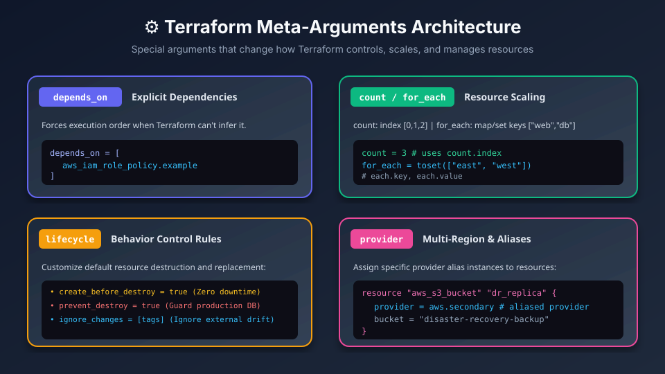
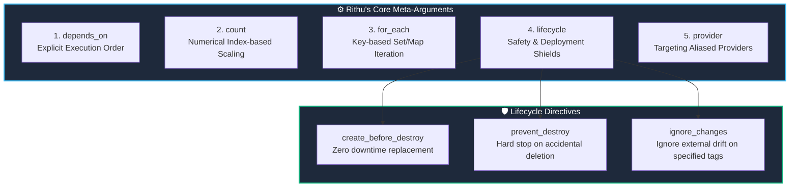

# ⚙️ 11. Terraform Meta-Arguments & Dependency Control

> *"Hey Ravi! 🌸 Today we unlock Terraform's superpowers: Meta-Arguments! We'll scale resources dynamically, safeguard databases from accidental deletion, and take absolute control of deployment orders!"* — **Mentor Rithu 👩‍🏫**

---

## 👫 Mentor & Student Check-In

- **Ravi 👨‍🎓:** *"Rithu, I used `count` to create 3 servers, but when I deleted the first server from my list, Terraform destroyed and recreated all the other servers too! Why did that happen?"*
- **Rithu 👩‍🏫:** *"Ah, Ravi! You just experienced the classic 'Index Shifting Trap' of `count`! Don't feel bad—almost every DevOps engineer stumbles into this at least once. Today, I'm going to teach you why `for_each` is your savior, and how to use `lifecycle` blocks to put a bulletproof shield around your production databases!"*

---

## 🎯 What Ravi Will Learn Today

1. ⛓️ **Enforce explicit dependencies** using `depends_on` when implicit references aren't enough.
2. 🔢 **Understand `count`** for simple number scaling and conditional toggles.
3. 🗺️ **Master `for_each`** and understand why it is far safer than `count` for collections.
4. 🛡️ **Apply `lifecycle` shields** (`prevent_destroy`, `create_before_destroy`, `ignore_changes`).

---

## 📊 Visual Explanation





---

## 👶 Rithu Explains Like You Are a Beginner

### 🚦 The Construction Site Foreman Analogy
> *"Ravi, imagine you are managing a major construction site:"*
- **`depends_on`:** You tell the electricians: *"Do NOT turn on the power to the building until the city safety inspector has signed the document."* Even if the wires don't touch the paperwork, you enforce an **explicit sequence**.
- **`count` (Numbered bricks):** You order 3 identical concrete blocks (`Block #0`, `Block #1`, `Block #2`).
- **`for_each` (Named components):** You label each component specifically: `"North-Wing"`, `"South-Wing"`, `"East-Wing"`. If the North wing changes, the other wings aren't affected!
- **`lifecycle` (Safety rules):**
  - `prevent_destroy`: *"Under no circumstances may anyone knock down the central foundation pillar!"*
  - `create_before_destroy`: *"Build the new highway bridge first, route cars onto it, and only then demolish the old bridge!"*

---

## ⚔️ Rithu Explains: Why `for_each` Beats `count`

### The Trap with `count`:
```hcl
variable "subnets" {
  default = ["subnet-alpha", "subnet-beta", "subnet-gamma"]
}

resource "aws_subnet" "example" {
  count      = length(var.subnets)
  cidr_block = "10.0.${count.index}.0/24"
}
```
Terraform tracks them by index:
- `[0]` $\rightarrow$ `subnet-alpha`
- `[1]` $\rightarrow$ `subnet-beta`
- `[2]` $\rightarrow$ `subnet-gamma`

💥 **The Trap:** If you remove `"subnet-alpha"`, index `0` becomes `subnet-beta`! Terraform **destroys and recreates** both remaining subnets!

### The Solution: Use `for_each`!
```hcl
variable "subnets" {
  type    = set(string)
  default = ["subnet-alpha", "subnet-beta", "subnet-gamma"]
}

resource "aws_subnet" "example" {
  for_each = var.subnets
  tags = {
    Name = each.key  # 👈 Addressed by key name!
  }
}
```
Now Terraform addresses them as `["subnet-alpha"]`, `["subnet-beta"]`, `["subnet-gamma"]`. If you remove one, only that single one is deleted!

---

## 🛡️ Rithu's `lifecycle` Safety Shields

### 1. `prevent_destroy = true` (Database Armor)
```hcl
resource "aws_db_instance" "production" {
  allocated_storage = 100
  engine            = "postgres"

  lifecycle {
    prevent_destroy = true # 👈 Terraform will refuse to destroy this!
  }
}
```

### 2. `create_before_destroy = true` (Zero Downtime)
```hcl
resource "aws_instance" "web" {
  ami           = "ami-new"
  instance_type = "t3.micro"

  lifecycle {
    create_before_destroy = true # 👈 Launches replacement BEFORE killing old server!
  }
}
```

---

## 🧪 Hands-on Practice: Ravi's Meta-Arguments Lab

### 🎯 Objective
Use `for_each` to create multiple files and protect them with `prevent_destroy`.

### 🚀 Steps for Ravi:

1. Create a practice folder:
   ```bash
   mkdir ravi-meta-lab
   cd ravi-meta-lab
   ```

2. Create `main.tf`:
   ```hcl
   terraform {
     required_providers {
       local = {
         source  = "hashicorp/local"
         version = "~> 2.5"
       }
     }
   }

   locals {
     servers = {
       web = "WEB TIER - Managed by Ravi"
       api = "API TIER - Managed by Ravi"
       db  = "DB TIER - Protected by Rithu"
     }
   }

   resource "local_file" "configs" {
     for_each = locals.servers

     filename = "${path.module}/${each.key}.conf"
     content  = each.value
   }

   output "files" {
     value = [for f in local_file.configs : f.filename]
   }
   ```

3. Initialize and apply:
   ```bash
   terraform init
   terraform apply -auto-approve
   ```

4. **Test `prevent_destroy`:**
   Add this inside `resource "local_file" "configs"`:
   ```hcl
   lifecycle {
     prevent_destroy = true
   }
   ```
   Now try running:
   ```bash
   terraform destroy
   ```
   *Notice: Terraform blocks the destruction with an error!*

### 🧹 Cleanup:
Remove `prevent_destroy = true`, then run:
```bash
terraform destroy -auto-approve
```

---

## 💬 Ravi's Doubt Corner

### Ravi: *"Rithu, when should I use `depends_on`?"*
**Rithu:** *"Almost never for basic resource connections, Ravi! 95% of dependencies are handled automatically when you reference `aws_vpc.main.id`. Only use `depends_on` when there is an invisible permission or background relationship that Terraform's graph cannot see—like an IAM policy that must finish attaching before an EC2 instance can talk to S3!"*

---

## ⚡ Quick Revision with Rithu

- 📌 **Index Scaling:** `count = 3`
- 📌 **Key Scaling:** `for_each = toset([...])` (Far safer!)
- 📌 **Zero Downtime:** `lifecycle { create_before_destroy = true }`
- 📌 **Accident Protection:** `lifecycle { prevent_destroy = true }`
- 📌 **Explicit Ordering:** `depends_on = [aws_resource.name]`

> [!TIP]
> **Rithu's Note to Ravi:** *"You've mastered Meta-Arguments, Ravi! In Chapter 12, we're going to learn how to package reusable Lego blocks with Modules!"* 🧱✨
