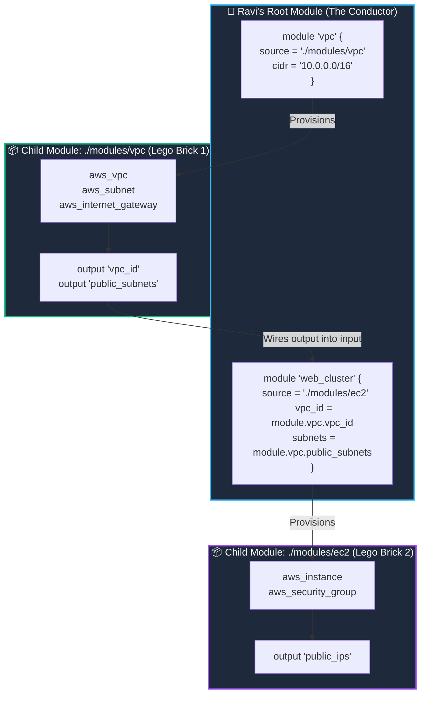

# 🧱 12. Terraform Reusable Modules: Architecture & Composition

> *"Hey Ravi! 🌸 Today we learn how senior engineers build massive cloud platforms without losing their sanity: Reusable Modules! Think of them as custom Lego bricks that you design once and snap into place anywhere!"* — **Mentor Rithu 👩‍🏫**

---

## 👫 Mentor & Student Check-In

- **Ravi 👨‍🎓:** *"Rithu, my `main.tf` file is already 400 lines long, and I'm only managing a VPC and two servers! When we build a real production system, won't our files become unmanageable monster monoliths?"*
- **Rithu 👩‍🏫:** *"You hit the nail on the head, Ravi! Writing everything into one giant file is called a 'Monolithic Anti-Pattern'. It's scary to edit, impossible to test, and messy to maintain. Today, I'm going to teach you how to break your infrastructure down into clean, reusable Lego bricks called **Modules**!"*

---

## 🎯 What Ravi Will Learn Today

1. 🧩 **Understand Root Modules vs. Child Modules** and where the boundary lies.
2. 🔌 **Source modules** from local folders, the public Terraform Registry, and Git repositories.
3. 🔗 **Compose modules together** by connecting outputs from Module A into inputs of Module B.
4. 🏗️ **Organize real-world repositories** with clean, modular folder structures.

---

## 📊 Visual Explanation




---

## 👶 Rithu Explains Like You Are a Beginner

### 🧱 The Lego Brick Analogy
> *"Ravi, imagine building a massive Lego castle:"*
- Instead of melting down plastic and molding individual bricks from scratch for every tower, you use standard pre-made **Lego bricks**.
- You have a standard 4x2 wall brick, a standard archway piece, and a standard roof tile.
- You can use the exact same Lego brick across 100 different castles.

**A Terraform module is your custom Lego brick.**
- You and I write a **VPC Module** once.
- The Development team calls the module with `cidr = "10.0.0.0/16"`.
- The Production team calls the *exact same module* with `cidr = "10.100.0.0/16"`.
- Nobody has to reinvent route tables and internet gateways from scratch!

---

## ⚡ The Essential 80/20 Concepts (Rithu's Focus Sheet)

| Concept | What Rithu Wants Ravi to Know | Practical DevOps Importance |
|---|---|---|
| **Root Module** | The main folder where Ravi runs `terraform plan` and `apply`. | The control room that calls and orchestrates child modules. |
| **Child Module** | A self-contained folder called via a `module` block. | Encapsulates reusable infrastructure logic. |
| **Module Inputs** | Variables declared in the child module's `variables.tf`. | Allows Ravi to customize parameters (CIDR, size, tags). |
| **Module Outputs** | Values exported in the child module's `outputs.tf`. | Exposes generated IDs and IPs to the root module. |
| **Module Composition** | Wiring the output of Child Module A into the input of Child Module B. | Creates clean, decoupled cloud architectures. |

---

## 📁 Rithu's Standard Enterprise Module Layout

Ravi, this is how Fortune 500 companies structure their Terraform repositories:

```text
my-platform/
├── main.tf             # Root module (calls child modules)
├── variables.tf        # Root inputs (environment, region)
├── outputs.tf          # Root exports (ALB DNS, server IP)
├── terraform.tfvars    # Environment values
│
└── modules/            # Local Child Modules
    ├── vpc/
    │   ├── main.tf     # aws_vpc, subnets, IGW
    │   ├── variables.tf# var.cidr_block
    │   └── outputs.tf  # output "vpc_id"
    │
    └── web-server/
        ├── main.tf     # aws_instance, security group
        ├── variables.tf# var.vpc_id, var.instance_type
        └── outputs.tf  # output "server_ip"
```

---

## 🔗 Module Composition: How Child Modules Talk to Each Other

Look at how Ravi's Root module glues two child modules together:

```hcl
# main.tf in Root Module

# 1. Call VPC Module
module "network" {
  source     = "./modules/vpc"
  cidr_block = "10.0.0.0/16"
}

# 2. Call Web Server Module, passing the VPC's generated output as input!
module "web_app" {
  source    = "./modules/web-server"
  
  # Notice the cross-module wiring:
  vpc_id    = module.network.vpc_id
  subnet_id = module.network.public_subnets[0]
}

# outputs.tf in Root Module
output "app_url" {
  value = module.web_app.server_url
}
```

---

## 🧪 Hands-on Practice: Ravi's First Reusable Module Lab

### 🎯 Objective
Build a reusable child module that generates personalized greeting cards and invoke it twice from a root module.

### 🚀 Steps for Ravi:

1. Create the directory structure:
   ```bash
   mkdir -p ravi-module-lab/modules/card-generator
   cd ravi-module-lab
   ```

2. Create the child module (`modules/card-generator/`):

   **`modules/card-generator/variables.tf`**:
   ```hcl
   variable "recipient_name" {
     type        = string
     description = "Person receiving the card"
   }

   variable "role_title" {
     type        = string
     default     = "DevOps Engineer"
   }
   ```

   **`modules/card-generator/main.tf`**:
   ```hcl
   terraform {
     required_providers {
       local = {
         source  = "hashicorp/local"
         version = "~> 2.5"
       }
     }
   }

   resource "local_file" "card" {
     filename = "${path.root}/${lower(var.recipient_name)}-badge.txt"
     content  = <<-EOT
       ================================
       DEVOPS SQUAD MEMBER BADGE
       Name:   ${var.recipient_name}
       Role:   ${var.role_title}
       Status: Certified by Mentor Rithu
       ================================
     EOT
   }
   ```

   **`modules/card-generator/outputs.tf`**:
   ```hcl
   output "badge_path" {
     value = local_file.card.filename
   }
   ```

3. Create Ravi's **Root Module** (`ravi-module-lab/main.tf`):
   ```hcl
   terraform {
     required_providers {
       local = {
         source  = "hashicorp/local"
         version = "~> 2.5"
       }
     }
   }

   # Call module for Ravi
   module "ravi_badge" {
     source         = "./modules/card-generator"
     recipient_name = "Ravi"
     role_title     = "Cloud Automation Lead"
   }

   # Call module for Rithu
   module "rithu_badge" {
     source         = "./modules/card-generator"
     recipient_name = "Rithu"
     role_title     = "Principal DevOps Architect"
   }

   output "ravi_file" {
     value = module.ravi_badge.badge_path
   }
   ```

4. Initialize and apply:
   ```bash
   # Whenever Ravi adds or touches modules, ALWAYS run init!
   terraform init
   terraform apply -auto-approve
   ```

### 🔎 Expected Result:
Inspect the generated files:
```bash
cat ravi-badge.txt
cat rithu-badge.txt
```
*Notice: One child module effortlessly stamped out two distinct, customized outputs!*

### 🧹 Cleanup:
```bash
terraform destroy -auto-approve
```

---

## 💬 Ravi's Doubt Corner

### Ravi: *"Rithu, why can't I access `aws_instance.web.id` directly from my root module when it's inside a child module?"*
**Rithu:** *"Because child modules are black boxes, Ravi! By design, Terraform hides internal resources to keep them safe and encapsulated. If your root module needs an attribute from a child module, the child module **must explicitly export it** in its `outputs.tf`! Then you access it as `module.<NAME>.<OUTPUT>`."*

---

## ⚡ Quick Revision with Rithu

- 📌 **Invoke Module:** `module "name" { source = "./path", ... }`
- 📌 **Always Re-Init:** Run `terraform init` when adding new modules!
- 📌 **Access Child Output:** `module.<MODULE_NAME>.<OUTPUT_NAME>`
- 📌 **Best Practice:** Keep modules small, focused, and single-purpose.

> [!TIP]
> **Rithu's Note to Ravi:** *"You're modularizing like a pro, Ravi! Now let's explore Chapter 13 and learn how to manage Remote State and Concurrency Locking for DevOps teams!"* 🔒✨
