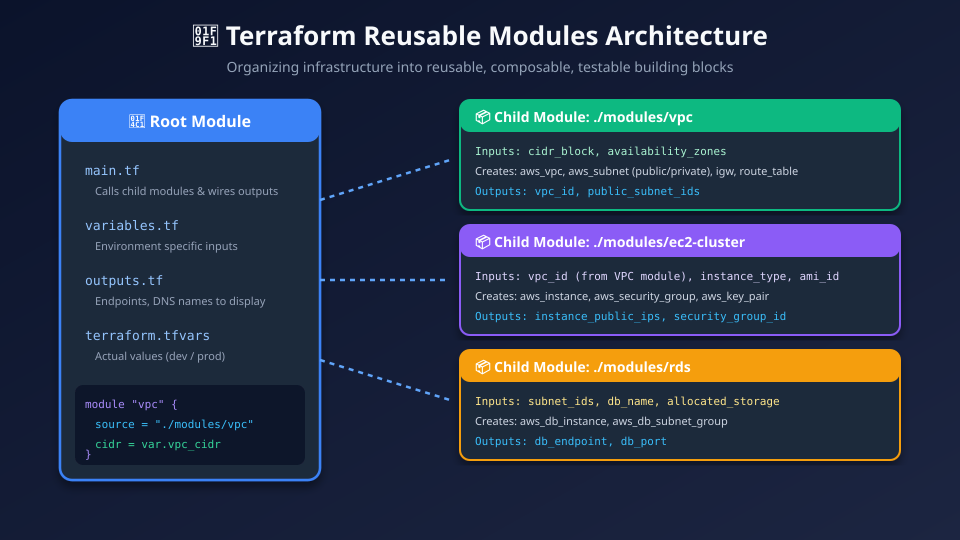
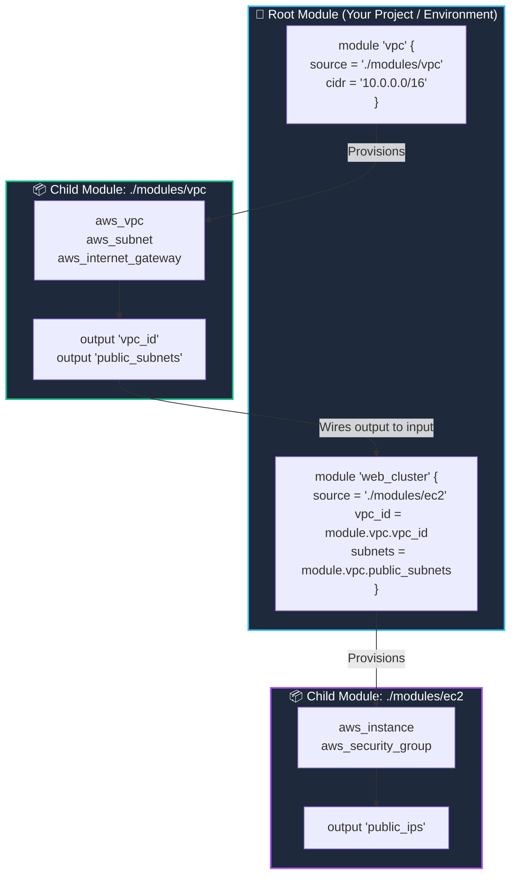

# 🧱 12. Terraform Reusable Modules: Architecture & Composition

> *"Don't write monoliths. Build your cloud like Lego blocks using reusable, composable Terraform modules!"* 📦🏗️

Writing all your infrastructure in one giant 3,000-line `main.tf` file is a recipe for disaster. It is impossible to test, terrifying to modify, and promotes endless copy-pasting. **Modules** are Terraform's equivalent of functions or classes in programming: self-contained packages of infrastructure code that can be shared, versioned, and reused across multiple environments.

---

## 🎯 Learning Objectives

By the end of this topic, you will be able to:
1. 🧩 **Understand Root Modules vs. Child Modules** and their communication boundary.
2. 🔌 **Source modules** from local paths, the public Terraform Registry, and Git repositories.
3. 🔗 **Compose modules together** by piping outputs from Module A into inputs of Module B.
4. 🏗️ **Structure enterprise-grade repositories** with clean, modular folder layouts.

---

## 📊 Visual Explanation





---

## 👶 Explain Like I Am a Beginner

### 🧱 The Lego Brick Analogy
Imagine building a Lego castle:
- Instead of molding individual plastic pellets into custom shapes every time you build a wall, you use pre-manufactured **Lego bricks**.
- You have a standard 4x2 red brick, a standard window piece, and a standard roof tile.
- You can use the exact same Lego brick in 100 different castles.

**A Terraform module is a custom Lego brick.**
- You build a **VPC Module** once.
- The Development team calls the module and passes `cidr = "10.0.0.0/16"`.
- The Production team calls the *exact same module* and passes `cidr = "10.100.0.0/16"`.
- Nobody has to reinvent how to write subnets, route tables, and gateways from scratch!

---

## ⚡ The Essential 80/20 Concepts

| Concept | Simple Explanation | Practical Importance |
|---|---|---|
| **Root Module** | The directory containing the `.tf` files where you run `terraform apply`. | The control center that orchestrates the overall deployment. |
| **Child Module** | A standalone directory or package invoked by another module using a `module` block. | Encapsulates reusable infrastructure logic. |
| **Module Inputs** | Variables declared in the child module's `variables.tf`. | Allows the caller to customize parameters (CIDR, size, tags). |
| **Module Outputs** | Values returned by the child module's `outputs.tf`. | Exposes computed IDs and IPs to the root module. |
| **Module Composition** | Feeding the output of one child module as the input to another child module. | Creates clean, decoupled infrastructure architectures. |

---

## 📁 Standard Enterprise Module Layout

```text
my-company-platform/
├── main.tf             # Root module (calls child modules)
├── variables.tf        # Root inputs (environment, region)
├── outputs.tf          # Root exports (ALB DNS, Bastion IP)
├── terraform.tfvars    # Environment values
│
└── modules/            # Local Child Modules
    ├── vpc/
    │   ├── main.tf     # aws_vpc, subnets, IGW
    │   ├── variables.tf# var.cidr_block, var.az_count
    │   └── outputs.tf  # output "vpc_id", "subnet_ids"
    │
    └── web-server/
        ├── main.tf     # aws_instance, security group
        ├── variables.tf# var.vpc_id, var.instance_type
        └── outputs.tf  # output "public_ip"
```

---

## 🔌 Sourcing Modules: 3 Ways

### 1. Local Sourcing (Internal Modules)
```hcl
module "networking" {
  source = "./modules/vpc"

  cidr_block = "10.0.0.0/16"
}
```

### 2. Public Terraform Registry (Community Standard Modules)
Verified, battle-tested modules written and maintained by AWS and HashiCorp:
```hcl
module "vpc" {
  source  = "terraform-aws-modules/vpc/aws"
  version = "~> 5.8"

  name = "prod-vpc"
  cidr = "10.0.0.0/16"

  azs             = ["us-east-1a", "us-east-1b"]
  private_subnets = ["10.0.1.0/24", "10.0.2.0/24"]
  public_subnets  = ["10.0.101.0/24", "10.0.102.0/24"]

  enable_nat_gateway = true
}
```

### 3. Git Sourcing (Private Corporate Repositories)
```hcl
module "compliance_bucket" {
  source = "git::https://github.com/my-org/terraform-aws-s3.git?ref=v2.1.0"

  bucket_name = "corp-audit-logs"
}
```

---

## 🔗 Module Composition in Action

Look at how the Root module glues two child modules together:

```hcl
# main.tf in root

# 1. Instantiate VPC
module "vpc" {
  source     = "./modules/vpc"
  cidr_block = "10.0.0.0/16"
}

# 2. Instantiate Web Server, passing VPC output as input!
module "web_server" {
  source    = "./modules/web-server"
  
  # Notice the cross-module wiring:
  vpc_id    = module.vpc.vpc_id
  subnet_id = module.vpc.public_subnet_ids[0]
}

# outputs.tf in root
output "website_ip" {
  value = module.web_server.server_ip
}
```

---

## 🧪 Hands-on Practice: Building a Local Custom Module

### 🎯 Objective
Create a child module that generates timestamped log files and invoke it twice from a root module.

### 📋 Prerequisites
Terraform CLI installed.

### 🚀 Steps to Follow:

1. Create directory structure:
   ```bash
   mkdir -p module-lab/modules/greeter
   cd module-lab
   ```

2. Create the child module (`modules/greeter/`):
   
   **`modules/greeter/variables.tf`**:
   ```hcl
   variable "user_name" {
     type        = string
     description = "Name of the person to greet"
   }

   variable "role" {
     type        = string
     description = "Job role"
     default     = "Engineer"
   }
   ```

   **`modules/greeter/main.tf`**:
   ```hcl
   terraform {
     required_providers {
       local = {
         source  = "hashicorp/local"
         version = "~> 2.5"
       }
     }
   }

   resource "local_file" "greeting_card" {
     filename = "${path.root}/${lower(var.user_name)}-card.txt"
     content  = <<-EOT
       Hello ${var.user_name}!
       Role: ${var.role}
       Badge ID: ${md5(var.user_name)}
     EOT
   }
   ```

   **`modules/greeter/outputs.tf`**:
   ```hcl
   output "card_path" {
     description = "Path to the created card"
     value       = local_file.greeting_card.filename
   }
   ```

3. Create the **Root Module** (`module-lab/main.tf`):
   ```hcl
   # Root main.tf
   terraform {
     required_providers {
       local = {
         source  = "hashicorp/local"
         version = "~> 2.5"
       }
     }
   }

   # Call module for Alice
   module "alice" {
     source    = "./modules/greeter"
     user_name = "Alice"
     role      = "DevOps Lead"
   }

   # Call module for Bob
   module "bob" {
     source    = "./modules/greeter"
     user_name = "Bob"
     role      = "Cloud Architect"
   }

   # Root outputs.tf
   output "alice_card" {
     value = module.alice.card_path
   }

   output "bob_card" {
     value = module.bob.card_path
   }
   ```

4. Initialize and apply:
   ```bash
   # When adding or modifying modules, ALWAYS run terraform init!
   terraform init
   terraform apply -auto-approve
   ```

### 🔎 Expected Result:
Inspect the generated files:
```bash
cat alice-card.txt
cat bob-card.txt
```
Notice how a single child module produced two distinct, perfectly formatted outputs!

### 🧹 Cleanup Instructions:
```bash
terraform destroy -auto-approve
```

---

## ⚠️ Common Beginner Mistakes

### 1. Forgetting `terraform init` When Adding a Module
- **What it looks like:** Error: `Module not installed: module "vpc" is not installed. Run "terraform init" to install it.`
- **Why it happens:** Terraform caches module sources inside `.terraform/modules/`.
- **The Fix:** Run `terraform init` whenever you add a new `module` block or change a module's `source`.

### 2. Trying to Access Internal Child Resources Directly
- **What it looks like:** Calling `aws_instance.web.id` in root when `aws_instance` was defined inside `module.web_server`.
- **Why it fails:** Child modules are black boxes! Resources inside them are private.
- **The Fix:** Export the value through the child module's `outputs.tf`, then reference it in root as `module.<MODULE_NAME>.<OUTPUT_NAME>`.

### 3. Hardcoding Cloud Providers Inside Child Modules
- **What it looks like:** Putting `provider "aws" { region = "us-east-1" }` inside child modules.
- **Why it is bad:** Providers should be declared in the **Root Module** and inherited by child modules. Child modules should only declare `required_providers`.

---

## 💼 Interview Revision Questions

### Q1: What is the difference between a Root Module and a Child Module in Terraform?
**Answer:** The **Root Module** is the working directory where the Terraform CLI commands (`plan`, `apply`) are executed. A **Child Module** is an external or subfolder configuration called by a root module (or another child module) via a `module` block to reuse packaged infrastructure patterns.

### Q2: How do you pass data into and retrieve data out of a Child Module?
**Answer:** Data is passed **into** a child module by declaring arguments in the `module` block corresponding to variables defined in the child module's `variables.tf`. Data is retrieved **out of** a child module by referencing its defined outputs using the syntax `module.<MODULE_NAME>.<OUTPUT_NAME>`.

### Q3: Why should reusable child modules avoid defining `provider` blocks?
**Answer:** Child modules should remain provider-agnostic so that the calling root module can determine provider configurations, credentials, regions, and default tags. A child module should only declare `required_providers` with version constraints.

---

## ⚡ Quick Revision & Cheat Sheet

- 📌 **Invoke Module:** `module "name" { source = "./path", ... }`
- 📌 **Always Re-Init:** Run `terraform init` when adding modules!
- 📌 **Access Child Output:** `module.<MODULE_NAME>.<OUTPUT_NAME>`
- 📌 **Registry Source:** `source = "terraform-aws-modules/vpc/aws"`
- 📌 **Pin Version:** `version = "~> 5.0"` (for registry modules)

> [!TIP]
> **Remember This:** Treat child modules like black boxes. If a root module needs an attribute from a child module, you MUST explicitly export it in the child module's `outputs.tf`!
