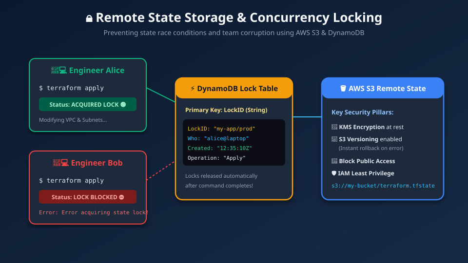
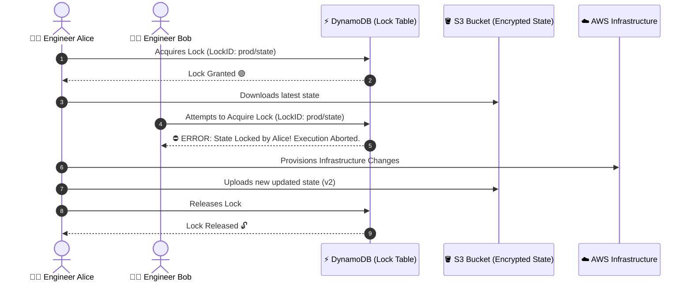

# 🔒 13. Remote State Storage & Concurrency Locking with AWS S3 & DynamoDB

> *"In solo projects, local state works. In DevOps teams, remote state with locking is the only thing standing between you and catastrophic state corruption!"* 🛡️👥

When you are learning on your laptop, keeping `terraform.tfstate` on your hard drive feels fine. But what happens when you join a team of 10 DevOps engineers? If Alice runs `terraform apply` on her laptop while Bob runs `terraform apply` on his laptop at the exact same moment, **they overwrite each other's state, corrupting the infrastructure**. 

In this chapter, you will master enterprise remote state storage using **AWS S3** and concurrency locking using **DynamoDB**.

---

## 🎯 Learning Objectives

By the end of this topic, you will be able to:
1. 👥 **Understand why local state fails** in team and CI/CD environments.
2. 🪣 **Configure an AWS S3 remote backend** with KMS encryption and versioning.
3. ⚡ **Implement state locking with DynamoDB** to prevent dangerous race conditions.
4. 🐣 **Solve the "Chicken-and-Egg" bootstrap paradox** of backend provisioning.
5. 🚚 **Migrate local state to remote storage** smoothly using `terraform init -migrate-state`.

---

## 📊 Visual Explanation





---

## 👶 Explain Like I Am a Beginner

### 🚻 The Airplane Bathroom Analogy
Imagine the lavatory on an airplane:
- If there is no lock on the door, two passengers might try to enter simultaneously, leading to chaos and embarrassment!
- To prevent this, the door has a **Deadbolt with an Occupied Sign**:
  - Passenger A enters and slides the latch $\rightarrow$ sign turns **RED (Occupied)**.
  - Passenger B approaches the door, sees the RED sign, and waits patiently outside.
  - When Passenger A finishes, they slide the latch back $\rightarrow$ sign turns **GREEN (Vacant)**.

In Terraform:
- The **Airplane Lavatory** is your **AWS S3 Bucket** (where state lives).
- The **Deadbolt & Red Occupied Sign** is **DynamoDB**. It guarantees that only ONE engineer or CI/CD pipeline can modify state at any given second!

---

## ⚡ The Essential 80/20 Concepts

| Concept | Simple Explanation | Practical Importance |
|---|---|---|
| **Remote Backend** | Storing `.tfstate` in a centralized, secure cloud location (AWS S3) instead of your local laptop. | Enables team collaboration and automated CI/CD pipelines. |
| **State Locking** | A mechanism that places a temporary mutex lock on the state during execution. | Prevents simultaneous applies from corrupting the state file. |
| **S3 Versioning** | Retains every historical version of your state file whenever an apply occurs. | Provides instant 1-click rollback if a bad apply corrupts state. |
| **DynamoDB Lock Table** | A lightweight NoSQL table with a primary key named `LockID`. | Stores the active lock metadata (who locked it, when, and why). |
| **State Migration** | Moving existing state data from local disk to S3 or between different backends. | Executed safely using `terraform init -migrate-state`. |

---

## 🐣 The Chicken-and-Egg Paradox (Bootstrap)

Beginners always ask:
*"If we use Terraform to create AWS resources, but Terraform needs an S3 bucket to store its state, how do we create the S3 bucket in the first place?"*

### The Industry Standard 2-Step Pattern:
1. **Step 1 (Bootstrap):** Write a simple `.tf` file with local state to create the S3 bucket and DynamoDB table. Run `terraform apply`.
2. **Step 2 (Backend Configuration):** Add the `backend "s3"` block pointing to the newly created bucket and run `terraform init -migrate-state`. Terraform uploads your local state into S3!

---

## 💻 Step 1: The Bootstrap Configuration (`bootstrap.tf`)

```hcl
# bootstrap.tf - Run this FIRST to build backend infrastructure
terraform {
  required_providers {
    aws = {
      source  = "hashicorp/aws"
      version = "~> 5.0"
    }
  }
}

provider "aws" {
  region = "us-east-1"
}

# 1. Dedicated S3 Bucket for State Storage
resource "aws_s3_bucket" "tf_state" {
  bucket        = "acme-corp-terraform-state-us-east-1"
  force_destroy = false # Protect against accidental deletion

  lifecycle {
    prevent_destroy = true
  }
}

# 2. Enable Versioning (Crucial for state rollback!)
resource "aws_s3_bucket_versioning" "tf_state_versioning" {
  bucket = aws_s3_bucket.tf_state.id
  versioning_configuration {
    status = "Enabled"
  }
}

# 3. Enable Server-Side Encryption at rest (AES-256 or KMS)
resource "aws_s3_bucket_server_side_encryption_configuration" "tf_state_encryption" {
  bucket = aws_s3_bucket.tf_state.id

  rule {
    apply_server_side_encryption_by_default {
      sse_algorithm = "AES256"
    }
  }
}

# 4. Explicitly Block all Public Access
resource "aws_s3_bucket_public_access_block" "tf_state_public_block" {
  bucket = aws_s3_bucket.tf_state.id

  block_public_acls       = true
  block_public_policy     = true
  ignore_public_acls      = true
  restrict_public_buckets = true
}

# 5. DynamoDB Table for State Locking
resource "aws_dynamodb_table" "tf_locks" {
  name         = "terraform-state-locks"
  billing_mode = "PAY_PER_REQUEST" # Free-tier friendly, pennies per million requests
  hash_key     = "LockID"           # 👈 MUST BE EXACTLY "LockID"!

  attribute {
    name = "LockID"
    type = "S" # String type
  }
}
```

---

## 💻 Step 2: Configuring the Remote Backend (`backend.tf`)

Once the S3 bucket and DynamoDB table exist, configure your backend:

```hcl
# backend.tf
terraform {
  backend "s3" {
    bucket         = "acme-corp-terraform-state-us-east-1"
    key            = "platform/prod/terraform.tfstate" # File path inside S3
    region         = "us-east-1"
    dynamodb_table = "terraform-state-locks"
    encrypt        = true
  }
}
```

Now run:
```bash
terraform init -migrate-state
```

**Terraform will prompt:**
```text
Do you want to copy existing state to the new backend?
  Pre-existing state was found while migrating the previous "local" backend to the
  new "s3" backend. An existing state was also detected in the "s3" backend.

  Enter a value: yes

Successfully configured the backend "s3"! Terraform will now
use this backend for future operations.
```
🎉 Your state file is now safely stored in the cloud with automated team locking!

---

## 🚨 Emergency: What if a Lock Gets Stuck?

If an engineer's laptop crashes or power cuts out in the middle of an apply, the lock in DynamoDB might not be released, leaving the state in a locked status.

Subsequent runs will fail with:
```text
Error: Error acquiring the state lock: ConditionalCheckFailedException
Lock Info:
  ID:        1a2b3c4d-5e6f-...
  Owner:     alice@laptop
```

### The Safe Solution:
Verify with Alice that her apply is truly terminated, then run:
```bash
terraform force-unlock 1a2b3c4d-5e6f-...
```
> [!CAUTION]
> Never force-unlock a state if someone or a CI/CD job is actively applying changes! Doing so can corrupt the state.

---

## ⚠️ Common Beginner Mistakes

### 1. Typo in DynamoDB Hash Key
- **What it looks like:** Setting `hash_key = "lock_id"` or `hash_key = "Id"`.
- **The Error:** `Error acquiring the state lock: Missing key in item`.
- **The Fix:** The partition key **must be spelled exactly `LockID`** with capital `L`, capital `ID`.

### 2. Variables Inside the `backend` Block
- **What it looks like:**
  ```hcl
  # ❌ ILLEGAL: Terraform backend blocks cannot use variables!
  terraform {
    backend "s3" {
      bucket = var.my_bucket
    }
  }
  ```
- **Why it fails:** The backend must be initialized before variables are parsed.
- **The Fix:** Hardcode backend values or pass them via a backend config file:
  `terraform init -backend-config="backend-prod.hcl"`.

### 3. Missing S3 Encryption
- **What it looks like:** Storing unencrypted state files in S3.
- **The Risk:** Sensitive database credentials inside the state file can be read by anyone with S3 read access.
- **The Fix:** Always specify `encrypt = true` in the backend block and enable SSE on the S3 bucket.

---

## 💼 Interview Revision Questions

### Q1: Why is remote state preferred over local state for teams?
**Answer:** Local state cannot be safely shared across multiple team members or CI/CD pipelines. Remote state provides a centralized single source of truth, enables automated state locking to prevent concurrent apply collisions, allows audit trails via versioning, and keeps sensitive state files off individual laptops.

### Q2: How does Terraform implement state locking using AWS DynamoDB?
**Answer:** When an operation starts (`plan`, `apply`, `destroy`), Terraform writes a record to the designated DynamoDB table containing a primary key `LockID` and execution metadata (process ID, user, timestamp). If another process attempts to execute, it sees the active lock in DynamoDB and halts immediately until the lock is released.

### Q3: What is the Chicken-and-Egg paradox in Terraform backend configuration and how is it resolved?
**Answer:** Terraform needs cloud resources (an S3 bucket and DynamoDB table) to store its remote state, but Terraform is also the tool used to create those resources. It is resolved by first provisioning the S3 and DynamoDB resources using local state, and then migrating the local state into the newly created S3 backend using `terraform init -migrate-state`.

---

## ⚡ Quick Revision & Cheat Sheet

- 📌 **Backend Block:** `terraform { backend "s3" { ... } }`
- 📌 **DynamoDB Key:** Must be named `LockID` (String)
- 📌 **Migrate to Remote:** `terraform init -migrate-state`
- 📌 **S3 Security:** Versioning + Server-Side Encryption + Block Public Access
- 📌 **Clear Stuck Lock:** `terraform force-unlock <LOCK_ID>`

> [!IMPORTANT]
> **Remember This:** Backend blocks CANNOT contain variables (`var.xyz`). Values must be hardcoded or passed via `-backend-config` flags during `init`!
