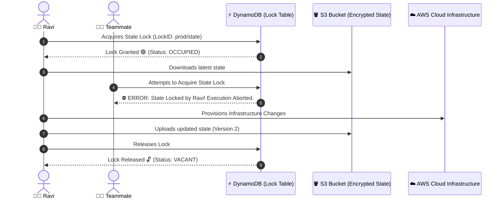

# 🔒 13. Remote State Storage & Concurrency Locking with AWS S3 & DynamoDB

> *"Hey Ravi! 🌸 On your personal laptop, keeping state locally works fine. But the moment you join a DevOps team, remote state with concurrency locking is the only thing standing between you and disaster!"* — **Mentor Rithu 👩‍🏫**

---

## 👫 Mentor & Student Check-In

- **Ravi 👨‍🎓:** *"Rithu, what happens when two engineers on the same team run `terraform apply` at the exact same minute?"*
- **Rithu 👩‍🏫:** *"They collide, Ravi! It's called a race condition. Both laptops try to write to the state file simultaneously, corrupting the file and leaving orphaned resources running in AWS. Today, I'm going to teach you how AWS S3 and DynamoDB work together to put an unbreakable lock on your infrastructure!"*

---

## 🎯 What Ravi Will Learn Today

1. 👥 **Understand why local state fails** in team and CI/CD environments.
2. 🪣 **Configure an AWS S3 remote backend** with KMS encryption and versioning.
3. ⚡ **Implement state locking with DynamoDB** using the mandatory `LockID` key.
4. 🐣 **Solve the famous Chicken-and-Egg bootstrap paradox** of backend provisioning.
5. 🚚 **Migrate local state to remote S3** smoothly using `terraform init -migrate-state`.

---

## 📊 Visual Explanation




---

## 👶 Rithu Explains Like You Are a Beginner

### 🚻 The Airplane Restroom Deadbolt Analogy
> *"Ravi, imagine the restroom on an airplane:"*
- If the door had no latch, two passengers might try to open the door and enter at the same second—total chaos and embarrassment!
- To prevent this, the door has a **Deadbolt with an Occupied Sign**:
  - Ravi enters and slides the deadbolt $\rightarrow$ sign turns **RED (Occupied)**.
  - Another passenger walks up, sees the RED sign, and waits patiently.
  - When Ravi finishes, he slides the bolt back $\rightarrow$ sign turns **GREEN (Vacant)**.

In Terraform, Ravi:
- The **Restroom** is your **AWS S3 Bucket** (where state lives).
- The **Deadbolt & Red Occupied Sign** is **DynamoDB**. It guarantees that only ONE engineer or pipeline can modify state at any given second!

---

## ⚡ The Essential 80/20 Concepts (Rithu's Focus Sheet)

| Concept | What Rithu Wants Ravi to Know | Practical DevOps Importance |
|---|---|---|
| **Remote Backend** | Storing `.tfstate` in AWS S3 instead of Ravi's local laptop. | Enables team collaboration and automated CI/CD pipelines. |
| **State Locking** | A mutex lock placed on the state during execution. | Prevents simultaneous applies from corrupting the state file. |
| **S3 Versioning** | Retains every past revision of your state file. | Provides instant 1-click rollback if a bad apply corrupts state. |
| **DynamoDB Lock Table** | A table with a primary partition key named `LockID`. | Stores the active lock metadata (who locked it, when, and why). |
| **State Migration** | Moving state from local disk into S3 safely. | Executed via `terraform init -migrate-state`. |

---

## 🐣 Rithu Solves the Chicken-and-Egg Paradox

Ravi asked: *"Rithu, if Terraform needs S3 to store its state, how do we create the S3 bucket in the first place?"*

### Rithu's 2-Step Bootstrap Formula:
1. **Step 1 (Bootstrap):** Write a simple `.tf` file with local state to create the S3 bucket and DynamoDB table. Run `terraform apply`.
2. **Step 2 (Backend Migration):** Add the `backend "s3"` block pointing to the newly created bucket and run `terraform init -migrate-state`. Terraform automatically moves your local state into S3!

---

## 💻 Step 1: Bootstrap S3 & DynamoDB (`bootstrap.tf`)

```hcl
# bootstrap.tf - Run this FIRST
terraform {
  required_providers {
    aws = {
      source  = "hashicorp/aws"
      version = "~> 5.0"
    }
  }
}

provider "aws" {
  region = "us-east-1"
}

# 1. Dedicated S3 Bucket for State
resource "aws_s3_bucket" "tf_state" {
  bucket        = "ravi-rithu-devops-tfstate-us-east-1"
  force_destroy = false

  lifecycle {
    prevent_destroy = true # Protect from accidental deletion!
  }
}

# 2. Enable S3 Versioning (Crucial for rollback!)
resource "aws_s3_bucket_versioning" "state_versioning" {
  bucket = aws_s3_bucket.tf_state.id
  versioning_configuration {
    status = "Enabled"
  }
}

# 3. Server-Side Encryption (AES256 / KMS)
resource "aws_s3_bucket_server_side_encryption_configuration" "state_crypto" {
  bucket = aws_s3_bucket.tf_state.id

  rule {
    apply_server_side_encryption_by_default {
      sse_algorithm = "AES256"
    }
  }
}

# 4. Block Public Access
resource "aws_s3_bucket_public_access_block" "state_access_block" {
  bucket = aws_s3_bucket.tf_state.id

  block_public_acls       = true
  block_public_policy     = true
  ignore_public_acls      = true
  restrict_public_buckets = true
}

# 5. DynamoDB Lock Table
resource "aws_dynamodb_table" "tf_locks" {
  name         = "terraform-state-locks"
  billing_mode = "PAY_PER_REQUEST" # Free-tier friendly!
  hash_key     = "LockID"           # 👈 RITHU ALERT: MUST BE EXACTLY "LockID"!

  attribute {
    name = "LockID"
    type = "S"
  }
}
```

---

## 💻 Step 2: Configuring the Remote Backend (`backend.tf`)

```hcl
# backend.tf
terraform {
  backend "s3" {
    bucket         = "ravi-rithu-devops-tfstate-us-east-1"
    key            = "platform/dev/terraform.tfstate"
    region         = "us-east-1"
    dynamodb_table = "terraform-state-locks"
    encrypt        = true
  }
}
```

Now run in your terminal:
```bash
terraform init -migrate-state
```
Type `yes` when prompted, and Terraform safely migrates your state to the cloud!

---

## 💬 Ravi's Doubt Corner

### Ravi: *"Rithu, what should I do if my laptop crashes during an apply and leaves the state locked?"*
**Rithu:** *"If a lock gets stuck because a process terminated abruptly, verify that no one else is currently applying, then run: `terraform force-unlock <LOCK_ID>`. The lock ID will be printed right in the error message!"*

---

## ⚡ Quick Revision with Rithu

- 📌 **Backend Block:** `terraform { backend "s3" { ... } }`
- 📌 **DynamoDB Key:** Must be named `LockID` (String)
- 📌 **S3 Security:** Versioning + Server-Side Encryption + Block Public Access
- 📌 **Migrate State:** `terraform init -migrate-state`
- 📌 **No Variables in Backend:** Backend arguments must be static or passed via `-backend-config`.

> [!TIP]
> **Rithu's Note to Ravi:** *"You just leveled up to team-ready DevOps engineering, Ravi! In Chapter 14, let's explore Workspaces and environment isolation!"* 🗂️✨
