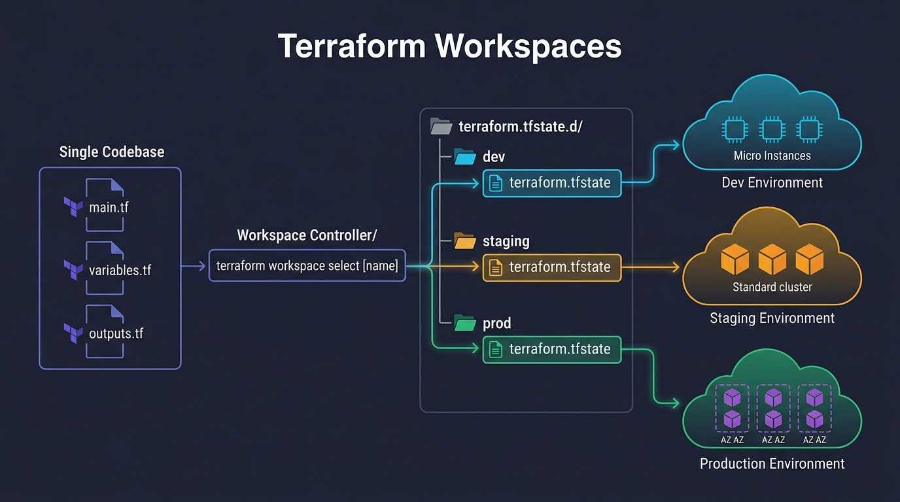
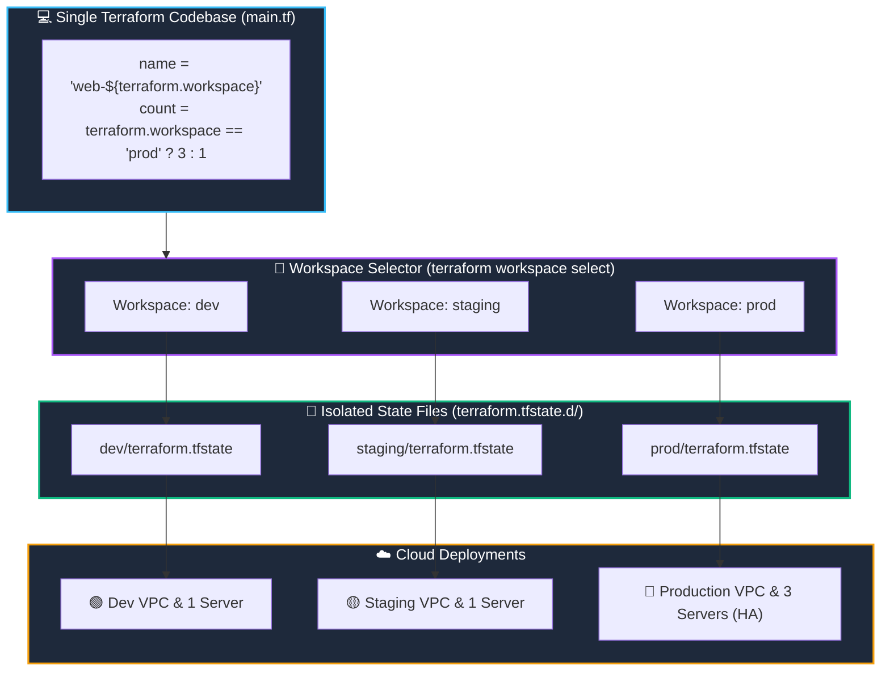

# 🗂️ 14. Terraform Workspaces & Multi-Environment Isolation

> *"Switch environments as easily as switching Git branches! But beware: workspaces are great for testing, but real production often demands separate cloud accounts!"* 🌍🔀

How do you deploy the exact same Terraform code to **Development**, **Staging**, and **Production** without duplicating your codebase? One built-in mechanism provided by Terraform is **Workspaces**. In this chapter, you will learn how workspaces isolate state files, how to interpolate `terraform.workspace`, and when to use directory-based separation instead.

---

## 🎯 Learning Objectives

By the end of this topic, you will be able to:
1. 🔀 **Create and switch between workspaces** (`default`, `dev`, `staging`, `prod`).
2. 💾 **Understand the internal storage structure** inside `terraform.tfstate.d/`.
3. 🎛️ **Interpolate `terraform.workspace`** to customize resource sizing and naming dynamically.
4. ⚖️ **Evaluate Workspaces vs. Separate Repositories/Accounts** to avoid massive production blast radii.

---

## 📊 Visual Explanation





---

## 👶 Explain Like I Am a Beginner

### 🎨 The Digital Drawing Canvas Analogy
Imagine using a digital painting program on an iPad:
- You have one set of brushes, color palettes, and drawing tools.
- But you have **3 different layers or canvas tabs**: `Tab 1: Sketch`, `Tab 2: Watercolors`, `Tab 3: Final Artwork`.
- When you click on `Tab 1`, you draw and save on Canvas 1.
- When you switch to `Tab 2`, Canvas 1 is hidden, and you draw on a clean, isolated Canvas 2.

**A Terraform Workspace is a canvas tab.**
You have ONE set of `.tf` files on your disk. But when you switch to the `dev` workspace, Terraform swaps out your state file for `dev.tfstate`. When you switch to `prod`, Terraform swaps it for `prod.tfstate`.

---

## ⚡ The Essential 80/20 Concepts

| Concept | Simple Explanation | Practical Importance |
|---|---|---|
| **`default` Workspace** | The initial workspace that exists in every Terraform directory. | Where state is saved if you never run any workspace commands. |
| **Named Workspaces** | Custom workspaces you create (e.g., `dev`, `staging`, `prod`). | Allows managing multiple state files from a single code directory. |
| **`terraform.workspace`** | A special built-in variable containing the name of the currently active workspace. | Used in ternary expressions and resource tags to adapt configs dynamically. |
| **State Isolation** | Local state is saved to `terraform.tfstate.d/<name>/`; remote S3 state is saved to `env:/<name>/<key>`. | Guarantees that changes to Dev do not touch Staging or Prod state. |
| **Blast Radius Limitation** | Workspaces share the same cloud provider credentials and backend bucket. | If an engineer accidentally runs `destroy` in the wrong workspace, production can be impacted. |

---

## ⌨️ Essential Workspace Commands

| Command | What It Does | Example |
|---|---|---|
| `terraform workspace list` | Shows all workspaces with an asterisk `*` on the active one. | `terraform workspace list` |
| `terraform workspace new <NAME>` | Creates a brand-new workspace and immediately switches to it. | `terraform workspace new dev` |
| `terraform workspace select <NAME>` | Switches your current context to an existing workspace. | `terraform workspace select prod` |
| `terraform workspace show` | Displays the name of the currently active workspace. | `terraform workspace show` |
| `terraform workspace delete <NAME>` | Deletes an empty workspace (must destroy resources first). | `terraform workspace delete dev` |

---

## 💻 Dynamic Infrastructure with `terraform.workspace`

You can use the built-in `terraform.workspace` expression to vary your infrastructure by environment:

```hcl
locals {
  # Map instance sizes by workspace name
  instance_type_map = {
    default = "t3.micro"
    dev     = "t3.micro"
    staging = "t3.small"
    prod    = "m5.large"
  }

  # Multi-node sizing: 3 nodes in prod, 1 in dev/staging
  cluster_count = terraform.workspace == "prod" ? 3 : 1
}

resource "aws_instance" "web" {
  count         = locals.cluster_count
  ami           = "ami-0c55b159cbfafe1f0"
  instance_type = lookup(locals.instance_type_map, terraform.workspace, "t3.micro")

  tags = {
    Name        = "web-server-${terraform.workspace}-${count.index}"
    Environment = terraform.workspace
  }
}
```

---

## ⚖️ The Hard Truth: When Workspaces are NOT Enough

While workspaces seem magical, **enterprise DevOps teams often avoid them for production environments**.

```text
┌─────────────────────────────────┐      ┌─────────────────────────────────┐
│       Terraform Workspaces      │      │  Separate Folders & AWS Accounts│
├─────────────────────────────────┤      ├─────────────────────────────────┤
│ 💡 Best for:                    │      │ 💡 Best for:                    │
│ • Ephemeral feature branches    │      │ • Production vs Non-Production  │
│ • Solo developer experiments    │      │ • Regulated environments        │
│ • Quick temporary test stacks   │      │ • Strict IAM security isolation │
├─────────────────────────────────┤      ├─────────────────────────────────┤
│ ⚠️ Danger:                      │      │ 🛡️ Safety:                      │
│ • Same cloud account credentials│      │ • Dev credentials CANNOT touch  │
│ • Easy to forget which          │      │   production AWS account!       │
│   workspace you are in!         │      │ • Zero blast radius leak!       │
└─────────────────────────────────┘      └─────────────────────────────────┘
```

> [!WARNING]
> **Production Danger:** An engineer thinks they are in `dev`, runs `terraform destroy -auto-approve`, only to realize their terminal was actually set to `prod`! To prevent this, enterprise teams use **separate AWS accounts** and **separate Git directories** for Dev, Staging, and Prod.

---

## 🧪 Hands-on Practice: Workspaces in Action

### 🎯 Objective
Create `dev` and `prod` workspaces and observe how each maintains independent state and content.

### 📋 Prerequisites
Terraform CLI installed.

### 🚀 Steps to Follow:

1. Create a lab directory:
   ```bash
   mkdir workspace-lab
   cd workspace-lab
   ```

2. Create `main.tf`:
   ```hcl
   terraform {
     required_providers {
       local = {
         source  = "hashicorp/local"
         version = "~> 2.5"
       }
     }
   }

   resource "local_file" "environment_banner" {
     filename = "${path.module}/app-${terraform.workspace}.txt"
     content  = <<-EOT
       Current Workspace: ${upper(terraform.workspace)}
       Deployment Time:   ${timestamp()}
     EOT
   }

   output "current_workspace" {
     value = terraform.workspace
   }
   ```

3. Initialize:
   ```bash
   terraform init
   ```

4. **Create and Apply Dev Workspace:**
   ```bash
   terraform workspace new dev
   terraform apply -auto-approve
   ```
   *Notice:* Generated `app-dev.txt`!

5. **Create and Apply Prod Workspace:**
   ```bash
   terraform workspace new prod
   terraform apply -auto-approve
   ```
   *Notice:* Generated `app-prod.txt`!

6. **Inspect the Local State Directories:**
   Look inside `terraform.tfstate.d/`:
   ```bash
   # On PowerShell:
   Get-ChildItem -Recurse terraform.tfstate.d

   # On Linux/macOS:
   find terraform.tfstate.d
   ```
   You will see:
   - `terraform.tfstate.d/dev/terraform.tfstate`
   - `terraform.tfstate.d/prod/terraform.tfstate`

7. Switch back to Dev:
   ```bash
   terraform workspace select dev
   terraform workspace show
   ```

### 🧹 Cleanup Instructions:
Destroy both environments:
```bash
terraform workspace select dev
terraform destroy -auto-approve

terraform workspace select prod
terraform destroy -auto-approve

terraform workspace select default
terraform workspace delete dev
terraform workspace delete prod
```

---

## ⚠️ Common Beginner Mistakes

### 1. Forgetting Which Workspace is Active
- **What it looks like:** Running `apply` thinking you are in `dev`, but inadvertently altering `staging`.
- **The Fix:** Configure your shell prompt (e.g. Starship or Powerlevel10k) to always display the active Terraform workspace, or run `terraform workspace show` before executing changes.

### 2. Deleting an Active Workspace
- **What it looks like:** Error: `Workspace "dev" is currently selected. You must select another workspace before deleting it.`
- **The Fix:** Switch to another workspace (`terraform workspace select default`) before deleting `dev`.

### 3. Deleting a Workspace With Active Resources
- **What it looks like:** Deleting a workspace containing running cloud resources.
- **The Disaster:** Deleting the workspace deletes the state file, stranding the live cloud infrastructure in AWS!
- **The Fix:** Always run `terraform destroy` *before* deleting a workspace!

---

## 💼 Interview Revision Questions

### Q1: What is a Terraform Workspace and what problem does it solve?
**Answer:** A workspace is an isolated instance of state within a single configuration directory. It allows a single codebase to manage multiple distinct environments (e.g., dev, test, stage) without duplicating HCL code or directory structures.

### Q2: How does Terraform store state differently when using Workspaces?
**Answer:** In local storage, state files for named workspaces are organized under `terraform.tfstate.d/<workspace-name>/terraform.tfstate`. In remote backends (like AWS S3), workspaces store state files under an environment prefix, typically `env:/<workspace-name>/<key>`.

### Q3: When should a team choose directory-based separation over Terraform Workspaces?
**Answer:** Workspaces share the same backend, provider credentials, and cloud account. When managing mission-critical Production infrastructure alongside Development, directory-based separation with dedicated AWS accounts and distinct IAM credentials provides stronger security isolation and prevents catastrophic cross-environment blast radii.

---

## ⚡ Quick Revision & Cheat Sheet

- 📌 **List Workspaces:** `terraform workspace list`
- 📌 **Create & Switch:** `terraform workspace new <name>`
- 📌 **Switch Existing:** `terraform workspace select <name>`
- 📌 **Current Workspace:** `terraform.workspace`
- 📌 **State Folder:** `terraform.tfstate.d/<workspace-name>/`

> [!TIP]
> **Remember This:** Workspaces are fantastic for spinning up temporary preview stacks for pull requests, but separate AWS accounts remain the gold standard for production security!
