# 🗂️ 14. Terraform Workspaces & Multi-Environment Isolation

> *"Hey Ravi! 🌸 Switching environments in Terraform can be as easy as switching Git branches! But today, I'm also going to teach you when workspaces are great, and when separate AWS accounts are far safer!"* — **Mentor Rithu 👩‍🏫**

---

## 👫 Mentor & Student Check-In

- **Ravi 👨‍🎓:** *"Rithu, I heard that Terraform has 'Workspaces' to separate Dev, Staging, and Production. Can I use workspaces for all my company's environments?"*
- **Rithu 👩‍🏫:** *"Workspaces are awesome for quick testing and feature branches, Ravi! But in large enterprise companies, relying on workspaces for production can be risky because they share the same AWS account and credentials. Today, we'll learn how workspaces work, and when to use account-level isolation instead!"*

---

## 🎯 What Ravi Will Learn Today

1. 🔀 **Create and switch between workspaces** (`default`, `dev`, `staging`, `prod`).
2. 💾 **Understand internal state storage** inside `terraform.tfstate.d/`.
3. 🎛️ **Use `terraform.workspace`** to customize server sizes and names dynamically.
4. ⚖️ **Evaluate Workspaces vs. Separate Accounts** to eliminate production blast radius.

---

## 📊 Visual Explanation

```mermaid
flowchart TD
    subgraph SingleCodebase ["💻 Ravi's Single Codebase (main.tf)"]
        HCL["name = 'web-${terraform.workspace}'\ncount = terraform.workspace == 'prod' ? 3 : 1"]
    end

    subgraph WorkspaceRouter ["🔀 Workspace Selector (terraform workspace select)"]
        DEV_WS["Workspace: dev"]
        STG_WS["Workspace: staging"]
        PRD_WS["Workspace: prod"]
    end

    subgraph StateStorage ["📁 Isolated State Files (terraform.tfstate.d/)"]
        DEV_STATE["dev/terraform.tfstate"]
        STG_STATE["staging/terraform.tfstate"]
        PRD_STATE["prod/terraform.tfstate"]
    end

    subgraph CloudEnvironments ["☁️ Cloud Deployments"]
        DEV_CLOUD["🟢 Dev: 1 Small Server"]
        STG_CLOUD["🟡 Staging: 1 Medium Server"]
        PRD_CLOUD["🔴 Production: 3 Large Servers (HA)"]
    end

    SingleCodebase --> WorkspaceRouter
    DEV_WS --> DEV_STATE --> DEV_CLOUD
    STG_WS --> STG_STATE --> STG_CLOUD
    PRD_WS --> PRD_STATE --> PRD_CLOUD

    style SingleCodebase fill:#1e293b,stroke:#38bdf8,stroke-width:2px,color:#fff
    style WorkspaceRouter fill:#1e293b,stroke:#a855f7,stroke-width:2px,color:#fff
    style StateStorage fill:#1e293b,stroke:#10b981,stroke-width:2px,color:#fff
    style CloudEnvironments fill:#1e293b,stroke:#f59e0b,stroke-width:2px,color:#fff
```




---

## 👶 Rithu Explains Like You Are a Beginner

### 🎨 The Digital Drawing Tablet Analogy
> *"Ravi, imagine drawing on an iPad with a stylus:"*
- You have one set of brushes and color palettes.
- But you have **3 different drawing tabs or canvas layers**:
  - `Tab 1: Rough Sketch`
  - `Tab 2: Watercolors`
  - `Tab 3: Final Art`
- When you tap `Tab 1`, you draw on Canvas 1. When you tap `Tab 2`, Canvas 1 is hidden, and you draw on Canvas 2.

**A Terraform Workspace is a canvas tab.**
You have ONE set of `.tf` files in your folder. But when you switch to the `dev` workspace, Terraform swaps out your state file for `dev.tfstate`. When you switch to `prod`, Terraform swaps it for `prod.tfstate`!

---

## ⌨️ Rithu's Essential Workspace Commands for Ravi

| Command | What Rithu Says It Does | Example |
|---|---|---|
| `terraform workspace list` | Shows all workspaces (with an asterisk `*` on active). | `terraform workspace list` |
| `terraform workspace new <NAME>` | Creates a brand-new workspace and switches to it. | `terraform workspace new dev` |
| `terraform workspace select <NAME>` | Switches your active context to an existing workspace. | `terraform workspace select prod` |
| `terraform workspace show` | Displays the name of the currently active workspace. | `terraform workspace show` |
| `terraform workspace delete <NAME>` | Deletes an empty workspace (after destroying resources). | `terraform workspace delete dev` |

---

## 💻 Dynamic Code with `terraform.workspace`

Look at how Ravi's code adapts automatically:

```hcl
locals {
  instance_type_map = {
    default = "t3.micro"
    dev     = "t3.micro"
    staging = "t3.small"
    prod    = "m5.large"
  }

  server_count = terraform.workspace == "prod" ? 3 : 1
}

resource "aws_instance" "web" {
  count         = locals.server_count
  ami           = "ami-0c55b159cbfafe1f0"
  instance_type = lookup(locals.instance_type_map, terraform.workspace, "t3.micro")

  tags = {
    Name        = "ravi-web-${terraform.workspace}-${count.index}"
    Environment = terraform.workspace
    Mentor      = "Rithu"
  }
}
```

---

## ⚖️ Rithu's Warning: When Workspaces Are Dangerous

> *"Ravi, pay close attention to this interview question!"*

```text
┌─────────────────────────────────┐      ┌─────────────────────────────────┐
│       Terraform Workspaces      │      │  Separate Folders & AWS Accounts│
├─────────────────────────────────┤      ├─────────────────────────────────┤
│ 💡 Best for:                    │      │ 💡 Best for:                    │
│ • Ephemeral feature branches    │      │ • Production vs Non-Production  │
│ • Quick local testing           │      │ • Strict security compliance    │
├─────────────────────────────────┤      ├─────────────────────────────────┤
│ ⚠️ Danger:                      │      │ 🛡️ Safety:                      │
│ • Same cloud account credentials│      │ • Dev credentials CANNOT touch  │
│ • Easy to forget which          │      │   production AWS account!       │
│   workspace you are in!         │      │ • Zero blast radius leak!       │
└─────────────────────────────────┘      └─────────────────────────────────┘
```

> [!WARNING]
> **Rithu's Golden Rule:** If an engineer thinks they are in `dev` and accidentally runs `terraform destroy -auto-approve` while their shell was set to `prod`, production goes down! That's why enterprise companies keep Production in a **completely separate AWS account**!

---

## 🧪 Hands-on Practice: Ravi's Workspaces Lab

### 🎯 Objective
Create `dev` and `prod` workspaces and inspect their isolated local state files.

### 🚀 Steps for Ravi:

1. Create a practice folder:
   ```bash
   mkdir ravi-workspace-lab
   cd ravi-workspace-lab
   ```

2. Create `main.tf`:
   ```hcl
   terraform {
     required_providers {
       local = {
         source  = "hashicorp/local"
         version = "~> 2.5"
       }
     }
   }

   resource "local_file" "banner" {
     filename = "${path.module}/env-${terraform.workspace}.txt"
     content  = "Active Workspace: ${terraform.workspace} | Lead: Ravi (Guided by Rithu)\n"
   }

   output "active_env" {
     value = terraform.workspace
   }
   ```

3. Initialize:
   ```bash
   terraform init
   ```

4. **Create Dev Workspace:**
   ```bash
   terraform workspace new dev
   terraform apply -auto-approve
   ```

5. **Create Prod Workspace:**
   ```bash
   terraform workspace new prod
   terraform apply -auto-approve
   ```

6. **Inspect Local State Directory:**
   Look inside `terraform.tfstate.d/`:
   ```bash
   # On Windows PowerShell:
   Get-ChildItem -Recurse terraform.tfstate.d

   # On Linux / macOS:
   find terraform.tfstate.d
   ```
   *You will see distinct state files for each environment!*

### 🧹 Cleanup:
```bash
terraform workspace select dev
terraform destroy -auto-approve

terraform workspace select prod
terraform destroy -auto-approve

terraform workspace select default
terraform workspace delete dev
terraform workspace delete prod
```

---

## ⚡ Quick Revision with Rithu

- 📌 **Create Workspace:** `terraform workspace new <name>`
- 📌 **Switch Workspace:** `terraform workspace select <name>`
- 📌 **Active Name:** `terraform.workspace`
- 📌 **State Folder:** `terraform.tfstate.d/<workspace-name>/`
- 📌 **Enterprise Safety:** Use separate AWS accounts for true production isolation!

> [!TIP]
> **Rithu's Note to Ravi:** *"Great job on workspaces, Ravi! Next up in Chapter 15, we'll learn why Provisioners are a last resort and how Cloud-Init bootstraps servers cleanly!"* ⚙️✨
