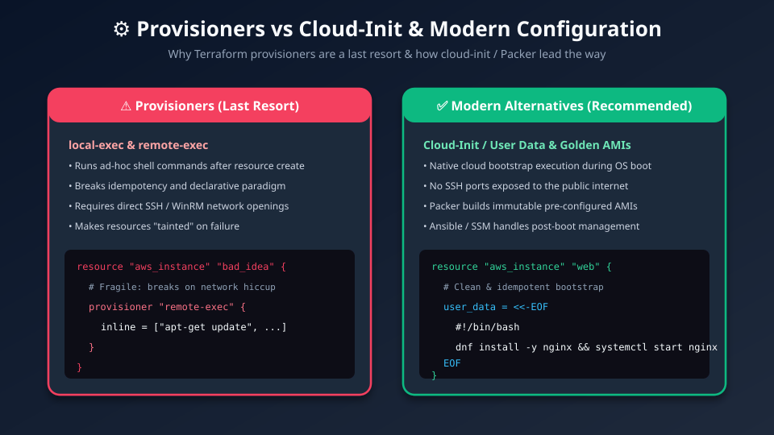
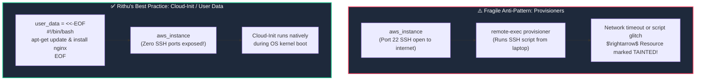

# ⚙️ 15. Provisioners vs. Cloud-Init: The Right Way to Bootstrap Servers

> *"Hey Ravi! 🌸 When you launch an EC2 virtual machine, you need software installed on it. Today, I'm going to steer you away from a dangerous anti-pattern (Provisioners) and teach you the modern, bulletproof way: Cloud-Init & Golden Images!"* — **Mentor Rithu 👩‍🏫**

---

## 👫 Mentor & Student Check-In

- **Ravi 👨‍🎓:** *"Rithu, I saw someone in a forum using `remote-exec` to SSH into an EC2 server and run `apt-get install nginx`. Is that how we install applications with Terraform?"*
- **Rithu 👩‍🏫:** *"I am so glad you asked before trying it yourself, Ravi! HashiCorp's official docs explicitly state: **Provisioners are a last resort.** Using SSH inside Terraform breaks the declarative model, exposes port 22, and taints your resources if the network drops. Today, I'll show you how we do it the elegant DevOps way with **Cloud-Init**!"*

---

## 🎯 What Ravi Will Learn Today

1. ⚠️ **Understand what provisioners are** (`local-exec`, `remote-exec`) and why HashiCorp warns against them.
2. 🦹 **Recognize the 4 major pitfalls of provisioners** (broken idempotency, open SSH ports, tainted resources).
3. 🚀 **Bootstrap servers cleanly using `user_data` and Cloud-Init**.
4. 🧱 **Embrace Immutable Infrastructure** with HashiCorp Packer and AWS Systems Manager (SSM).

---

## 📊 Visual Explanation





---

## 👶 Rithu Explains Like You Are a Beginner

### 🎂 The Custom Birthday Cake Analogy
> *"Ravi, imagine ordering a birthday cake from a bakery:"*
- **The Provisioner Approach (Messy ❌):** The baker delivers a plain, undecorated sponge cake to your house. Then, you hire a separate decorator to drive across town with frosting bags to decorate it on your dining table. If the decorator gets stuck in traffic, your party starts with a ruined, half-frosted cake!
- **The Cloud-Init / Golden Image Approach (Clean ✅):** The bakery bakes the sponge, frosts the icing, and writes "Happy Birthday Ravi" in their commercial kitchen. When the cake arrives at your door, it is **100% complete, fully baked, and ready to serve immediately**!

In Cloud computing, Ravi:
- **Provisioners:** Launching a bare VM and having Terraform SSH into it over the internet to run bash commands. If the SSH connection drops, Terraform panics!
- **Cloud-Init / User Data:** Handing the server its startup recipe as it boots up, or using **Packer** to pre-bake a complete AMI with all software already installed.

---

## ⚡ The Essential 80/20 Concepts (Rithu's Focus Sheet)

| Concept | What Rithu Wants Ravi to Know | Practical DevOps Importance |
|---|---|---|
| **`remote-exec`** | Instructs Terraform to SSH into a VM to execute commands. | **Anti-pattern:** Requires open SSH ports and fragile network tunnels. |
| **`local-exec`** | Executes a shell script locally on Ravi's computer. | Useful for local notifications or running Ansible playbooks. |
| **`user_data` (Cloud-Init)** | A boot script passed to AWS executed by the OS during startup. | **Industry standard:** Native, reliable, requires zero SSH keys. |
| **Tainted Resource** | A resource whose provisioner failed, marked for deletion. | Can accidentally trigger downtime on healthy databases! |
| **Golden AMI (Packer)** | A pre-baked machine image with all applications pre-installed. | Instances boot in 15 seconds with zero startup delays. |

---

## ✅ The Pro Way: Ravi's Clean Cloud-Init Script

Look at how clean this is, Ravi! No SSH keys needed:

```hcl
# compute.tf
resource "aws_instance" "web" {
  ami           = "ami-0c55b159cbfafe1f0"
  instance_type = "t3.micro"

  # Clean Cloud-Init bootstrap!
  user_data = <<-EOF
    #!/bin/bash
    dnf update -y
    dnf install -y nginx
    systemctl start nginx
    systemctl enable nginx
    echo "<h1>Welcome to Ravi's Server! Guided by Mentor Rithu 🚀</h1>" > /usr/share/nginx/html/index.html
  EOF

  # Recreate the server automatically if user_data changes!
  user_data_replace_on_change = true

  tags = {
    Name  = "Ravi-Web-Server"
    Owner = "Ravi"
  }
}
```

---

## 🛠️ The Only Acceptable Use for `local-exec`

If there's one place where `local-exec` is acceptable, it's for local logging on Ravi's machine:

```hcl
resource "aws_instance" "web" {
  ami           = "ami-0c55b159cbfafe1f0"
  instance_type = "t3.micro"

  # Log the new server IP to a local file
  provisioner "local-exec" {
    command = "echo Server ${self.public_ip} deployed successfully! >> audit.log"
  }
}
```

---

## 🧪 Hands-on Practice: Ravi's Local-Exec & Script Lab

### 🎯 Objective
Use `local-exec` safely to run a local script upon resource creation.

### 🚀 Steps for Ravi:

1. Create a practice folder:
   ```bash
   mkdir ravi-provisioner-lab
   cd ravi-provisioner-lab
   ```

2. Create `main.tf`:
   ```hcl
   terraform {
     required_providers {
       local = {
         source  = "hashicorp/local"
         version = "~> 2.5"
       }
     }
   }

   resource "local_file" "config" {
     filename = "${path.module}/bootstrap.conf"
     content  = "SYSTEM_READY=true\nOPERATOR=Ravi\nMENTOR=Rithu\n"

     provisioner "local-exec" {
       command = "echo Bootstrap completed at $(date) >> lab-audit.log"
     }
   }
   ```

3. Initialize and apply:
   ```bash
   terraform init
   terraform apply -auto-approve
   ```

### 🔎 Expected Result:
Check `lab-audit.log`:
```bash
cat lab-audit.log
```

### 🧹 Cleanup:
```bash
terraform destroy -auto-approve
rm -f lab-audit.log
```

---

## 💬 Ravi's Doubt Corner

### Ravi: *"Rithu, what does it mean when Terraform says a resource is 'Tainted'?"*
**Rithu:** *"If a provisioner script fails midway, Terraform marks the resource as 'Tainted' in the state file. It means: 'This server was created, but its setup failed, so it might be in a broken state.' On your next `terraform apply`, Terraform will automatically delete and recreate the tainted resource from scratch!"*

---

## ⚡ Quick Revision with Rithu

- 📌 **Provisioners:** `remote-exec` (SSH), `local-exec` (Local)
- 📌 **Why Avoid:** Non-declarative, opens port 22, taints resources on failure
- 📌 **Best Practice:** Use `user_data` with Cloud-Init
- 📌 **Auto-Recreate:** `user_data_replace_on_change = true`
- 📌 **Enterprise Gold Standard:** Pre-bake images with **HashiCorp Packer**!

> [!TIP]
> **Rithu's Note to Ravi:** *"You're making incredible progress, Ravi! In Chapter 16, let's explore Enterprise Best Practices and how senior architects limit blast radius!"* 🏆✨
