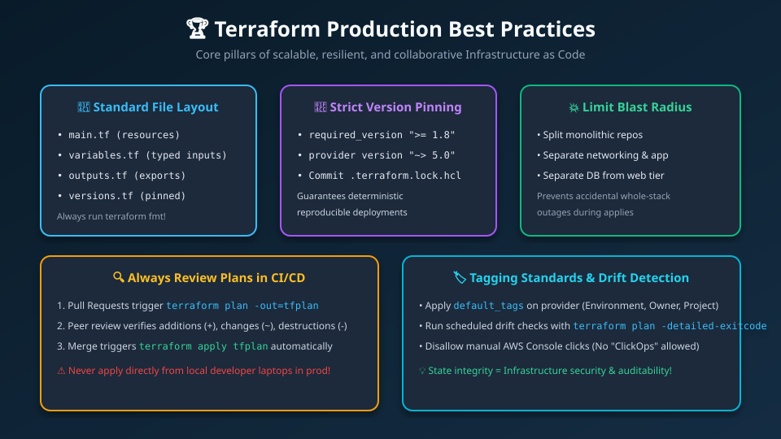
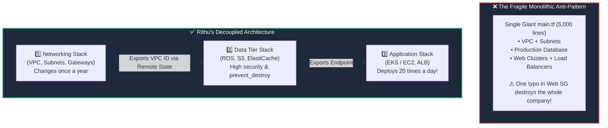

# 🏆 16. Terraform Enterprise Best Practices & Production Guidelines

> *"Hey Ravi! 🌸 Good Terraform code builds servers. Great Terraform code scales across 50 engineers, prevents 3:00 AM outages, and survives company compliance audits!"* — **Mentor Rithu 👩‍🏫**

---

## 👫 Mentor & Student Check-In

- **Ravi 👨‍🎓:** *"Rithu, what is the biggest difference between junior engineers writing Terraform and senior architects running production infrastructure?"*
- **Rithu 👩‍🏫:** *"Senior architects design for failure, Ravi! They ask: 'If an intern makes a mistake in the web tier, will it knock down our primary database?' Today, I'm going to teach you how to limit your **Blast Radius**, enforce mandatory company tagging, and automate drift checks!"*

---

## 🎯 What Ravi Will Learn Today

1. 💥 **Limit Blast Radius** by breaking giant state files into independent, decoupled stacks.
2. 🏷️ **Enforce mandatory tagging standards** globally using provider `default_tags`.
3. 📌 **Implement strict 3-tier version pinning** across Core, Providers, and Modules.
4. 🤖 **Automate continuous drift detection** in CI/CD pipelines using `-detailed-exitcode`.

---

## 📊 Visual Explanation





---

## 👶 Rithu Explains Like You Are a Beginner

### 🚢 The Titanic Bulkheads Analogy
> *"Ravi, imagine an ocean liner sailing across the North Atlantic:"*
- If the ship is just one big hollow hull and strikes an iceberg, seawater fills the entire ship, and it sinks.
- To prevent this, modern ships are built with **Watertight Bulkhead Compartments**:
  - If water breaches Compartment 1, heavy steel doors seal shut automatically.
  - Compartments 2, 3, and 4 stay completely dry.
  - The ship safely sails to harbor!

**In Terraform, separating your infrastructure into independent state files is your watertight bulkhead.**
If a deployment fails on the web application tier, the **Networking** and **Database** tiers are in separate state files—they cannot be touched, corrupted, or destroyed!

---

## ⚡ The Essential 80/20 Concepts (Rithu's Focus Sheet)

| Pillar | What Rithu Wants Ravi to Know | Practical Benefit |
|---|---|---|
| **Limit Blast Radius** | Separate state into independent stacks (Networking, Data, Compute). | An error on an app deployment cannot knock down your core network or drop a database. |
| **Strict Version Pinning** | Pin Terraform version (`required_version`), Provider versions (`~> 5.0`), and Modules. | Guarantees deterministic, reproducible builds without unexpected upstream breakage. |
| **Enforce `default_tags`** | Declare universal tags (Environment, Owner, CostCenter) in the `provider` block. | 100% cloud cost tracking and audit compliance without manual tagging on every resource. |
| **Automate Formatting** | Always run `terraform fmt -recursive` in CI/CD pipelines. | Clean, unified Git diffs without styling arguments in pull requests. |
| **Plan-First Review** | Run `terraform plan` in Pull Requests, apply ONLY after human peer approval. | Catches unexpected destructions (`- / +`) before production is touched. |

---

## 🏷️ 1. Global Tagging Hygiene with `default_tags`

Ravi, never manually write `tags = { ... }` 50 times across every individual resource block! Instead, declare them globally on the AWS provider:

```hcl
# providers.tf
provider "aws" {
  region = "us-east-1"

  # Applies to EVERY resource created in this AWS account!
  default_tags {
    tags = {
      Environment = "Production"
      Project     = "CloudRocket"
      ManagedBy   = "Terraform"
      Owner       = "Ravi"
      Mentor      = "Rithu"
    }
  }
}
```

---

## 📂 2. Decoupling State: Rithu's Blast Radius Architecture

Organize your corporate repositories into independent state directories:

```text
infrastructure/
├── environments/
│   ├── prod/
│   │   ├── 01-networking/   # VPC, Subnets, NAT Gateways (Applies rarely)
│   │   ├── 02-database/     # RDS PostgreSQL, Redis (prevent_destroy)
│   │   └── 03-compute/      # EC2, Application Load Balancers (Deploys often!)
│   └── staging/
│       ├── 01-networking/
│       ├── 02-database/
│       └── 03-compute/
```

---

## 🤖 3. Continuous Drift Detection in CI/CD

Run a daily scheduled cron job or GitHub Action:
```bash
terraform plan -detailed-exitcode
```
- `0`: Succeeded with **zero changes** (Infrastructure in 100% sync! 🟢)
- `1`: Error encountered.
- `2`: Succeeded, but **Drift Detected** (Send a Slack notification to Ravi & Rithu! 🔔)

---

## 💬 Ravi's Doubt Corner

### Ravi: *"Rithu, how long should a `terraform plan` take to run in a healthy project?"*
**Rithu:** *"If your plan takes longer than 2 minutes to calculate, your state file has grown too big! That's a red flag that you're managing too many resources in a single folder. Decouple it into smaller stacks to keep your feedback loop fast and your blast radius small!"*

---

## ⚡ Quick Revision with Rithu

- 📌 **Auto-Format Everything:** `terraform fmt -recursive`
- 📌 **Global Tagging:** `default_tags` in provider block
- 📌 **Decouple Stacks:** Separate Networking from Data from Compute
- 📌 **Drift Alerts:** `terraform plan -detailed-exitcode`

> [!TIP]
> **Rithu's Note to Ravi:** *"You're thinking like a senior DevOps engineer now, Ravi! In Chapter 17, let's explore Security, Secrets Hygiene, and Zero-Trust Architecture!"* 🛡️✨
