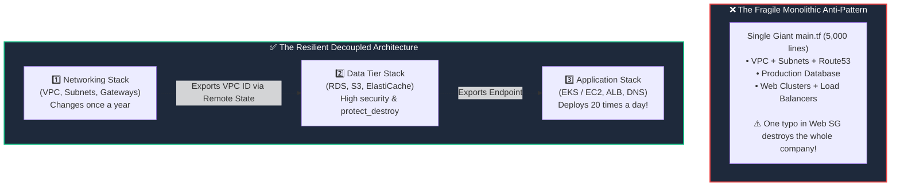

# 🏆 16. Terraform Enterprise Best Practices & Production Guidelines

> *"Good Terraform code manages servers. Great Terraform code scales teams, prevents 3:00 AM outages, and survives company audits!"* 🛡️📋

When transitioning from toy labs to production enterprise environments, the challenges shift from *"How do I write HCL?"* to *"How do 50 engineers collaborate safely on mission-critical banking infrastructure?"* In this chapter, you will learn the battle-tested conventions, architectural patterns, and safety guardrails used by top DevOps teams worldwide.

---

## 🎯 Learning Objectives

By the end of this topic, you will be able to:
1. 💥 **Limit Blast Radius** by decoupling monolithic architectures into independent, decoupled state stacks.
2. 🏷️ **Enforce mandatory tagging standards** across all cloud resources using provider `default_tags`.
3. 📌 **Implement strict version pinning** across Terraform Core, Provider plugins, and child modules.
4. 🤖 **Automate continuous drift detection** and CI/CD plan reviews in production.

---

## 📊 Visual Explanation




---

## 👶 Explain Like I Am a Beginner

### 🚢 The Titanic Bulkheads Analogy
When engineers built ocean liners, they learned a painful lesson: if a ship is just one big hollow hull and hits an iceberg, water fills the entire hull and the ship sinks. 

To solve this, modern ships are built with **Watertight Bulkhead Compartments**:
- If water breaches Compartment 1, heavy steel doors seal shut automatically.
- Compartment 2, 3, and 4 stay completely dry.
- The ship safely makes it to harbor!

**In Terraform, dividing your infrastructure into separate state files is your watertight bulkhead.**
If a junior engineer makes a typo while deploying the web application tier, the **Networking** and **Database** tiers are in completely separate state files—they cannot be touched, corrupted, or destroyed!

---

## ⚡ The Essential 80/20 Concepts

| Best Practice Pillar | Rule of Thumb | Practical Benefit |
|---|---|---|
| **Limit Blast Radius** | Separate state into independent stacks (Networking, Database, Compute). | A bad apply on an app deployment cannot knock down your core network or drop a database. |
| **Strict Version Pinning** | Pin Terraform version (`required_version`), Provider versions (`~> 5.0`), and Modules (`version = "x.y"`). | Guarantees deterministic, reproducible builds without unexpected upstream breakage. |
| **Enforce `default_tags`** | Declare universal tags (Environment, Owner, CostCenter, Repository) in the `provider` block. | 100% cloud cost tracking and audit compliance without manual tagging on every resource. |
| **Automate Formatting** | Always run `terraform fmt -recursive` in pre-commit hooks and CI pipelines. | Clean, unified Git diffs without styling arguments in pull requests. |
| **Plan-First Review (CI/CD)** | Run `terraform plan` in Pull Requests, apply ONLY after human peer approval. | Catches unexpected destructions (`- / +`) before production is touched. |

---

## 🏷️ 1. Global Tagging Hygiene with `default_tags`

Never manually write `tags = { ... }` 50 times across every individual resource block! Instead, declare them globally on the AWS provider:

```hcl
# providers.tf
provider "aws" {
  region = "us-east-1"

  # Applies to EVERY resource created in this AWS account!
  default_tags {
    tags = {
      Environment = "Production"
      Project     = "CoreBanking"
      ManagedBy   = "Terraform"
      Owner       = "FinOps-Squad"
      Repository  = "github.com/my-org/terraform-infrastructure"
    }
  }
}
```

If a specific resource needs extra tags, simply add them—Terraform will automatically merge them with the default tags!

---

## 📌 2. The Strict Three-Tier Version Pinning Rule

Always create a `versions.tf` in every root directory:

```hcl
# versions.tf
terraform {
  # 1. Pin Terraform Core Engine
  required_version = ">= 1.8.0, < 2.0.0"

  # 2. Pin Provider Plugins with pessimistic constraints
  required_providers {
    aws = {
      source  = "hashicorp/aws"
      version = "~> 5.45"
    }
    random = {
      source  = "hashicorp/random"
      version = "~> 3.6"
    }
  }
}
```

And when sourcing Registry modules, **always pin the module version**:
```hcl
module "vpc" {
  source  = "terraform-aws-modules/vpc/aws"
  version = "5.8.1" # 👈 Explicit pin! Never leave unpinned!
  # ...
}
```

---

## 📂 3. Decoupling State: The Blast Radius Architecture

Organize your corporate repositories into independent state directories:

```text
infrastructure/
├── global/
│   └── s3-and-iam/          # IAM roles, KMS keys, State buckets (Apply rarely)
├── environments/
│   ├── prod/
│   │   ├── 01-networking/   # VPC, Subnets, NAT Gateways, Transit Gateway
│   │   ├── 02-database/     # RDS PostgreSQL, Redis, DynamoDB (prevent_destroy)
│   │   └── 03-compute/      # ECS/EKS, EC2, Application Load Balancers
│   └── staging/
│       ├── 01-networking/
│       ├── 02-database/
│       └── 03-compute/
```

### How Does Compute Read the VPC ID?
Use `terraform_remote_state` or query with `data` sources:

```hcl
# In compute/main.tf:
data "terraform_remote_state" "networking" {
  backend = "s3"
  config = {
    bucket = "acme-terraform-state"
    key    = "environments/prod/01-networking/terraform.tfstate"
    region = "us-east-1"
  }
}

# Use the VPC ID safely:
resource "aws_security_group" "web" {
  vpc_id = data.terraform_remote_state.networking.outputs.vpc_id
  # ...
}
```

---

## 🤖 4. Continuous Drift Detection in CI/CD

Over time, developers or sysadmins might make emergency manual changes in the AWS Console. How do you find out?

Set up a **Daily Scheduled GitHub Action or Cron Job**:
```bash
terraform plan -detailed-exitcode
```

### Exit Codes Meaning:
- `0`: Succeeded with **zero changes** (Infrastructure is in 100% sync! 🟢)
- `1`: Error encountered.
- `2`: Succeeded, but **Drift Detected** (Cloud differs from code! 🔔 Send Slack notification to DevOps team!)

---

## 🧪 Hands-on Practice: Multi-File Best-Practice Structure

### 🎯 Objective
Assemble a standards-compliant project featuring `versions.tf`, `providers.tf`, `variables.tf`, and `outputs.tf` with global `default_tags`.

### 📋 Prerequisites
Terraform CLI installed.

### 🚀 Steps to Follow:

1. Create a lab directory:
   ```bash
   mkdir best-practices-lab
   cd best-practices-lab
   ```

2. Create `versions.tf`:
   ```hcl
   terraform {
     required_version = ">= 1.8.0"
     required_providers {
       local = {
         source  = "hashicorp/local"
         version = "~> 2.5"
       }
     }
   }
   ```

3. Create `variables.tf`:
   ```hcl
   variable "project_name" {
     type        = string
     description = "Name of the DevOps project"
     default     = "Apollo-Cloud"
   }
   ```

4. Create `main.tf`:
   ```hcl
   locals {
     mandatory_tags = {
       Project   = var.project_name
       ManagedBy = "Terraform"
     }
   }

   resource "local_file" "deployment_manifest" {
     filename = "${path.module}/manifest.json"
     content  = jsonencode({
       name      = var.project_name
       status    = "Ready"
       tags      = locals.mandatory_tags
       timestamp = timestamp()
     })
   }
   ```

5. Create `outputs.tf`:
   ```hcl
   output "manifest_location" {
     description = "Path to manifest"
     value       = local_file.deployment_manifest.filename
   }
   ```

6. Run formatting and validation:
   ```bash
   terraform fmt -check
   terraform validate
   terraform init
   terraform apply -auto-approve
   ```

### 🧹 Cleanup Instructions:
```bash
terraform destroy -auto-approve
```

---

## ⚠️ Common Beginner Mistakes

### 1. The 10,000-Line Monolith Repository
- **What it looks like:** Putting VPC, 12 microservices, databases, and monitoring in a single directory.
- **Why it is fatal:** `terraform plan` takes 15 minutes to run, state lock contention blocks all developers, and a small error can destroy unrelated production assets.
- **The Fix:** Split by lifecycle and blast radius.

### 2. Missing Pre-Commit Hooks
- **What it looks like:** Committing unformatted HCL and syntax errors to pull requests.
- **The Fix:** Use `pre-commit` with `terraform-docs`, `terraform fmt`, and `tflint`.

### 3. Modifying Infrastructure Manually in Emergencies
- **What it looks like:** Manually resizing an AWS database during an incident and never updating the Terraform code.
- **The Result:** The next `terraform apply` shrinks the database back down, triggering a second outage!
- **The Fix:** If an emergency manual change is made, update the Terraform code immediately afterwards to match reality!

---

## 💼 Interview Revision Questions

### Q1: What does "Blast Radius" mean in Terraform, and how do you reduce it?
**Answer:** Blast radius refers to the scope of infrastructure damage that can occur if a single `terraform apply` fails or experiences an error. To minimize blast radius, decouple large monolithic state files into smaller, independently managed stacks (e.g. Networking, Storage/Database, Compute/Application) stored in separate state paths.

### Q2: What is the purpose of `terraform plan -detailed-exitcode`?
**Answer:** It returns distinct exit codes useful for CI/CD scripting: `0` for success with no changes, `1` for execution failure, and `2` for success with detected differences/drift. It is standard for automated drift-detection jobs.

### Q3: Why should reusable child modules strictly pin provider versions differently than root modules?
**Answer:** Child modules should use loose/pessimistic constraints (e.g. `>= 5.0, < 6.0`) to avoid conflicts when multiple child modules are combined in a root module. The root module, however, pins the exact version via `.terraform.lock.hcl` to ensure deterministic execution.

---

## ⚡ Quick Revision & Cheat Sheet

- 📌 **Auto-Format Everything:** `terraform fmt -recursive`
- 📌 **Lint Code:** `terraform validate`
- 📌 **Global Tagging:** `default_tags { tags = { ... } }` in provider block
- 📌 **Decouple Stacks:** Separate Networking from Database from App
- 📌 **Drift Alert:** `terraform plan -detailed-exitcode`

> [!TIP]
> **Remember This:** If an apply takes longer than 2 minutes to calculate its plan, your state file is too large! Break it into smaller stacks to speed up feedback loops and limit blast radius!
