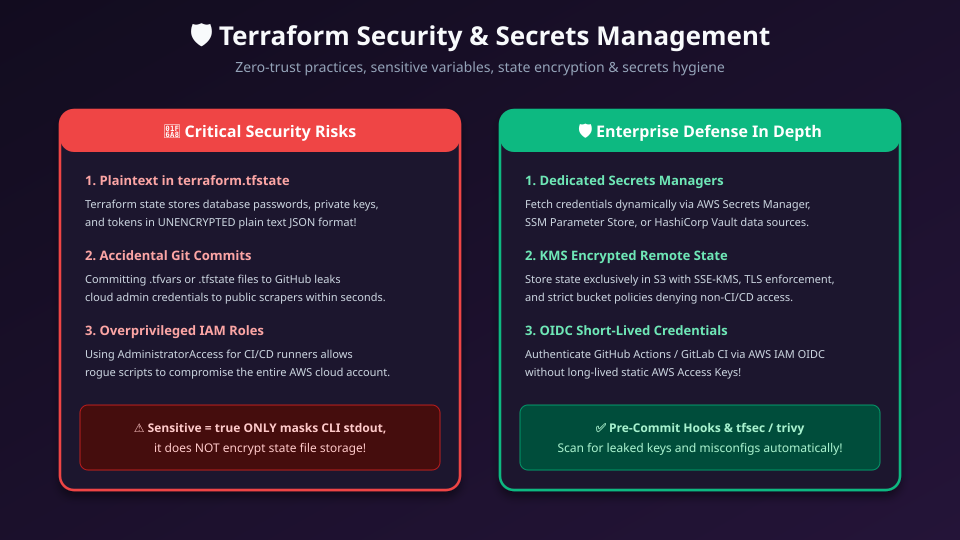
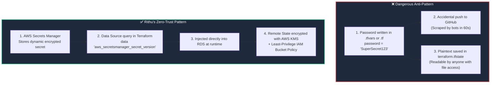

# 🛡️ 17. Terraform Security, Secrets Hygiene & Zero-Trust Architecture

> *"Hey Ravi! 🌸 In DevOps, security isn't something we bolt on at the end—it's the foundation of everything we build. Today, I'll teach you how to protect your credentials, secure state files, and eliminate static AWS keys forever!"* — **Mentor Rithu 👩‍🏫**

---

## 👫 Mentor & Student Check-In

- **Ravi 👨‍🎓:** *"Rithu, I have a database password that my EC2 app needs. If I don't write it in `.tfvars`, how does Terraform pass it to AWS?"*
- **Rithu 👩‍🏫:** *"By using **AWS Secrets Manager**, Ravi! We let AWS generate and store the password securely in its own encrypted vault. Terraform simply looks up the secret reference dynamically at runtime. You and I never have to see or type the raw password in our code!"*

---

## 🎯 What Ravi Will Learn Today

1. 🚨 **Avoid the 3 greatest security traps** in Terraform (State exposure, Git leaks, overprivileged IAM).
2. 🔑 **Fetch secrets dynamically** from **AWS Secrets Manager** and **SSM Parameter Store**.
3. 🤖 **Authenticate CI/CD pipelines safely via OIDC** without long-lived static AWS Access Keys.
4. 🛡️ **Scan your Terraform code automatically** using **Trivy** and **Checkov**.

---

## 📊 Visual Explanation





---

## 👶 Rithu Explains Like You Are a Beginner

### 🏦 The Bank Safe vs. The Sticky Note
> *"Ravi, imagine keeping your ATM PIN safe:"*
- **The Bad Way (Sticky Note):** You write your 4-digit PIN on a bright yellow Sticky Note and paste it onto your laptop screen at a busy coffee shop. Anyone walking past can steal your money.  
  *(Writing passwords in `terraform.tfvars` is putting a sticky note on your monitor!)*
- **The Secure Way (Bank Safe):** You keep the PIN in a biometric password vault. When you need it, you retrieve it temporarily and enter it privately.

In Terraform, Ravi:
- We store secrets in **AWS Secrets Manager** or **AWS SSM Parameter Store**.
- Terraform fetches the credentials dynamically via a data source query at apply time.
- No plain text passwords ever sit in your Git repository!

---

## ⚡ The Essential 80/20 Concepts (Rithu's Focus Sheet)

| Security Principle | What Rithu Wants Ravi to Know | Practical Impact |
|---|---|---|
| **State is Plaintext** | Everything in `terraform.tfstate` is unencrypted JSON, including passwords. | State files must be treated like production root passwords. |
| **`sensitive = true` Limit** | Only suppresses terminal printing; does NOT encrypt state file storage. | Essential for log hygiene, but backend encryption is still mandatory! |
| **Dynamic Secrets Lookup** | Querying AWS Secrets Manager instead of writing passwords in HCL. | Eliminates static credentials from code repositories. |
| **OIDC for CI/CD** | Using GitHub Actions OpenID Connect to request short-lived 15-minute AWS tokens. | Eliminates the need to create static, leakable IAM Access Keys. |
| **Static Code Analysis (SAST)** | Running tools like `trivy` or `checkov` before applying code. | Catches open security groups (`0.0.0.0/0`) before deployment. |

---

## 🔑 Secure Pattern: Dynamic Secrets in Action

```hcl
# 1. Look up the Secret in AWS Secrets Manager
data "aws_secretsmanager_secret" "db_secret" {
  name = "production/rds/master-password"
}

# 2. Fetch the latest secret payload
data "aws_secretsmanager_secret_version" "current" {
  secret_id = data.aws_secretsmanager_secret.db_secret.id
}

locals {
  creds = jsondecode(data.aws_secretsmanager_secret_version.current.secret_string)
}

# 3. Provision RDS using fetched credentials!
resource "aws_db_instance" "database" {
  allocated_storage = 50
  engine            = "postgres"
  instance_class    = "db.t4g.medium"
  username          = locals.creds.username
  password          = locals.creds.password # 👈 Zero hardcoding!
  storage_encrypted = true

  lifecycle {
    prevent_destroy = true
  }
}
```

---

## 🤖 GitHub Actions OIDC: No More Static Keys!

> *"Ravi, in modern companies, we don't store `AWS_ACCESS_KEY_ID` in GitHub secrets anymore! We use OIDC (OpenID Connect)!"* — **Rithu**

With OIDC:
1. GitHub Actions presents a cryptographically signed token to AWS STS.
2. AWS STS verifies that the request came from Ravi's specific GitHub repo (`repo:ravi/my-infra`).
3. AWS issues a **temporary, short-lived 15-minute token** that expires automatically.
4. **Result:** If someone inspects your GitHub secrets, there are zero static keys to steal!

---

## 💬 Ravi's Doubt Corner

### Ravi: *"Rithu, what is the best tool to scan my Terraform code for security flaws before I commit?"*
**Rithu:** *"My favorite tool is **Trivy**! It's super fast. You just run `trivy config .` in your terminal. It checks for unencrypted S3 buckets, security groups that allow `0.0.0.0/0` on sensitive ports, and missing tags in seconds!"*

---

## ⚡ Quick Revision with Rithu

- 📌 **Mask Logs:** `sensitive = true` on variables & outputs
- 📌 **State Security:** S3 SSE-KMS + S3 Versioning + Block Public Access
- 📌 **Zero Static Keys:** Use GitHub Actions OIDC
- 📌 **Dynamic Fetch:** Use `data "aws_secretsmanager_secret_version"`
- 📌 **Pre-Flight Scans:** `trivy config .`

> [!CAUTION]
> **Rithu's Golden Reminder:** Never commit `.tfvars` or `.tfstate` files to GitHub. State files contain plain text secrets, so protect your S3 state bucket like Fort Knox! 🔐
