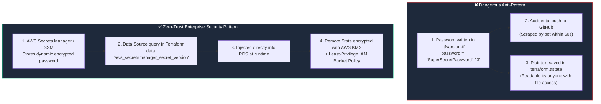

# 🛡️ 17. Terraform Security, Secrets Hygiene & Zero-Trust Architecture

> *"A single committed secret on GitHub can cost your company tens of thousands of dollars in minutes. Secure your Terraform pipeline from Day 1!"* 🔐🚨

In Infrastructure as Code, security is not an afterthought—it is the foundation. Because Terraform provisions core security groups, database credentials, IAM roles, and encryption keys, a single misconfiguration can expose your entire enterprise cloud to the public internet. In this chapter, you will master secrets hygiene, state file protection, and automated security scanners.

---

## 🎯 Learning Objectives

By the end of this topic, you will be able to:
1. 🚨 **Understand the 3 greatest security traps** in Terraform (State exposure, Git leaks, overprivileged IAM).
2. 🔑 **Fetch secrets dynamically** from **AWS Secrets Manager** and **SSM Parameter Store** without writing passwords in code.
3. 🤖 **Authenticate CI/CD pipelines safely via OIDC** without long-lived static AWS Access Keys.
4. 🛡️ **Scan your Terraform code automatically** for security vulnerabilities using **Trivy** and **Checkov**.

---

## 📊 Visual Explanation




---

## 👶 Explain Like I Am a Beginner

### 🏦 The Bank Safe vs. The Sticky Note
Imagine storing your ATM PIN:
- **The Bad Way:** You write your 4-digit PIN on a bright yellow Sticky Note and paste it onto your computer monitor at a busy coffee shop. Anyone walking by can see it.
- **The Secure Way:** You memorize the PIN, or keep it inside an encrypted password vault on your phone protected by biometric FaceID. When you need it at the ATM, you retrieve it temporarily and punch it in.

In Terraform:
- **Writing passwords in `terraform.tfvars`:** Putting a sticky note on your monitor.
- **Using AWS Secrets Manager:** Calling the bank safe to generate and rotate a strong 32-character password automatically. Terraform simply passes the reference without anyone seeing the plain text!

---

## ⚡ The Essential 80/20 Concepts

| Security Principle | Explanation | Practical Impact |
|---|---|---|
| **State is Plaintext** | Everything in `terraform.tfstate` is unencrypted JSON, including passwords and certificates. | State files must be treated like production root passwords. |
| **`sensitive = true` Limit** | Only suppresses terminal printing; does NOT encrypt state file storage. | Essential for CI/CD log hygiene, but not a replacement for backend encryption. |
| **Dynamic Secrets Lookup** | Querying AWS Secrets Manager or HashiCorp Vault instead of defining passwords in HCL. | Eliminates static credentials from code repositories. |
| **OIDC for CI/CD** | Using GitHub Actions OpenID Connect to request short-lived 15-minute AWS tokens. | Eliminates the need to generate static IAM Access Keys. |
| **Static Code Analysis (SAST)** | Running tools like `trivy` or `checkov` before applying code. | Catches open security groups (`0.0.0.0/0`) and unencrypted buckets before deployment. |

---

## 🔑 Secure Pattern: Fetching Secrets from AWS Secrets Manager

Instead of defining database passwords in variables or `.tfvars`, create the secret in AWS Secrets Manager first, then read it dynamically:

```hcl
# 1. Look up the Secret container by name
data "aws_secretsmanager_secret" "db_secret" {
  name = "production/rds/master-password"
}

# 2. Fetch the latest secret version payload
data "aws_secretsmanager_secret_version" "current" {
  secret_id = data.aws_secretsmanager_secret.db_secret.id
}

# 3. Parse JSON secret payload safely
locals {
  db_credentials = jsondecode(data.aws_secretsmanager_secret_version.current.secret_string)
}

# 4. Provision database using fetched secret!
resource "aws_db_instance" "prod_database" {
  allocated_storage      = 50
  engine                 = "postgres"
  instance_class         = "db.t4g.medium"
  username               = locals.db_credentials.username
  password               = locals.db_credentials.password # 👈 Zero hardcoding!
  skip_final_snapshot    = false
  storage_encrypted      = true

  lifecycle {
    prevent_destroy = true
  }
}
```

---

## 🤖 GitHub Actions OIDC: Say Goodbye to AWS Access Keys!

Storing static `AWS_ACCESS_KEY_ID` and `AWS_SECRET_ACCESS_KEY` in GitHub repository secrets is a major security risk: if someone with repo access prints environment variables, the credentials are compromised.

### The Modern OIDC Approach:
1. Configure an **AWS IAM Identity Provider** for GitHub (`token.actions.githubusercontent.com`).
2. Create an IAM Role with a Trust Policy permitting your specific repository:
   ```json
   {
     "Version": "2012-10-17",
     "Statement": [
       {
         "Effect": "Allow",
         "Principal": { "Federated": "arn:aws:iam::123456789012:oidc-provider/token.actions.githubusercontent.com" },
         "Action": "sts:AssumeRoleWithWebIdentity",
         "Condition": {
           "StringEquals": {
             "token.actions.githubusercontent.com:aud": "sts.amazonaws.com"
           },
           "StringLike": {
             "token.actions.githubusercontent.com:sub": "repo:my-org/my-infra-repo:ref:refs/heads/main"
           }
         }
       }
     ]
   }
   ```
3. Inside your GitHub Actions workflow:
   ```yaml
   # .github/workflows/terraform.yml
   jobs:
     deploy:
       runs-on: ubuntu-latest
       permissions:
         id-token: write # Required for requesting the JWT
         contents: read
       steps:
         - uses: actions/checkout@v4
         - name: Authenticate to AWS via OIDC
           uses: aws-actions/configure-aws-credentials@v4
           with:
             role-to-assume: arn:aws:iam::123456789012:role/GitHubActionsTerraformRole
             aws-region: us-east-1
         - run: terraform apply tfplan
   ```
🎉 **No static credentials exist anywhere!** GitHub obtains a 15-minute temporary session token from AWS STS that expires automatically.

---

## 🛡️ Pre-Flight Security Scans: Trivy & Checkov

Before running `terraform apply`, always scan your code locally:

### Using Trivy (Fast & Lightweight):
```bash
# Install trivy, then scan directory:
trivy config .
```

### Using Checkov:
```bash
checkov -d .
```

### Example Checkov Finding:
```text
Passed checks: 14, Failed checks: 1, Skipped checks: 0

Check: CKV_AWS_20: "Ensure S3 bucket has an Object Lock configuration"
FAILED for resource: aws_s3_bucket.data
File: /main.tf:12-25
Guidance: Enable object lock to prevent malicious deletion!
```

---

## 🧪 Hands-on Practice: Simulating Sensitive State & Masking

### 🎯 Objective
Create a configuration with sensitive inputs and observe how Terraform masks the values in CLI output while storing them in state.

### 📋 Prerequisites
Terraform CLI installed.

### 🚀 Steps to Follow:

1. Create a lab directory:
   ```bash
   mkdir security-lab
   cd security-lab
   ```

2. Create `main.tf`:
   ```hcl
   terraform {
     required_providers {
       local = {
         source  = "hashicorp/local"
         version = "~> 2.5"
       }
     }
   }

   variable "api_token" {
     type        = string
     default     = "super-secret-jwt-token-999"
     sensitive   = true # 👈 Masks output in terminal!
   }

   resource "local_file" "vault_record" {
     filename = "${path.module}/app-secret.conf"
     content  = "TOKEN=${var.api_token}\n"
   }

   output "masked_token" {
     value     = var.api_token
     sensitive = true
   }
   ```

3. Initialize and apply:
   ```bash
   terraform init
   terraform apply -auto-approve
   ```

4. **Observe the Terminal Output:**
   ```text
   Apply complete! Resources: 1 added, 0 changed, 0 destroyed.

   Outputs:
   masked_token = <sensitive>
   ```
   Notice that Terraform did **not** print your secret token!

5. **Now Inspect the State File:**
   ```bash
   cat terraform.tfstate
   ```
   Search for `super-secret-jwt-token-999`:
   *You will see the plain text token inside the JSON!*
   This proves why protecting `.tfstate` with S3 KMS encryption and IAM least-privilege is non-negotiable!

### 🧹 Cleanup Instructions:
```bash
terraform destroy -auto-approve
rm -f app-secret.conf
```

---

## ⚠️ Common Beginner Mistakes

### 1. Committing `.env` or `terraform.tfvars` Files to Git
- **The Catastrophe:** Cloud providers constantly scan public GitHub for leaked AWS keys; attackers scan even faster. A leaked key will result in an account takeover within minutes.
- **The Fix:** Maintain a strict `.gitignore`:
  ```gitignore
  .terraform/
  *.tfstate
  *.tfstate.*
  *.tfvars
  *.tfvars.json
  override.tf
  ```

### 2. Using `AdministratorAccess` IAM Policies for Terraform
- **The Risk:** If someone injects malicious code or runs a compromised module, the script has full permissions to delete the entire AWS organization.
- **The Fix:** Follow IAM Least Privilege. Grant permissions scoped only to the services being managed.

### 3. Printing Sensitive Outputs in Plaintext
- **What it looks like:** Declaring an output for a password without `sensitive = true`.
- **The Result:** CI/CD build logs publicly display the database password to anyone who can view the pipeline logs.
- **The Fix:** Always mark secrets with `sensitive = true` in both variables and outputs.

---

## 💼 Interview Revision Questions

### Q1: Does setting `sensitive = true` encrypt the value inside the Terraform state file?
**Answer:** No. Setting `sensitive = true` only instructs Terraform to mask the value as `<sensitive>` in CLI stdout logs, plan summaries, and output commands. The value is still stored in **unencrypted plain text** inside the `terraform.tfstate` file. State security must be handled via encrypted remote storage (e.g. AWS S3 with SSE-KMS) and strict IAM access controls.

### Q2: How does OpenID Connect (OIDC) improve Terraform security in CI/CD pipelines?
**Answer:** OIDC enables CI/CD pipelines (such as GitHub Actions) to authenticate to cloud providers using short-lived, dynamically generated JWT tokens from the identity provider. This completely eliminates the need to generate, store, and rotate long-lived, static cloud API access keys within CI/CD secrets.

### Q3: What is the purpose of static code analysis tools like Checkov, Trivy, or tfsec in a Terraform workflow?
**Answer:** These tools perform pre-deployment static application security testing (SAST) directly on HCL code. They scan for cloud security misconfigurations—such as publicly accessible S3 buckets, unrestricted ingress rules (`0.0.0.0/0`), missing encryption at rest, and unversioned resources—before any code is applied to real cloud infrastructure.

---

## ⚡ Quick Revision & Cheat Sheet

- 📌 **Mask Logs:** `sensitive = true` on variables & outputs
- 📌 **State Security:** S3 SSE-KMS + S3 Versioning + Block Public Access
- 📌 **Zero Static Keys:** Use GitHub Actions OIDC with AWS IAM Roles
- 📌 **Fetch at Runtime:** Use `data "aws_secretsmanager_secret_version"`
- 📌 **Scan Code:** `trivy config .` or `checkov -d .`

> [!CAUTION]
> **Remember This:** Never commit `.tfvars` or `.tfstate` files to Git. State files contain plain text secrets, so treat your remote state bucket like your most sensitive corporate database!
