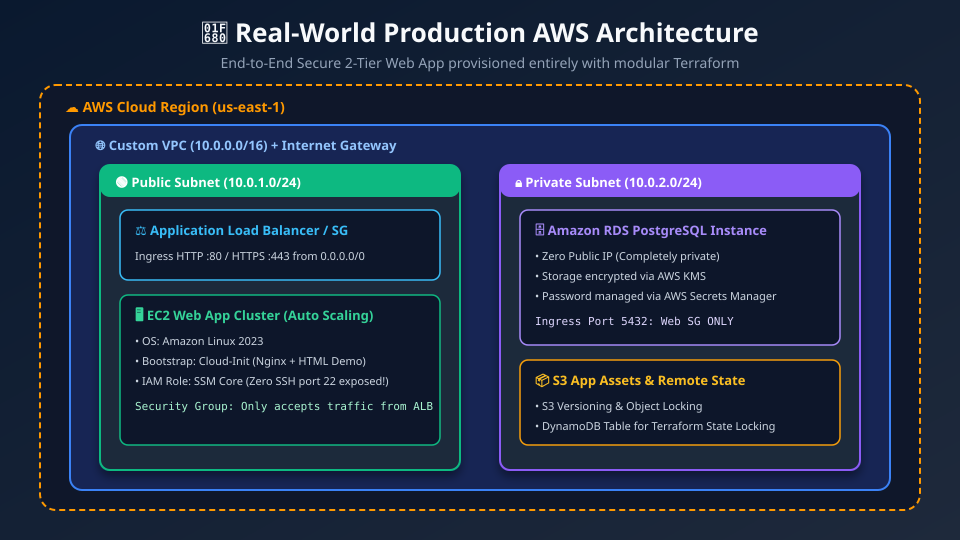
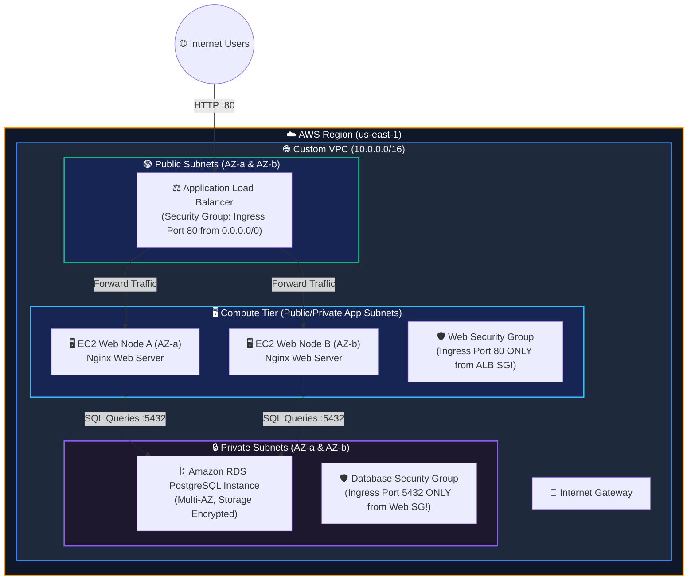

# 🚀 18. Real-World Production Capstone Project: Secure 2-Tier AWS Web Stack

> *"Put everything you have learned together! Build a complete, enterprise-grade, highly available 2-tier web application stack on AWS from scratch with Terraform!"* 🏗️☁️✨

Welcome to your **Capstone Project**! You have mastered fundamentals, HCL syntax, providers, resources, variables, state, data sources, meta-arguments, modules, and security. Now it's time to assemble these building blocks into a production-ready, highly available architecture in AWS.

---

## 🎯 Learning Objectives & Project Goals

In this capstone, you will build an end-to-end architecture that adheres to AWS Well-Architected and DevOps best practices:
1. 🌐 **Custom Multi-AZ VPC**: Isolated public and private subnets across two Availability Zones with an Internet Gateway.
2. ⚖️ **Application Load Balancer (ALB)**: Public-facing load balancer distributing HTTP traffic across compute nodes.
3. 🖥️ **Web Compute Tier**: EC2 instances bootstrapped via **Cloud-Init (User Data)** running an automated Nginx web service.
4. 🔒 **Private Data Tier**: Secure Amazon RDS PostgreSQL database placed strictly in private subnets with zero public internet access.
5. 🛡️ **Zero-Trust Security Groups**: Chained security groups ensuring web servers only accept traffic from the ALB, and the database only accepts traffic from the web servers.
6. 🏷️ **Enterprise Tagging & Outputs**: Comprehensive outputs exporting the live website URL and RDS connection endpoint.

---

## 📊 Visual Explanation





---

## 📁 Project Directory Structure

```text
18-real-world-project/
├── versions.tf         # Terraform Core and Provider version pinning
├── providers.tf        # AWS Provider configuration with default_tags
├── variables.tf        # Configurable project inputs (CIDRs, instance sizes)
├── locals.tf           # Computed local values and tag merges
├── vpc.tf              # VPC, Subnets, Internet Gateway, Route Tables
├── security_groups.tf  # Tiered security groups (ALB -> Web -> RDS)
├── compute.tf          # EC2 instances with Cloud-Init user-data script
├── database.tf         # DB Subnet Group and RDS PostgreSQL instance
├── outputs.tf          # Website URL, ALB DNS, and DB Endpoint
└── terraform.tfvars    # Environment-specific configuration values
```

---

## 💻 1. Versions & Provider Declarations

### `versions.tf`
```hcl
terraform {
  required_version = ">= 1.8.0"

  required_providers {
    aws = {
      source  = "hashicorp/aws"
      version = "~> 5.45"
    }
    random = {
      source  = "hashicorp/random"
      version = "~> 3.6"
    }
  }
}
```

### `providers.tf`
```hcl
provider "aws" {
  region = var.aws_region

  default_tags {
    tags = {
      Project     = var.project_name
      Environment = var.environment
      ManagedBy   = "Terraform"
      Repository  = "Terraform-DevOps-Capstone"
    }
  }
}
```

---

## 💻 2. Input Variables (`variables.tf`)

```hcl
variable "aws_region" {
  type        = string
  description = "Target AWS region"
  default     = "us-east-1"
}

variable "project_name" {
  type        = string
  description = "Name prefix for all resources"
  default     = "cloud-rocket"
}

variable "environment" {
  type        = string
  description = "Environment identifier (dev, staging, prod)"
  default     = "dev"
}

variable "vpc_cidr" {
  type        = string
  description = "CIDR block for the custom VPC"
  default     = "10.0.0.0/16"
}

variable "public_subnet_cidrs" {
  type        = list(string)
  description = "CIDR blocks for public subnets (2 AZs required for ALB)"
  default     = ["10.0.1.0/24", "10.0.2.0/24"]
}

variable "private_subnet_cidrs" {
  type        = list(string)
  description = "CIDR blocks for private database subnets (2 AZs required for RDS)"
  default     = ["10.0.10.0/24", "10.0.20.0/24"]
}

variable "instance_type" {
  type        = string
  description = "EC2 instance size for web nodes"
  default     = "t3.micro"
}

variable "db_instance_class" {
  type        = string
  description = "RDS instance size"
  default     = "db.t4g.micro"
}

variable "db_name" {
  type        = string
  description = "Name of the default PostgreSQL database"
  default     = "appdb"
}

variable "db_username" {
  type        = string
  description = "Master database username"
  default     = "dbadmin"
}
```

---

## 💻 3. Networking Layer (`vpc.tf`)

```hcl
# Fetch available AZs in current region
data "aws_availability_zones" "available" {
  state = "available"
}

# 1. Main Custom VPC
resource "aws_vpc" "main" {
  cidr_block           = var.vpc_cidr
  enable_dns_hostnames = true
  enable_dns_support   = true

  tags = {
    Name = "${var.project_name}-${var.environment}-vpc"
  }
}

# 2. Internet Gateway for Public Internet Access
resource "aws_internet_gateway" "gw" {
  vpc_id = aws_vpc.main.id

  tags = {
    Name = "${var.project_name}-${var.environment}-igw"
  }
}

# 3. Two Public Subnets (across 2 AZs for ALB high availability)
resource "aws_subnet" "public" {
  count                   = 2
  vpc_id                  = aws_vpc.main.id
  cidr_block              = var.public_subnet_cidrs[count.index]
  availability_zone       = data.aws_availability_zones.available.names[count.index]
  map_public_ip_on_launch = true

  tags = {
    Name = "${var.project_name}-${var.environment}-public-subnet-${count.index + 1}"
    Tier = "Public"
  }
}

# 4. Two Private Subnets (for isolated Database)
resource "aws_subnet" "private" {
  count             = 2
  vpc_id            = aws_vpc.main.id
  cidr_block        = var.private_subnet_cidrs[count.index]
  availability_zone = data.aws_availability_zones.available.names[count.index]

  tags = {
    Name = "${var.project_name}-${var.environment}-private-subnet-${count.index + 1}"
    Tier = "Private"
  }
}

# 5. Route Table for Public Subnets pointing to Internet Gateway
resource "aws_route_table" "public" {
  vpc_id = aws_vpc.main.id

  route {
    cidr_block = "0.0.0.0/0"
    gateway_id = aws_internet_gateway.gw.id
  }

  tags = {
    Name = "${var.project_name}-${var.environment}-public-rt"
  }
}

# 6. Associate Route Table with Public Subnets
resource "aws_route_table_association" "public" {
  count          = 2
  subnet_id      = aws_subnet.public[count.index].id
  route_table_id = aws_route_table.public.id
}
```

---

## 💻 4. Chained Security Groups (`security_groups.tf`)

Notice the zero-trust security architecture: **No passwords or ports are exposed publicly except port 80 on the ALB!**

```hcl
# 1. ALB Security Group: Accepts HTTP port 80 from anywhere
resource "aws_security_group" "alb" {
  name        = "${var.project_name}-${var.environment}-alb-sg"
  description = "Allows inbound public HTTP traffic to ALB"
  vpc_id      = aws_vpc.main.id

  ingress {
    description = "Public HTTP"
    from_port   = 80
    to_port     = 80
    protocol    = "tcp"
    cidr_blocks = ["0.0.0.0/0"]
  }

  egress {
    from_port   = 0
    to_port     = 0
    protocol    = "-1"
    cidr_blocks = ["0.0.0.0/0"]
  }
}

# 2. Web Server SG: ONLY accepts traffic from the ALB Security Group!
resource "aws_security_group" "web" {
  name        = "${var.project_name}-${var.environment}-web-sg"
  description = "Allows HTTP traffic only from the Application Load Balancer"
  vpc_id      = aws_vpc.main.id

  ingress {
    description     = "HTTP from ALB SG only"
    from_port       = 80
    to_port         = 80
    protocol        = "tcp"
    security_groups = [aws_security_group.alb.id] # 👈 Chained security!
  }

  egress {
    from_port   = 0
    to_port     = 0
    protocol    = "-1"
    cidr_blocks = ["0.0.0.0/0"]
  }
}

# 3. Database SG: ONLY accepts PostgreSQL port 5432 from Web Server SG!
resource "aws_security_group" "db" {
  name        = "${var.project_name}-${var.environment}-db-sg"
  description = "Allows PostgreSQL traffic only from the Web EC2 instances"
  vpc_id      = aws_vpc.main.id

  ingress {
    description     = "PostgreSQL from Web SG only"
    from_port       = 5432
    to_port         = 5432
    protocol        = "tcp"
    security_groups = [aws_security_group.web.id] # 👈 Zero public access!
  }

  egress {
    from_port   = 0
    to_port     = 0
    protocol    = "-1"
    cidr_blocks = ["0.0.0.0/0"]
  }
}
```

---

## 💻 5. Compute Layer & ALB (`compute.tf`)

```hcl
# Fetch newest Amazon Linux 2023 AMI
data "aws_ami" "amazon_linux_2023" {
  most_recent = true
  owners      = ["amazon"]

  filter {
    name   = "name"
    values = ["al2023-ami-2023.*-x86_64"]
  }
}

# 1. Two EC2 Web Servers (One per public subnet)
resource "aws_instance" "web" {
  count                  = 2
  ami                    = data.aws_ami.amazon_linux_2023.id
  instance_type          = var.instance_type
  subnet_id              = aws_subnet.public[count.index].id
  vpc_security_group_ids = [aws_security_group.web.id]

  # Clean Cloud-Init bootstrap script!
  user_data = <<-EOF
    #!/bin/bash
    dnf update -y
    dnf install -y nginx
    systemctl start nginx
    systemctl enable nginx
    INSTANCE_ID=$(curl -s http://169.254.169.254/latest/meta-data/instance-id)
    echo "<h1>🚀 Terraform Production Capstone Stack!</h1>" > /usr/share/nginx/html/index.html
    echo "<p>Served dynamically from Node: <b>$INSTANCE_ID</b> in Subnet: <b>${aws_subnet.public[count.index].id}</b></p>" >> /usr/share/nginx/html/index.html
  EOF

  tags = {
    Name = "${var.project_name}-${var.environment}-web-${count.index + 1}"
  }
}

# 2. Application Load Balancer
resource "aws_lb" "main" {
  name               = "${var.project_name}-${var.environment}-alb"
  internal           = false
  load_balancer_type = "application"
  security_groups    = [aws_security_group.alb.id]
  subnets            = aws_subnet.public[*].id

  tags = {
    Name = "${var.project_name}-${var.environment}-alb"
  }
}

# 3. Target Group for HTTP Port 80
resource "aws_lb_target_group" "web" {
  name     = "${var.project_name}-${var.environment}-tg"
  port     = 80
  protocol = "HTTP"
  vpc_id   = aws_vpc.main.id

  health_check {
    path                = "/"
    protocol            = "HTTP"
    matcher             = "200"
    interval            = 30
    healthy_threshold   = 2
    unhealthy_threshold = 2
  }
}

# 4. Attach EC2 instances to ALB Target Group
resource "aws_lb_target_group_attachment" "web" {
  count            = 2
  target_group_arn = aws_lb_target_group.web.arn
  target_id        = aws_instance.web[count.index].id
  port             = 80
}

# 5. ALB Listener on Port 80 forwarding to Target Group
resource "aws_lb_listener" "http" {
  load_balancer_arn = aws_lb.main.arn
  port              = 80
  protocol          = "HTTP"

  default_action {
    type             = "forward"
    target_group_arn = aws_lb_target_group.web.arn
  }
}
```

---

## 💻 6. Secure Database Layer (`database.tf`)

```hcl
# Random password generator for RDS (Never hardcode passwords!)
resource "random_password" "db_password" {
  length  = 20
  special = false # Avoid special characters that require URL encoding
}

# 1. DB Subnet Group across private subnets
resource "aws_db_subnet_group" "rds" {
  name        = "${var.project_name}-${var.environment}-db-subnet-group"
  subnet_ids  = aws_subnet.private[*].id
  description = "Private database subnet group"
}

# 2. Amazon RDS PostgreSQL Instance
resource "aws_db_instance" "postgres" {
  identifier             = "${var.project_name}-${var.environment}-postgres"
  allocated_storage      = 20
  max_allocated_storage  = 50
  engine                 = "postgres"
  engine_version         = "16.1"
  instance_class         = var.db_instance_class
  db_name                = var.db_name
  username               = var.db_username
  password               = random_password.db_password.result
  db_subnet_group_name   = aws_db_subnet_group.rds.name
  vpc_security_group_ids = [aws_security_group.db.id]

  # Security & Reliability Settings
  publicly_accessible = false # 👈 Guaranteed NO public access!
  skip_final_snapshot = true  # For lab testing (Set to false in production)
  storage_encrypted   = true

  tags = {
    Name = "${var.project_name}-${var.environment}-rds"
  }
}
```

---

## 💻 7. Exported Outputs (`outputs.tf`)

```hcl
output "alb_dns_name" {
  description = "Public DNS address of the Application Load Balancer"
  value       = aws_lb.main.dns_name
}

output "website_url" {
  description = "Direct HTTP URL to access the deployed web application"
  value       = "http://${aws_lb.main.dns_name}"
}

output "ec2_public_ips" {
  description = "Direct Public IP addresses of individual web nodes"
  value       = aws_instance.web[*].public_ip
}

output "rds_endpoint" {
  description = "Private database connection endpoint"
  value       = aws_db_instance.postgres.endpoint
}

output "db_password" {
  description = "Auto-generated database password (masked)"
  value       = random_password.db_password.result
  sensitive   = true # 👈 Protected from leaking into terminal stdout!
}
```

---

## 🚀 Execution & Verification Guide

### 1. Initialize & Validate
```bash
terraform init
terraform fmt
terraform validate
```

### 2. Generate Plan
```bash
terraform plan -out=tfplan
```
Review the execution plan: You should see approximately **16 resources to add, 0 to change, 0 to destroy**.

### 3. Deploy
```bash
terraform apply tfplan
```
*Note: RDS takes approximately 4–6 minutes to initialize.*

### 4. Live Verification! 🎉
When apply completes, copy the output `website_url` and open it in your browser:
```text
Outputs:
website_url = "http://cloud-rocket-dev-alb-123456789.us-east-1.elb.amazonaws.com"
```
Refresh the browser tab multiple times. You will notice the ALB automatically load-balances requests across both EC2 nodes!

---

## 🧹 Complete Teardown & Cleanup ($0 Cloud Bill)

Always destroy lab resources when you finish testing:
```bash
terraform destroy -auto-approve
```
**Verification:**
Verify in your terminal:
```text
Destroy complete! Resources: 16 destroyed.
```
Your AWS account is now completely clean with zero ongoing hourly costs! 💸

---

## 🎓 How to Evolve This Project into Reusable Modules

In production, you can refactor this capstone by extracting:
1. `modules/vpc/`: Reusable networking module accepting `vpc_cidr` and subnet counts.
2. `modules/alb-asg/`: Reusable compute module creating Auto Scaling Groups behind an ALB.
3. `modules/rds/`: Reusable database module with automated backups and KMS encryption.

---

## 💼 Interview Revision Questions

### Q1: In this architecture, why are EC2 web instances prevented from accepting direct internet traffic on port 80?
**Answer:** By routing all public traffic through the Application Load Balancer (ALB) and configuring the EC2 security group to only accept ingress traffic originating from the ALB's Security Group, we eliminate direct attack vectors against individual servers, enforce SSL termination at the edge, and enable centralized DDoS mitigation via AWS WAF.

### Q2: Why does an Application Load Balancer (ALB) require subnets in at least two different Availability Zones?
**Answer:** AWS ALBs are designed for high availability and fault tolerance. Requiring subnets in at least two distinct Availability Zones ensures that even if an entire AWS data center experiences a physical outage, the load balancer can automatically route traffic to healthy nodes in the alternate AZ without downtime.

### Q3: How was database credential security handled in this project without committing passwords to Git?
**Answer:** The configuration used the `random_password` provider to generate a cryptographically strong 20-character password dynamically in memory at apply time. The resulting secret was passed directly to the RDS instance and marked with `sensitive = true` in outputs, ensuring zero hardcoded passwords exist anywhere in source code or CI/CD logs.

---

## ⚡ Quick Revision & Capstone Summary

- 📌 **Multi-AZ VPC:** Public subnets for ingress load balancers; private subnets for data stores.
- 📌 **Chained Security:** ALB SG $\rightarrow$ Web SG $\rightarrow$ DB SG (Least Privilege).
- 📌 **Cloud-Init:** Instant automated bootstrapping with zero SSH dependencies.
- 📌 **Dynamic Credentials:** `random_password` provider eliminates plaintext secrets.
- 📌 **Zero Ongoing Cost:** Always verify `terraform destroy` when completing hands-on labs!

🎉 **Congratulations! You have successfully mastered Terraform from fundamental concepts to enterprise production architectures! You are now fully prepared to write, test, and manage cloud infrastructure as code in real-world DevOps environments!** 🚀☁️🏆
