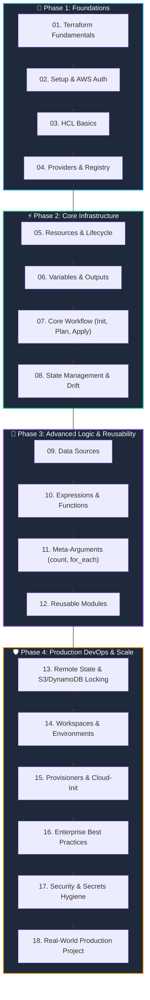

# 🚀 Terraform for DevOps: The Visual Fast-Track Handbook 🌍

> *"Tame the cloud, stop clicking buttons manually, and build bulletproof infrastructure with code!"* 💡✨

Welcome to your **hands-on, visual, and beginner-friendly companion** for mastering HashiCorp Terraform! Whether you are an aspiring DevOps engineer, a systems administrator transitioning to the cloud, or a software developer curious about Infrastructure as Code (IaC), this repository is crafted specifically for you.

---

## 🎯 Why This Handbook Exists (The 80/20 Philosophy)

Most cloud documentation is either dry and academic or full of fragmented copy-paste snippets. This handbook applies the **Pareto Principle (The 80/20 Rule)**:

⚡ **Focus on the 20% of core Terraform concepts, commands, and patterns that power 80% of real-world production DevOps jobs.**

- 🚫 **No endless theoretical jargon:** Straight-to-the-point explanations.
- 🎨 **Visual First:** Every single topic features dedicated architecture diagrams and Mermaid workflows.
- 🧑‍🏫 **Friendly Mentor Tone:** Complex concepts broken down with real-world analogies.
- 🧪 **Hands-on Labs & Cleanup:** Safe, cost-conscious exercises with clear verification and teardown instructions.
- 💼 **Job & Interview Ready:** Curated interview questions, traps to avoid, and rapid revision summaries.

---

## 🧭 Complete Learning Roadmap

---

## 📚 Curriculum Table of Contents

| # | Topic | Key Focus | Visual | Direct Link |
|---|---|---|:---:|:---:|
| **01** | **Terraform Fundamentals** | IaC principles, Declarative vs Imperative, Terraform vs Ansible | 🖼️ | [Read Notes →](./01-terraform-fundamentals/README.md) |
| **02** | **Installation & Setup** | CLI install, VS Code HCL tooling, Secure AWS CLI authentication | 🖼️ | [Read Notes →](./02-terraform-setup/README.md) |
| **03** | **HCL Basics** | Blocks, Arguments, Types (string, number, bool, list, map) | 🖼️ | [Read Notes →](./03-hcl-basics/README.md) |
| **04** | **Providers** | Terraform Registry, Plugin RPC architecture, Version lockfile | 🖼️ | [Read Notes →](./04-providers/README.md) |
| **05** | **Resources** | Resource declaration, Lifecycle (CRUD), Attribute references | 🖼️ | [Read Notes →](./05-resources/README.md) |
| **06** | **Variables & Outputs** | Typed variables, `.tfvars`, Precedence, Sensitive outputs | 🖼️ | [Read Notes →](./06-variables-and-outputs/README.md) |
| **07** | **Terraform Workflow** | `fmt`, `validate`, `plan`, `apply`, `destroy` cycle & symbols | 🖼️ | [Read Notes →](./07-terraform-workflow/README.md) |
| **08** | **State Management** | State triangle (.tf, .tfstate, Cloud), Drift detection & safety | 🖼️ | [Read Notes →](./08-state-management/README.md) |
| **09** | **Data Sources** | Read-only queries, Querying VPCs, subnets, and latest AMIs | 🖼️ | [Read Notes →](./09-data-sources/README.md) |
| **10** | **Expressions & Functions** | String interpolation, Ternary conditions, Built-in functions | 🖼️ | [Read Notes →](./10-expressions-and-functions/README.md) |
| **11** | **Meta-Arguments** | `depends_on`, `count`, `for_each`, and `lifecycle` hooks | 🖼️ | [Read Notes →](./11-meta-arguments/README.md) |
| **12** | **Modules** | Root vs Child modules, Composable architecture, Inputs/Outputs | 🖼️ | [Read Notes →](./12-modules/README.md) |
| **13** | **Remote State & Locking** | AWS S3 backend, DynamoDB `LockID`, Team race condition defense | 🖼️ | [Read Notes →](./13-remote-state-and-locking/README.md) |
| **14** | **Workspaces** | Default, dev, staging, prod workspaces, Isolation rules | 🖼️ | [Read Notes →](./14-workspaces/README.md) |
| **15** | **Provisioners & Cloud-Init** | Why provisioners are last resort, User-data & Packer alternative | 🖼️ | [Read Notes →](./15-provisioners-and-cloud-init/README.md) |
| **16** | **Best Practices** | Code style, Blast radius control, Tagging, CI/CD plan checks | 🖼️ | [Read Notes →](./16-terraform-best-practices/README.md) |
| **17** | **Security & Secrets** | State exposure risks, AWS Secrets Manager, IAM least privilege | 🖼️ | [Read Notes →](./17-security-and-secrets/README.md) |
| **18** | **Real-World Project** | Full production AWS 2-tier VPC, Web EC2, ALB, and secure RDS | 🖼️ | [Read Notes →](./18-real-world-project/README.md) |

---

## 🛠️ Prerequisites Before You Begin

You don't need to be a senior DevOps engineer to use these notes! You only need:
1. 💻 **Basic Terminal / Shell Familiarity**: Ability to run basic bash or PowerShell commands.
2. ☁️ **Free Cloud Account**: An [AWS Free Tier Account](https://aws.amazon.com/free/) (or local simulation tools).
3. 📝 **Code Editor**: [VS Code](https://code.visualstudio.com/) recommended with the official HashiCorp Terraform extension.
4. 🧠 **Curiosity & Growth Mindset**: Readiness to build, break, fix, and automate!

---

## 📋 Learning Tracker Checklist

Use this checklist to track your personal learning journey. Clone the repo and check off each topic as you complete it:

- [ ] **01.** Terraform Fundamentals & IaC Concepts
- [ ] **02.** Terraform Installation & AWS Authentication Setup
- [ ] **03.** HashiCorp Configuration Language (HCL) Syntax
- [ ] **04.** Providers & Terraform Registry
- [ ] **05.** Terraform Resources & CRUD Lifecycles
- [ ] **06.** Input Variables, `.tfvars`, and Outputs
- [ ] **07.** Terraform Core CLI Workflow (`init`, `plan`, `apply`)
- [ ] **08.** State Management, `.tfstate`, and Drift
- [ ] **09.** Data Sources (Querying existing cloud objects)
- [ ] **10.** Expressions, Conditionals & Built-in Functions
- [ ] **11.** Meta-Arguments (`depends_on`, `count`, `for_each`, `lifecycle`)
- [ ] **12.** Reusable Modules Architecture
- [ ] **13.** Team Remote State & DynamoDB Concurrency Locking
- [ ] **14.** Terraform Workspaces & Multi-Environment Isolation
- [ ] **15.** Bootstrap Automation: Provisioners vs Cloud-Init
- [ ] **16.** Enterprise Best Practices & Blast Radius Management
- [ ] **17.** Security Hygiene & Secrets Defense
- [ ] **18.** Real-World Capstone Project: Production 2-Tier Cloud Stack

---

## 🔗 Official Documentation & Reliable References

Always cross-reference with official primary sources:
- 📖 [Official HashiCorp Terraform Documentation](https://developer.hashicorp.com/terraform/docs)
- 🌐 [Terraform Registry (Providers & Modules)](https://registry.terraform.io/)
- ☁️ [Official AWS Provider Documentation](https://registry.terraform.io/providers/hashicorp/aws/latest/docs)
- 🔐 [Terraform Language Specification (HCL)](https://developer.hashicorp.com/terraform/language)

---

## 🤝 How to Learn with This Repository

1. **Read Top-to-Bottom**: Each chapter is designed for a brisk **5–10 minute read**.
2. **Inspect the Visuals**: Study the educational infographic or SVG and trace the Mermaid workflow.
3. **Execute the Hands-on Lab**: Build the mini-lab in a test sandbox.
4. **Always Clean Up**: Run `terraform destroy` when instructed to keep your cloud bill at zero! 💸
5. **Ace the Interview Questions**: Test yourself before looking at the answers.

*Happy Automating! Let's build some amazing cloud infrastructure!* 🚀🏗️☁️
