# 🌸 Rithu & Ravi's Terraform Journey: The Gentle Visual DevOps Guide 🚀☁️

> *"Hey Ravi! Welcome to the exciting world of Terraform. Don't worry if cloud infrastructure feels overwhelming right now—I'm Rithu, your DevOps mentor, and together, step by step, we are going to master Infrastructure as Code with zero stress and lots of fun!"* — **Mentor Rithu 👩‍🏫☕**

---

## 👫 Meet Your Learning Duo

```text
┌─────────────────────────────────────────┐      ┌─────────────────────────────────────────┐
│           👩‍🏫 Mentor Rithu               │      │            👨‍🎓 Learner Ravi              │
├─────────────────────────────────────────┤      ├─────────────────────────────────────────┤
│ • Senior DevOps & Cloud Architect       │      │ • Aspiring Cloud & DevOps Engineer      │
│ • Patient, friendly & encouraging       │      │ • Curious, eager to build real systems  │
│ • Believes in visual 80/20 learning     │      │ • Tired of boring theory, wants hands-on│
│ • Mission: Turn Ravi into an IaC pro!   │      │ • Mission: Master Terraform with Rithu! │
└─────────────────────────────────────────┘      └─────────────────────────────────────────┘
```

---

## ☕ A Personal Note from Rithu to Ravi

> *"Hey Ravi! Whenever you look at the AWS Console with hundreds of buttons, drop-down menus, and confusing settings, remember this: **Nobody likes clicking buttons all day.** It’s slow, stressful, and easy to mess up.*
>
> *In these notes, I have written down our private 1-on-1 mentorship sessions for you. Whenever a concept gets tricky, you'll see me break it down with daily life analogies (like ordering pizza or checking a coat at a hotel). Take your time, run the mini-labs, and never hesitate to test things out in our sandbox! You've got this!"* — **Rithu 🌸**

---

## 🎯 Our 80/20 Learning Philosophy

Ravi, you don't need to memorize 500 pages of HashiCorp documentation to get hired as a DevOps engineer! 

We follow the **Pareto Principle (The 80/20 Rule)**:
⚡ **We focus on the 20% of core concepts, commands, and best practices that drive 80% of real-world cloud engineering.**

- 💖 **Soft & Encouraging:** No intimidating jargon or dry textbook tone.
- 🎨 **Visual First:** Every lesson has custom architecture diagrams and Mermaid charts.
- 💬 **Mentor Dialogue:** Every chapter includes "Ravi's Doubt Corner" where I answer your exact questions!
- 🧪 **Zero-Risk Labs:** Mini-exercises designed to keep your AWS cloud bill at **$0.00**! 💸
- 💼 **Interview Ready:** Questions asked in real DevOps interviews, answered simply.

---

## 🧭 The Learning Roadmap (Rithu's Step-by-Step Curriculum)

```mermaid
flowchart TD
    subgraph Phase1 ["🌱 Phase 1: Warm Welcome & Foundations"]
        A["01. Terraform Fundamentals\n(Rithu introduces IaC to Ravi)"] --> B["02. Setup & Safe Cloud Auth\n(Setting up Ravi's cockpit)"]
        B --> C["03. HCL Basics\n(Learning the language)"]
        C --> D["04. Providers & Registry\n(The universal adapters)"]
    end

    subgraph Phase2 ["⚡ Phase 2: Building Core Infrastructure"]
        D --> E["05. Resources & Lifecycle\n(Ravi builds his first cloud assets)"]
        E --> F["06. Variables & Outputs\n(Making code flexible)"]
        F --> G["07. Core Workflow\n(Init, Plan, Apply, Destroy)"]
        G --> H["08. State Management\n(The single source of truth)"]
    end

    subgraph Phase3 ["🧠 Phase 3: Smart Logic & Reusable Blocks"]
        H --> I["09. Data Sources\n(Querying existing cloud)"]
        I --> J["10. Expressions & Functions\n(Adding brainpower to HCL)"]
        J --> K["11. Meta-Arguments\n(Scaling with count & for_each)"]
        K --> L["12. Reusable Modules\n(Building with Lego bricks)"]
    end

    subgraph Phase4 ["🛡️ Phase 4: Production DevOps & Enterprise Mastery"]
        L --> M["13. Remote State & Locking\n(Team collaboration with S3 & DynamoDB)"]
        M --> N["14. Workspaces & Environments\n(Dev vs Staging vs Prod)"]
        N --> O["15. Provisioners vs Cloud-Init\n(The elegant way to boot servers)"]
        P["16. Enterprise Best Practices\n(Limiting blast radius & tagging)"]
        Q["17. Security & Secrets Hygiene\n(Zero-trust secrets defense)"]
        R["18. Real-World Capstone Stack\n(Ravi & Rithu's Production 2-Tier VPC)"]
        M --> N --> O --> P --> Q --> R
    end

    style Phase1 fill:#1e293b,stroke:#38bdf8,stroke-width:2px,color:#fff
    style Phase2 fill:#1e293b,stroke:#10b981,stroke-width:2px,color:#fff
    style Phase3 fill:#1e293b,stroke:#a855f7,stroke-width:2px,color:#fff
    style Phase4 fill:#1e293b,stroke:#f59e0b,stroke-width:2px,color:#fff
```



---

## 📚 Complete Chapter Index

| Chapter | Lesson Title | Rithu's Teaching Focus | Visual | Direct Link |
|---|---|---|:---:|:---:|
| **01** | **Terraform Fundamentals** | What is IaC? Why declarative beats imperative | 🖼️ | [Read Notes →](./01-terraform-fundamentals/README.md) |
| **02** | **Installation & Setup** | VS Code setup & safe AWS auth without leaking keys | 🖼️ | [Read Notes →](./02-terraform-setup/README.md) |
| **03** | **HCL Basics** | Blocks, arguments, data types & standard file layout | 🖼️ | [Read Notes →](./03-hcl-basics/README.md) |
| **04** | **Providers** | Sourcing plugins, version constraints & `.terraform.lock.hcl` | 🖼️ | [Read Notes →](./04-providers/README.md) |
| **05** | **Resources** | Lifecycle (+, ~, -, -/+), dependency graph & attributes | 🖼️ | [Read Notes →](./05-resources/README.md) |
| **06** | **Variables & Outputs** | Typed variables, `.tfvars`, precedence & sensitive values | 🖼️ | [Read Notes →](./06-variables-and-outputs/README.md) |
| **07** | **Terraform Workflow** | The 6-step loop: init, fmt, validate, plan, apply, destroy | 🖼️ | [Read Notes →](./07-terraform-workflow/README.md) |
| **08** | **State Management** | Code vs State vs Cloud: The Holy Trinity & Drift | 🖼️ | [Read Notes →](./08-state-management/README.md) |
| **09** | **Data Sources** | Read-only queries, dynamic AMI lookup, zero hardcoding | 🖼️ | [Read Notes →](./09-data-sources/README.md) |
| **10** | **Expressions & Functions** | Conditionals, splat operator `[*]`, top 6 functions | 🖼️ | [Read Notes →](./10-expressions-and-functions/README.md) |
| **11** | **Meta-Arguments** | `depends_on`, `count`, `for_each`, and `lifecycle` armor | 🖼️ | [Read Notes →](./11-meta-arguments/README.md) |
| **12** | **Reusable Modules** | Lego-brick child modules and inputs/outputs wiring | 🖼️ | [Read Notes →](./12-modules/README.md) |
| **13** | **Remote State & Locking** | AWS S3 backend, KMS encryption, DynamoDB LockID | 🖼️ | [Read Notes →](./13-remote-state-and-locking/README.md) |
| **14** | **Workspaces** | Multi-environment isolation: dev, staging, prod | 🖼️ | [Read Notes →](./14-workspaces/README.md) |
| **15** | **Provisioners & Cloud-Init**| Why provisioners are last resort; Cloud-Init bootstrap | 🖼️ | [Read Notes →](./15-provisioners-and-cloud-init/README.md) |
| **16** | **Best Practices** | Blast radius control, global default_tags, CI/CD reviews | 🖼️ | [Read Notes →](./16-terraform-best-practices/README.md) |
| **17** | **Security & Secrets** | State security, OIDC in GitHub Actions, Trivy scanners | 🖼️ | [Read Notes →](./17-security-and-secrets/README.md) |
| **18** | **Real-World Project** | Capstone: Multi-AZ VPC, ALB, Auto-Scaling Web, RDS | 🖼️ | [Read Notes →](./18-real-world-project/README.md) |

---

## 📋 Ravi's Personal Learning Checklist

Ravi, check off each box as we finish each topic together!

- [ ] **01.** Terraform Fundamentals & IaC Concepts
- [ ] **02.** Terraform Installation & AWS Authentication Setup
- [ ] **03.** HashiCorp Configuration Language (HCL) Syntax
- [ ] **04.** Providers & Terraform Registry
- [ ] **05.** Terraform Resources & CRUD Lifecycles
- [ ] **06.** Input Variables, `.tfvars`, and Outputs
- [ ] **07.** Terraform Core CLI Workflow (`init`, `plan`, `apply`)
- [ ] **08.** State Management, `.tfstate`, and Drift Detection
- [ ] **09.** Data Sources (Querying existing cloud objects)
- [ ] **10.** Expressions, Conditionals & Built-in Functions
- [ ] **11.** Meta-Arguments (`depends_on`, `count`, `for_each`, `lifecycle`)
- [ ] **12.** Reusable Modules Architecture
- [ ] **13.** Team Remote State & DynamoDB Concurrency Locking
- [ ] **14.** Terraform Workspaces & Multi-Environment Isolation
- [ ] **15.** Bootstrap Automation: Provisioners vs Cloud-Init
- [ ] **16.** Enterprise Best Practices & Blast Radius Management
- [ ] **17.** Security Hygiene & Secrets Defense
- [ ] **18.** Real-World Capstone Project: Production 2-Tier Cloud Stack

---

## 💌 Rithu's Golden Advice for Ravi

1. ☕ **Take breaks:** Don't try to cram all 18 topics in one afternoon. Master 2 or 3 topics a day.
2. 💻 **Type the code yourself:** Don't just copy-paste! Muscle memory is real in DevOps.
3. 🧹 **Always clean up:** When our lab ends, run `terraform destroy -auto-approve` so your AWS bill stays at $0.00!
4. 🌟 **Stay curious:** Whenever you see an error, smile! Errors are just Terraform's way of teaching us how it works under the hood.

*Ready, Ravi? Let's turn the page to Chapter 1!* 🚀✨
